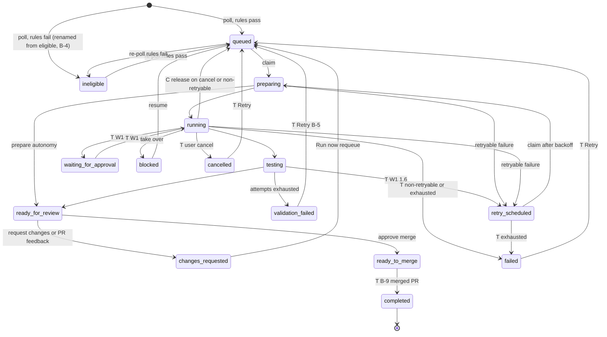
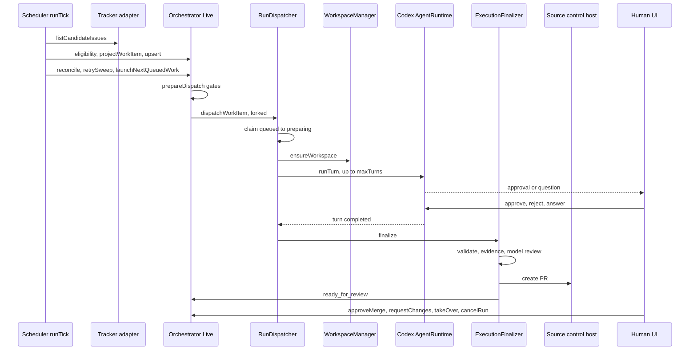

# Neokod plan, revision 10 (updated 21 October 2026)

Current direction and acceptance contract: revision 10, 21 October 2026, section 16. The latest execution instruction is section 16.8: parallel DeepSeek ACP lanes, no builds, commit/push to dev for Sol 6.1 and Opus review. Sections 16.4 to 16.7 supersede conflicting historical order and handoff-reuse assumptions. Owner priority is core app reliability, then working thread orchestration and Symphony with selected stage/review/tree UI, then mobile and other-machine access. Implementation uses DeepSeek V4.1 Flash through OpenCode ACP. The earlier revisions remain below as decision history.

Status: implementation roadmap remains open. The owner has committed Symphony handler/settings/type fixes; expanded browser audit W9 is partially complete, with confirmed defects and explicit blockers. This audit delivered documentation and evidence, not application fixes. This is the canonical plan. It replaces the first version (kept for provenance at `docs/research/plan-codex-original-2026-10-04.md`) and replaces `.plans/22-neokod-action-plan.md`, which was folded in here. [Plan 20](.plans/20-orchestration-direction.md) keeps the architecture rationale. Update this file instead of creating another roadmap.

Historical revision 8 (5 October 2026, Phase 1 locked). Revision 7 added section 0 and 66 cards. Revision 8 adds a second audit round (providers, file and project APIs, terminal, git, competitor comparison), 16 more cards (X-1 to X-16, files 06 and 07), and section 14, which locks Phase 1. Everything not in Phase 1 is Phase 2 (carded, deferred) or goes to `HANDOFF.md` as items to investigate later.

Revision 5 (4 October 2026, afternoon) merges a second session's W9 browser audit with: the owner's decisions, the multi-machine design based on T3's implementation, the development-database migration drift, and a consolidated UI task register (section 11) built from two read-only Codex reviews (69 findings) and two Playwright runs against isolated instances (27 defects).

Evidence labels. **READ** means the code was read and the control flow traced. **RUN** means a command, test or process was executed and its output observed. Where a result is RUN it says what was run. Nothing is claimed beyond that label.

Effort: S under half a day, M one to two days, L three days or more.

## 0. Implementation guide

This section is for the person implementing (a smaller model is expected) and for the reviewer. Read it fully before starting any card.

### 0.1 Where things are

- This file is the roadmap and the decisions. The implementation specifications are 82 cards in `docs/plan-cards/` (seven files, indexed in 0.4). Section 14 says which are in Phase 1. One card is one commit.
- A card gives the problem with proof, the files and functions to change with line numbers, numbered change steps, pitfalls, the tests to write, the verify commands, dependencies, effort and the commit message. Line numbers are at base commit `da7655bb2` and drift after earlier cards. Search by symbol name.
- Every card ends with unverified items. The card authors read the code but did not compile or run any new snippet. Treat snippets as strong suggestions. If a snippet does not typecheck, fix it using the surrounding code. Do not change the design the card describes without asking.

### 0.2 Rules for the implementer

Owner update, 21 October: section 16.8 controls the current parallel DeepSeek workflow. No builds are authorised. Commit and push completed implementation to `dev` for Sol 6.1 and Opus review; do not merge to `main` or trigger a release. Existing check results are retained with their scope.

1. Work on a branch per wave from `main`, never on `main`. Stage explicit paths (`git add path`), never `git add -A`, `git add .` or `git commit -a`. Never push to `main`. Open a pull request.
2. Write the test first and confirm it fails on the base code. Then make the change. A card whose test passes before the change is wrong, so stop and report.
3. One card, one commit, using the commit message in the card. Do not combine cards. Do not fix other things you notice. Add them to the list in 0.7.
4. Do not add abstractions, options, libraries or files that the card does not name. Reuse existing code. `packages/contracts` stays schema-only. Shared runtime code goes in `packages/shared` with an explicit subpath export.
5. Effect code follows the patterns already nearby (`Effect.gen`, `Layer`, `Context.Service`, `Schema`). The reference for idioms is `.repos/effect-smol` (read `LLMS.md` first). Do not edit `.repos/`.
6. Writing style for any comment, doc or UI text: plain direct English, no em dashes.
7. If a card is blocked (an anchor does not exist, an API differs, a test cannot fail first), stop that card, write what you found under the card's heading in 0.7, and move to the next independent card.
8. Do not run `pnpm install` with changes to the lockfile. Do not edit `pnpm-workspace.yaml` release-age settings.
9. Never run a test or experiment against `~/.neokod`, `~/.neokod-review` or your real project directories. Tests that touch git or files use a temporary directory. The development database `~/.neokod/dev.archived-2026-10-04` is an archive, so do not open it for writing.

### 0.3 Environment and commands

| Need                       | Command                                                                                                                                                                                                                                                           |
| -------------------------- | ----------------------------------------------------------------------------------------------------------------------------------------------------------------------------------------------------------------------------------------------------------------- |
| Node                       | Node 24 (`^24.13.1`). This machine has 26.10 by default, so put a Node 24 on `PATH` first. A copy is at `/var/folders/b6/87d2msqd6fdbtcddcw5k8gbw0000gn/T/opencode/node-v24.21.0-darwin-arm64/bin` for this session, and `.node-version` (task W0.1) will pin it. |
| Install                    | `pnpm install --frozen-lockfile` from the repo root (7 to 8 minutes the first time).                                                                                                                                                                              |
| One server test            | from `apps/server`: `pnpm exec vp test run src/path/File.test.ts`                                                                                                                                                                                                 |
| One web unit test          | from `apps/web`: `pnpm exec vp test run --project unit src/path/File.test.ts` (without `--project unit` the run starts the browser project and is killed; about 40 s)                                                                                             |
| One web browser test       | from `apps/web`: `pnpm exec vp test run --project browser src/path/File.browser.tsx`. Needs Chromium: `pnpm exec playwright install chromium` once.                                                                                                               |
| Typecheck one package      | from the package directory: `pnpm exec tsgo --noEmit`                                                                                                                                                                                                             |
| Final gates for every card | from the repo root: `pnpm exec vp check`, `pnpm exec vp lint`, `pnpm run typecheck`. Existing warnings are acceptable, new errors are not.                                                                                                                        |
| Format                     | The pre-commit hook runs `vp fmt` on staged files. Do not bypass hooks.                                                                                                                                                                                           |
| Run the app                | `NEOKOD_HOME=$HOME/.neokod-review pnpm dev` (web 5733, server 13773). Never point tests at your real data.                                                                                                                                                        |
| Orchestrator tests         | The Symphony orchestrator tests share one in-memory database. Isolate new tests with their own `projectId` and early timestamps, as the cards describe.                                                                                                           |

### 0.4 Card library and order

Branches that exist: `fix/symphony-runner-and-config-wip` (3 commits: runtime handlers, settings form and Run now, typing fixes) and `feat/clone-parent-destination` (3 commits: clone destination, sidebar fix, clone fixes U-22). Both are independent of each other. Merge both to `main` through pull requests first, then branch each wave from `main`.

Recommended order. Track A is correctness, B is remote access, C is the task flow. A and B can run in parallel by different implementers. Within a track, go top to bottom. Cards that edit the same function are noted in the card, so apply them in this order.

| Step | Cards                                                                   | Purpose                                                                                                                       |
| ---- | ----------------------------------------------------------------------- | ----------------------------------------------------------------------------------------------------------------------------- |
| A0   | 0.5, 1.13, 1.15, 2.4, 2.5, 2.6a, 2.6b-i, 2.6b-ii, 2.6c                  | Small independent fixes, including the migration identity guard that protects against the database problem found on 4 October |
| A1   | H0, 1.1, 1.2, 1.3, 1.4, 1.6, 1.5, 1.7, 1.8, 1.10, 1.12, 1.9, 1.11, 1.14 | Symphony run correctness (W1). H0 is the fake Codex harness every later test uses.                                            |
| A2   | 2.2, 2.3                                                                | Rewind safety and crash recovery                                                                                              |
| A3   | U-01, U-02, U-02b, U-03, U-04, S-01, S-02, U-06, U-07, U-11             | UI data loss and wrong results (W2b)                                                                                          |
| B1   | A1, A1b, A1c, A2, B1, B4                                                | Access token, then token-gated non-loopback bind, then Tailscale documentation                                                |
| B2   | B2, B2b, B3, B3b                                                        | Saved machines, the Machines list, the "Run on" picker                                                                        |
| C1   | B-1, B-2, B-3, B-4, B-5, B-6, B-9, B-7, B-8a, B-8b, B-10                | Honest board, links, approvals in the UI, Agile layout, then delete the orphaned views                                        |
| C2   | H-0, H-1, H-3, H-2, H-4, H-5a, H-5b, H-5c, H-6a, H-6b                   | Chat to Symphony handoff for GitHub Issues with the result returned to the chat                                               |

Migration numbers are assigned when a card merges. Check the highest number in `apps/server/src/persistence/Migrations/` and use the next one. Never reuse or renumber a merged migration. B-4 plans 042, and the handoff table (H-1) takes the next free number after it.

| Card    | Title                                                                                                                                                               | Depends on                                       | Effort | File                                                          |
| ------- | ------------------------------------------------------------------------------------------------------------------------------------------------------------------- | ------------------------------------------------ | ------ | ------------------------------------------------------------- |
| H0      | (W0.4) Shared fake-Codex stdio harness for tests                                                                                                                    | none                                             | L      | [01](docs/plan-cards/01-symphony-runner-w1.md)                |
| 1.1     | (N0b, S10) `rawStreams` option on the Codex client                                                                                                                  | H0                                               | M      | [01](docs/plan-cards/01-symphony-runner-w1.md)                |
| 1.2     | (N2) Map Symphony approval decisions and user-input answers to Codex wire values                                                                                    | H0, 1.1                                          | S      | [01](docs/plan-cards/01-symphony-runner-w1.md)                |
| 1.3     | (N1) Key live requests by run and request id, resolve the durable row first                                                                                         | 1.2                                              | S      | [01](docs/plan-cards/01-symphony-runner-w1.md)                |
| 1.4     | (N10, S04) Pin the turn wait to thread and turn, honour `turn.status`, bound EOF and fail late requests                                                             | H0, 1.1, 1.2                                     | M      | [01](docs/plan-cards/01-symphony-runner-w1.md)                |
| 1.6     | (N6) Allow `testing` to `retry_scheduled` and stop swallowing refused transitions                                                                                   | none                                             | S      | [01](docs/plan-cards/01-symphony-runner-w1.md)                |
| 1.5     | (N3, B3) Cancel ends `cancelled`, exhaustion ends `failed`, the scheduler never relaunches a terminal-failed item                                                   | 1.6, 1.4, H0                                     | M      | [01](docs/plan-cards/01-symphony-runner-w1.md)                |
| 1.7     | (N4) A failure before the attempt row exists records a failed attempt and leaves the queue                                                                          | 1.5                                              | M      | [01](docs/plan-cards/01-symphony-runner-w1.md)                |
| 1.8     | (N5) Fork dispatches into the dispatch scope from both retrySweep and the manual RPC                                                                                | 1.5, 1.7                                         | S      | [01](docs/plan-cards/01-symphony-runner-w1.md)                |
| 0.5     | (M1) Refuse to start when the recorded migration history does not match the repo                                                                                    | none                                             | S      | [02](docs/plan-cards/02-w0-w1-w2-containment.md)              |
| 1.9     | (N8) Never store the server pid on a claim; record the child pid after spawn; skip the kill for the server's own pid                                                | none                                             | S      | [02](docs/plan-cards/02-w0-w1-w2-containment.md)              |
| 1.10    | (N7) Gate recovery, reconcile and polling on holding the lock; retry the lock; show the role                                                                        | 1.8                                              | M      | [02](docs/plan-cards/02-w0-w1-w2-containment.md)              |
| 1.11    | (N9) Persist the workspace base branch on the work item and stop taking it from the tracker                                                                         | none                                             | M      | [02](docs/plan-cards/02-w0-w1-w2-containment.md)              |
| 1.12    | (N11) Re-evaluate eligibility on the fresh issue before dispatch                                                                                                    | 1.5, 1.10                                        | S      | [02](docs/plan-cards/02-w0-w1-w2-containment.md)              |
| 1.13    | (N12) An unrecognised heading must not erase the collected summary                                                                                                  | none                                             | S      | [02](docs/plan-cards/02-w0-w1-w2-containment.md)              |
| 1.14    | (S08) Agent child environment: no `extendEnv`, and fail closed when the secret list is unknown                                                                      | 1.1, 1.2                                         | S      | [02](docs/plan-cards/02-w0-w1-w2-containment.md)              |
| 1.15    | Model review timeout and a warning for a configured `app-server` command                                                                                            | none                                             | S      | [02](docs/plan-cards/02-w0-w1-w2-containment.md)              |
| 2.2     | (S05) Checkpoint revert: honest copy, a recovery ref before restoring, refuse a busy shared folder                                                                  | none                                             | M      | [02](docs/plan-cards/02-w0-w1-w2-containment.md)              |
| 2.3     | (S02 crash) Settle a thread whose provider binding was left `running` by a hard crash                                                                               | none                                             | M      | [02](docs/plan-cards/02-w0-w1-w2-containment.md)              |
| 2.4     | (S10) Boot reconciliation reads the command read model, not the full snapshot                                                                                       | none                                             | S      | [02](docs/plan-cards/02-w0-w1-w2-containment.md)              |
| 2.5     | (B2, S07) Remove the three approval checkboxes that no code reads                                                                                                   | none                                             | S      | [02](docs/plan-cards/02-w0-w1-w2-containment.md)              |
| 2.6a    | (S01) A reused command id must not return another aggregate's receipt                                                                                               | none                                             | S      | [02](docs/plan-cards/02-w0-w1-w2-containment.md)              |
| 2.6b-i  | (S03, part 1) KeyedCoalescingWorker keeps a value whose processing failed                                                                                           | none                                             | S      | [02](docs/plan-cards/02-w0-w1-w2-containment.md)              |
| 2.6b-ii | (S03, part 2) Terminal history: atomic write, bounded retry, retry on flush, compare the process object                                                             | 2.6b-i                                           | M      | [02](docs/plan-cards/02-w0-w1-w2-containment.md)              |
| 2.6c    | (F06) Cap terminal history by bytes so one newline-free line cannot grow without bound                                                                              | none                                             | S      | [02](docs/plan-cards/02-w0-w1-w2-containment.md)              |
| A1      | Stable access token for every web-mode launch, explicit CORS origins                                                                                                | none                                             | M      | [03](docs/plan-cards/03-access-token-and-machines.md)         |
| A1b     | Project CLI sends the access token to a running server                                                                                                              | A1                                               | S      | [03](docs/plan-cards/03-access-token-and-machines.md)         |
| A1c     | Docs: one account of the access token                                                                                                                               | A1                                               | S      | [03](docs/plan-cards/03-access-token-and-machines.md)         |
| A2      | Web client: access token prompt, storage and bearer on HTTP and WebSocket ticket                                                                                    | A1                                               | M      | [03](docs/plan-cards/03-access-token-and-machines.md)         |
| B1      | Server: `--host`, token-gated non-loopback bind, multi-value public origins, optional Tailscale login allowlist                                                     | A1, A1c                                          | M      | [03](docs/plan-cards/03-access-token-and-machines.md)         |
| B2      | Client runtime core: `RemoteConnectionTarget`, catalog v3, registry register, setEnabled, remove, setToken                                                          | A1, B1 for a reachable remote                    | L      | [03](docs/plan-cards/03-access-token-and-machines.md)         |
| B2b     | Persistence adapters and atom commands for remote machines                                                                                                          | B2, and A2                                       | M      | [03](docs/plan-cards/03-access-token-and-machines.md)         |
| B3      | Settings > Connections "Machines": add, enable switch, remove, status, last error                                                                                   | B2, B2b                                          | M      | [03](docs/plan-cards/03-access-token-and-machines.md)         |
| B3b     | "Run on" picker, reconnect banner and add-project for a remote machine                                                                                              | B3                                               | M      | [03](docs/plan-cards/03-access-token-and-machines.md)         |
| B4      | Tailscale helper: do not revive the package, document the commands                                                                                                  | B1                                               | S      | [03](docs/plan-cards/03-access-token-and-machines.md)         |
| B-1     | Typed board read failure and last-good banner (F01, S-14)                                                                                                           | none                                             | S      | [04](docs/plan-cards/04-symphony-model-and-board.md)          |
| B-2     | Board coverage: newest terminal items, exact counts, truncated flag (F02, S-12)                                                                                     | B-1                                              | M      | [04](docs/plan-cards/04-symphony-model-and-board.md)          |
| B-3     | Dispatch returns started or refused with a reason (B1, S-03)                                                                                                        | none                                             | M      | [04](docs/plan-cards/04-symphony-model-and-board.md)          |
| B-4     | Rename the `eligible` lifecycle to `ineligible` and gate Run now (S-11)                                                                                             | B-3                                              | M      | [04](docs/plan-cards/04-symphony-model-and-board.md)          |
| B-5     | Run action for changes_requested and validation_failed (S-06)                                                                                                       | B-3, B-4                                         | S      | [04](docs/plan-cards/04-symphony-model-and-board.md)          |
| B-6     | Links from cards and Runs rows to the run page, deep-linkable tabs, back link (S-05)                                                                                | B-1, B-2                                         | M      | [04](docs/plan-cards/04-symphony-model-and-board.md)          |
| B-9     | Merged-PR detector: ready_to_merge to completed (B3, W1 1.5, W4 4.1)                                                                                                | none                                             | M      | [04](docs/plan-cards/04-symphony-model-and-board.md)          |
| B-7     | Answer approvals and agent questions from the Attention tab and the run page (S-04)                                                                                 | S1 card 1.3, B-6                                 | M      | [04](docs/plan-cards/04-symphony-model-and-board.md)          |
| B-8a    | Board layout: contract, validator, server board and config storage (W4 4.2, 4.3)                                                                                    | B-2, B-4                                         | M      | [04](docs/plan-cards/04-symphony-model-and-board.md)          |
| B-8b    | Board layout: dynamic grid and settings editor (W4 4.3, 4.4)                                                                                                        | B-8a                                             | M      | [04](docs/plan-cards/04-symphony-model-and-board.md)          |
| B-10    | Delete the orphaned Symphony views and redirects, move global controls to the project list header (S-07, S-25)                                                      | B-6, B-7                                         | M      | [04](docs/plan-cards/04-symphony-model-and-board.md)          |
| U-01    | Rendered Markdown over 1 MB must not save the truncated prefix                                                                                                      | none                                             | S      | [05](docs/plan-cards/05-ui-data-loss-and-handoff.md)          |
| U-02    | Closing a saved file must not rewrite the old buffer (client)                                                                                                       | U-01                                             | S      | [05](docs/plan-cards/05-ui-data-loss-and-handoff.md)          |
| U-02b   | Conditional file write with a content hash, conflict state in the editor                                                                                            | U-02                                             | M      | [05](docs/plan-cards/05-ui-data-loss-and-handoff.md)          |
| U-03    | Diff panel: allow registered project roots in the review service, remove the server-cwd fallback                                                                    | none                                             | M      | [05](docs/plan-cards/05-ui-data-loss-and-handoff.md)          |
| U-04    | Environment variable rows: unchecking Sensitive or renaming a stored secret must not delete it                                                                      | none                                             | M      | [05](docs/plan-cards/05-ui-data-loss-and-handoff.md)          |
| S-01    | Symphony settings list fields: buffer the text, parse on blur                                                                                                       | none                                             | S      | [05](docs/plan-cards/05-ui-data-loss-and-handoff.md)          |
| S-02    | Symphony settings form: keep one draft per project with its base revision                                                                                           | none                                             | M      | [05](docs/plan-cards/05-ui-data-loss-and-handoff.md)          |
| U-06    | Queued message: keep the queue entry until the send is accepted (verified, holds)                                                                                   | none                                             | S      | [05](docs/plan-cards/05-ui-data-loss-and-handoff.md)          |
| U-07    | Failed plan follow-up must restore the composer draft (verified, holds)                                                                                             | U-06                                             | S      | [05](docs/plan-cards/05-ui-data-loss-and-handoff.md)          |
| U-11    | Sidebar "Copy Path" in All threads copies the first project's root (verified, holds)                                                                                | none                                             | S      | [05](docs/plan-cards/05-ui-data-loss-and-handoff.md)          |
| H-0     | Record positive turn-start evidence as a run event                                                                                                                  | S1 1.4                                           | S      | [05](docs/plan-cards/05-ui-data-loss-and-handoff.md)          |
| H-1     | Delegation request table, migration and repository                                                                                                                  | B-4 and the labels card for the migration number | M      | [05](docs/plan-cards/05-ui-data-loss-and-handoff.md)          |
| H-3     | Resolve a GitHub issue reference through the project's tracker, and let an explicit request pass the label rules                                                    | H-1, B-4                                         | M      | [05](docs/plan-cards/05-ui-data-loss-and-handoff.md)          |
| H-2     | Atomic accept, replay and conflict, and the delegateFromThread RPC                                                                                                  | H-1, H-3, B-4                                    | L      | [05](docs/plan-cards/05-ui-data-loss-and-handoff.md)          |
| H-4     | State reconciler and result delivery to the originating chat                                                                                                        | H-0, H-1, H-2                                    | L      | [05](docs/plan-cards/05-ui-data-loss-and-handoff.md)          |
| H-5a    | Read model RPC for a thread's handoffs and client-runtime atoms                                                                                                     | H-2, H-4                                         | M      | [05](docs/plan-cards/05-ui-data-loss-and-handoff.md)          |
| H-5b    | Link a board card back to the chat that sent it                                                                                                                     | H-1, H-2                                         | S      | [05](docs/plan-cards/05-ui-data-loss-and-handoff.md)          |
| H-5c    | Send to Symphony in the chat header and a workstream summary                                                                                                        | H-5a                                             | M      | [05](docs/plan-cards/05-ui-data-loss-and-handoff.md)          |
| H-6a    | Stop from the chat, and stops from the board show in the chat                                                                                                       | H-4, H-5c, S1 1.5                                | M      | [05](docs/plan-cards/05-ui-data-loss-and-handoff.md)          |
| H-6b    | Restart behaviour tests and the owner acceptance script                                                                                                             | H-1 to H-6a                                      | M      | [05](docs/plan-cards/05-ui-data-loss-and-handoff.md)          |
| X-1     | readFile on a FIFO must not block a worker thread                                                                                                                   | none                                             | S      | [06](docs/plan-cards/06-providers-files-and-api-hardening.md) |
| X-2     | writeFile: contain symlinks, write atomically, bound size, no encoding loss                                                                                         | X-1                                              | L      | [06](docs/plan-cards/06-providers-files-and-api-hardening.md) |
| X-3     | Claude usage limits and API errors end the turn as failed and show on the provider card                                                                             | none                                             | L      | [06](docs/plan-cards/06-providers-files-and-api-hardening.md) |
| X-4     | Copilot runtime death must settle the running turn and recover without a restart                                                                                    | none                                             | M      | [06](docs/plan-cards/06-providers-files-and-api-hardening.md) |
| X-5     | Stop on an OpenCode turn must end the turn as interrupted, not failed                                                                                               | none                                             | M      | [06](docs/plan-cards/06-providers-files-and-api-hardening.md) |
| X-6     | Spawned `opencode serve` children: random password, scrubbed environment, orphan ledger                                                                             | none                                             | L      | [06](docs/plan-cards/06-providers-files-and-api-hardening.md) |
| X-7     | Stop and approval responses on a binding with no resume state settle the thread and expire approvals; provider error text is sanitised (amendment to plan card 2.3) | 2.3                                              | L      | [06](docs/plan-cards/06-providers-files-and-api-hardening.md) |
| X-8     | OTLP traces proxy: 1 MiB body limit with 413, no body logging, keep browser tracing working (FA-09)                                                                 | none                                             | S      | [06](docs/plan-cards/06-providers-files-and-api-hardening.md) |
| X-9     | Worktree removal on thread delete: inspect first, never force dirty work silently, reclaim the branch, fix bulk delete (TG-04, U-05)                                | none                                             | L      | [07](docs/plan-cards/07-git-terminal-and-web-hardening.md)    |
| X-10    | Refuse commit and push during unresolved merge conflicts, and report merge or rebase in progress (TG-13)                                                            | none                                             | M      | [07](docs/plan-cards/07-git-terminal-and-web-hardening.md)    |
| X-11    | Option injection in git argv: one shared name validator, `--` ordering and `--end-of-options` at every call site (TG-06, CP-12)                                     | apply after X-9                                  | M      | [07](docs/plan-cards/07-git-terminal-and-web-hardening.md)    |
| X-12    | Chat markdown: block automatic remote image loads and remove the Google favicon request (FA-06, CP-05)                                                              | none                                             | M      | [07](docs/plan-cards/07-git-terminal-and-web-hardening.md)    |
| X-13    | Security headers: app-shell CSP, nosniff and Referrer-Policy on static files, sandboxed attachment-only asset responses (FA-05, CP-04)                              | none                                             | M      | [07](docs/plan-cards/07-git-terminal-and-web-hardening.md)    |
| X-14    | Closing a terminal, deleting a thread or stopping the server must stop the background jobs started in the terminal (TG-01)                                          | none                                             | M      | [07](docs/plan-cards/07-git-terminal-and-web-hardening.md)    |
| X-15    | Terminal paste over 64 KiB: send it in ordered chunks, and stop echoing the whole paste in the error text (TG-09)                                                   | none                                             | S      | [07](docs/plan-cards/07-git-terminal-and-web-hardening.md)    |
| X-16    | Carry a bounded, sanitised git stderr tail in `GitCommandError` and show it in error toasts (TG-07)                                                                 | none                                             | M      | [07](docs/plan-cards/07-git-terminal-and-web-hardening.md)    |

### 0.5 Symphony operating model

This is the target design the cards implement. CURRENT means true at the base commit, TARGET needs a card. It exists so the owner can judge the deletion of the orphaned views (card B-10) against a defined way of working. Source: card file 04, Part 1.

### 0.5.1 Entities and tables

| Entity              | Table                          | Key columns                                                                                                                                                                                                                 | Written by                                                                                                                                                                                                |
| ------------------- | ------------------------------ | --------------------------------------------------------------------------------------------------------------------------------------------------------------------------------------------------------------------------- | --------------------------------------------------------------------------------------------------------------------------------------------------------------------------------------------------------- |
| Project             | `symphony_projects`            | `id`, `repository_path` (unique), `status` active or paused, `setup_state`, `configuration_json`, `revision`                                                                                                                | `Live.createProject`, `Live.updateProject`. Decoded strictly in `Persistence/Layers/SymphonyProjectRepository.ts:decodeProjectConfiguration`; a decode failure nulls the config and forces `needs_setup`. |
| Workflow            | `symphony_workflows`           | `id` (= project id), `workflow_path` (`symphony-project:<id>`), `status`, `effective_config_json`                                                                                                                           | `Live.syncProjectWorkflow` on boot, create, update. Dispatch reads policy from here.                                                                                                                      |
| Work item           | `symphony_work_items`          | `id` = `<projectId>:<trackerKind>:<issueId>`, `lifecycle`, `owner_token`, `generation`, `claimed_at`, `excluded`, `local_priority`, `eligibility_reasons_json`, `workspace_key`, `base_branch`, `labels_json` (always `[]`) | `pollWorkflow` upsert (Live:481), `HandoffService.delegateFromThread`, `WorkItemRepository` claim, transition, releaseClaim, writeOverrides.                                                              |
| Run attempt         | `symphony_run_attempts`        | `id` `run-<uuid>`, `work_item_id`, `attempt_number`, `status`, `started_at`, `finished_at`, `error_json`                                                                                                                    | Dispatcher, ExecutionFinalizer, Reconciler, Recovery.                                                                                                                                                     |
| Run event           | `symphony_run_events`          | `run_attempt_id`, `sequence`, `event_type`, `payload_json`                                                                                                                                                                  | Dispatcher, finalizer, Live, HandoffService, Reconciler, Recovery.                                                                                                                                        |
| Approval            | `symphony_approvals`           | durable `id` `sym-<uuid>`, `request_id` (Codex id), `run_attempt_id`, `action` (`user_input` for questions), `state`                                                                                                        | `Runner/ApprovalService.ts`, called from `AgentRuntime.ts:handleRequest:286`.                                                                                                                             |
| Attention item      | `symphony_attention_items`     | `id`, `work_item_id`, `kind`, `state`                                                                                                                                                                                       | `ExecutionFinalizer` only (`pr_creation_failed`). `Live.listAttention` merges these with pending approvals.                                                                                               |
| Evidence            | `symphony_evidence`            | `work_item_id` is the primary key: one bundle per item, not per attempt (S-09)                                                                                                                                              | Finalizer, `refreshPullRequest`, `approveMerge`.                                                                                                                                                          |
| Workspace ownership | `symphony_workspace_ownership` | `workspace_path`, `owner` symphony or work, `generation`                                                                                                                                                                    | `Workspaces/Live.ts`, `HandoffService`, `Recovery`.                                                                                                                                                       |
| Orchestrator state  | `symphony_orchestrator_state`  | `global_paused`, `lock_token`, `lock_expires_at`, `paused_workflows`, `paused_repositories`                                                                                                                                 | `Live` pause setters, `acquireLock`, `renewLock`.                                                                                                                                                         |
| Retry queue         | `symphony_retry_queue`         | none used                                                                                                                                                                                                                   | No reader or writer. Retry state is lifecycle `retry_scheduled` plus the latest attempt's `finished_at` plus `Orchestrator/Retry.ts:failureBackoffMs`.                                                    |

### 0.5.2 WorkItem lifecycle

Values (contracts `symphony.ts:206`): draft, eligible, queued, preparing, running, testing, blocked, waiting_for_approval, retry_scheduled, validation_failed, ready_for_review, changes_requested, ready_to_merge, completed, cancelled, failed. Nothing writes `draft`. Nothing writes `waiting_for_approval`: a pending agent approval leaves the item in `running`.

Legality is `DEFAULT_TRANSITION_SOURCES` (`Persistence/Layers/WorkItemRepository.ts:62`, target to allowed sources); a caller may pass an explicit `from`. Claim (`:298`) and `releaseClaim` (`:510`) are separate SQL.

| Transition                                                                 | Legal in table                                                | Performed by                                                                                            | Who                                                                   | Status                                                           |
| -------------------------------------------------------------------------- | ------------------------------------------------------------- | ------------------------------------------------------------------------------------------------------- | --------------------------------------------------------------------- | ---------------------------------------------------------------- |
| new to queued or eligible                                                  | INSERT; UPDATE CASE `:282` flips draft, eligible, queued only | `pollWorkflow`, `projectWorkItem`, `inferQueuedLifecycle` (`Eligibility.ts:77`)                         | scheduler                                                             | CURRENT                                                          |
| new to eligible (delegated)                                                | n/a                                                           | `HandoffService.delegateFromThread:535`                                                                 | chat user, no UI (H1)                                                 | CURRENT                                                          |
| eligible, queued, retry_scheduled to preparing                             | claim SQL                                                     | `Dispatcher.dispatchWorkItem:231`                                                                       | scheduler or Run now                                                  | CURRENT                                                          |
| changes_requested to queued                                                | yes                                                           | `Live.prepareDispatch:1370`                                                                             | Run now (no UI button)                                                | CURRENT                                                          |
| preparing to running; preparing to ready_for_review (autonomy prepare)     | yes                                                           | `Dispatcher:359`, `:336`                                                                                | system                                                                | CURRENT                                                          |
| running to testing; testing to ready_for_review                            | yes                                                           | `ExecutionFinalizer:90`, `:280`                                                                         | system                                                                | CURRENT                                                          |
| testing to validation_failed (attempts exhausted)                          | yes                                                           | `ExecutionFinalizer:176`                                                                                | system                                                                | CURRENT                                                          |
| testing to retry_scheduled (attempts remain)                               | no (N6)                                                       | `ExecutionFinalizer:169`, error swallowed, item released to queued                                      | system                                                                | CURRENT bug; legal in W1 1.6                                     |
| preparing, running to retry_scheduled                                      | yes                                                           | `Dispatcher.markFailed:208`, `Recovery:231`                                                             | system                                                                | CURRENT                                                          |
| preparing, running, testing to queued                                      | releaseClaim SQL                                              | `Dispatcher:137,530`, `Reconciler:115,141`, `Recovery:150,179` (cancel, non-retryable failure, restart) | system                                                                | CURRENT (N3: the reason failed and cancelled are never written)  |
| running to waiting_for_approval and back                                   | only source is running                                        | nothing                                                                                                 | system, on approval record and decision                               | TARGET (W1 1.3)                                                  |
| ready_for_review to changes_requested                                      | yes                                                           | `Live.requestChanges:1675`; `ingestReviewFeedback:1572` (automatic on PR refresh)                       | human or PR refresh                                                   | CURRENT                                                          |
| ready_for_review to ready_to_merge                                         | yes                                                           | `Live.approveMerge:1700`                                                                                | human, fresh host gate                                                | CURRENT                                                          |
| non-terminal to blocked                                                    | explicit `from`, `requireUnclaimed`                           | `HandoffService.takeOver:337`                                                                           | human, no UI                                                          | CURRENT                                                          |
| blocked, ready_for_review, retry_scheduled, waiting_for_approval to queued | explicit `from`                                               | `HandoffService.resumeAutonomous:473`                                                                   | human, no UI                                                          | CURRENT                                                          |
| validation_failed to queued                                                | yes                                                           | nothing; claim SQL also refuses it                                                                      | human Retry                                                           | TARGET (B-5)                                                     |
| ready_to_merge to completed                                                | yes, the only source                                          | nothing                                                                                                 | merged-PR sweep in `Live.runTick`                                     | TARGET (B-9)                                                     |
| non-terminal to cancelled                                                  | yes                                                           | nothing                                                                                                 | user cancel: `cancelRun` then fenced transition                       | TARGET (W1 1.5 says `blocked`; owner direction is `cancelled`)   |
| running, testing, retry_scheduled to failed                                | yes                                                           | nothing                                                                                                 | `Dispatcher.markFailed` on non-retryable failure or exhausted retries | TARGET (W1 1.5). Exhausted validation stays `validation_failed`. |
| failed, cancelled to queued                                                | explicit `from`                                               | nothing                                                                                                 | human Retry                                                           | TARGET (after W1 1.5)                                            |



#### The `eligible` lifecycle (S-11)

`eligible` has two meanings. `inferQueuedLifecycle` gives it to tracker issues that fail the rules (reasons non-empty), and `prepareDispatch:1399` always refuses those. `delegateFromThread` gives it to a dispatchable item (reasons empty). The board shows both as "eligible" with Run now.

Proposal (card B-4): rename the value to `ineligible` for failed-rules items and start delegated items as `queued`. An item with no reasons is claimable, which is what `queued` already means. Migration 042 (next free number; plan 4.7 also wants 042, renumber if that lands first): `UPDATE symphony_work_items SET lifecycle = CASE WHEN eligibility_reasons_json IN ('[]','') THEN 'queued' ELSE 'ineligible' END WHERE lifecycle = 'eligible'`. Every use found by grep: contract `symphony.ts:208`; `Eligibility.ts:77-80`; `ProjectBoard.ts:15`; `HandoffService.ts:340,535`; `WorkItemRepository.ts` `:63,66,76,96,283,313`; `Live:87,896,964`; web `SymphonyProjectView.tsx:139`; `docs/architecture/symphony.md:70`; tests `HandoffService.test.ts:460`, `Live.test.ts:559`, `WorkItemRepository.test.ts:26,50,186`, `ProjectBoard.test.ts:19`.

### 0.5.3 Run attempt statuses

Written today: `preparing_workspace`, `building_prompt` (autonomy prepare), `launching_agent`, `streaming_turn`, `succeeded`, `failed`, `validation_failed`, `stalled`, `interrupted`, `user_cancelled`. Never written: `initializing_session`, `finishing`, `timed_out`, `canceled_by_reconciliation`, `tracker_cancelled`, `process_failed`, `workflow_error`, `provider_error`, `retries_exhausted`; `current_stage` is never set. Terminal statuses are immutable, except that a cancel supersedes `interrupted` (`RunAttemptRepository.ts:updateStatus`).

`lifecycleForRun` (`Live:340`) is what Runs and History show. The item lifecycle wins when it is waiting_for_approval, blocked, testing, cancelled, changes_requested, ready_for_review, ready_to_merge, validation_failed, retry_scheduled or failed. Otherwise a `succeeded` attempt reads `ready_for_review`, any other terminal status reads `failed`, else `running`. So the row shows the item, not the attempt (S-08). `completed` is missing from that set, so B-9 must add it.

### 0.5.4 One run end to end



1. `Live.scheduler:825` runs `runStartupRecovery` (`Orchestrator/Recovery.ts:101`), then `runTick` (`Live:688`) every 5 s.
2. `pollWorkflow:481`, `evaluateEligibility` (`Eligibility.ts:30`), `projectWorkItem` (`Projection.ts:29`), `WorkItemRepository.upsert`.
3. `reconcileStaleClaims` (`Reconciler.ts:70`), `retrySweep` (`Live:739`), `launchNextQueuedWork` (`Live:1501`: first 100 queued, one dispatch per tick).
4. `prepareDispatch` (`Live:1350`). Manual Run now enters at `ws.ts:1048`, then `Live.dispatchWorkItem:1526`.
5. `Dispatcher.dispatchWorkItem:222`: claim, `ensureWorkspace` (`Workspaces/Manager.ts:164`), create attempt, `runTurn` (`Runner/AgentRuntime.ts:188`).
6. Approvals: `handleRequest` records a pending row and waits on a `LiveRequests` deferred; a human answers via `ApprovalService`; `sweepExpiredApprovals` expires old rows.
7. `ExecutionFinalizer.finalize:85`: testing, `ValidationRunner.runAll`, `EvidenceService.assemble`, `SymphonyModelReviewer.review`, `PullRequestService.create`, attempt `succeeded`, evidence upsert, `ready_for_review`. A PR creation failure raises an attention item and still reaches `ready_for_review`.
8. Human: `requestChanges`, `approveMerge` (re-reads the PR from the host; needs CI success, review not changes_requested, mergeable, zero unresolved comments, model review passed), `takeOver`, `cancelRun`.
9. Retry: `Dispatcher.markFailed:183` sets `retry_scheduled`; `retrySweep` re-dispatches after `min(10000 * 2^(n-1), maxRetryBackoffMs)`.
10. Restart: Recovery marks orphaned attempts `interrupted`, interrupts their approvals, releases the claim to `retry_scheduled` or `queued`.

### 0.5.5 Human controls

| Command                                                          | Effect and refusal                                                                                                     | UI today                      | UI target                          |
| ---------------------------------------------------------------- | ---------------------------------------------------------------------------------------------------------------------- | ----------------------------- | ---------------------------------- |
| createProject, updateProject                                     | `symphony_project_revision_conflict`, already exists                                                                   | Projects dialog, Settings tab | same                               |
| startProject, pauseProject                                       | refuses `needs_setup`, Deliver without authenticated remote                                                            | project header                | same                               |
| pauseGlobal, resumeGlobal                                        | global kill switch                                                                                                     | deleted Settings only         | list header (B-10)                 |
| stopAllRuns (`confirm: "stop-all-runs"`)                         | returns `ok: stopped > 0`, so `ok:false` means nothing was running                                                     | deleted Settings only         | list header, confirm dialog (B-10) |
| pauseWorkflow, resumeWorkflow, pauseRepository, resumeRepository | orchestrator-state flag                                                                                                | deleted Settings only         | none; project Pause covers it      |
| validate, activate, get, save, createWorkflow                    | WORKFLOW.md; `Loader.getWorkflowContent:187` reads `symphony-project:<id>` as a file, so project workflows cannot load | deleted Settings only         | removed                            |
| dispatchWorkItem                                                 | `{ok:true}` for every refusal (B1)                                                                                     | card Run now                  | started or refused (B-3)           |
| exclude, include, setLocalPriority                               | persisted overrides                                                                                                    | none                          | card actions, later                |
| cancelRun                                                        | interrupts live run, writes `user_cancelled`                                                                           | run detail, active only       | card, later                        |
| approve, reject, respondToUserInput                              | `approval_request_not_found`; `scope` and `reason` ignored; `{ok:true}` if the service is absent                       | none                          | Attention tab, run detail (B-7)    |
| requestChanges, approveMerge, refreshPullRequest                 | `{ok:false}` without a reason                                                                                          | `PullRequestPanel.tsx`        | same                               |
| takeOver, resumeAutonomous                                       | refuses non-current attempt, bad worktree, live Work session                                                           | none                          | run detail, later                  |
| delegateFromThread                                               | creates a work item                                                                                                    | none (H1)                     | W6                                 |

### 0.5.6 Board model

CURRENT: `ProjectBoard.ts:boardColumnForLifecycle` hard-codes five columns (contracts `:934`), grid `grid-cols-5 min-w-[70rem]` (`SymphonyProjectView.tsx:99`). not_started: draft, eligible, queued. in_progress: preparing, running, blocked, waiting_for_approval, retry_scheduled, changes_requested. testing: testing, validation_failed. human_review: ready_for_review, ready_to_merge. done: completed, cancelled, failed.

TARGET: optional `boardLayout` inside the project configuration JSON (no table change): `{ columns: [{ id, label, lifecycles[] }] }`; absent means Default. Validation in `packages/shared`, applied on write and on read: 2 to 8 columns; id matches `^[a-z][a-z0-9_]{0,31}$` and is unique; label 1 to 40 characters, unique ignoring case; every lifecycle in exactly one column; no empty column; completed, cancelled and failed in the last column. An invalid stored layout falls back to Default with a warning and never invalidates the rest of the configuration.

| Preset  | Columns                                                                                                                                                                                                                                                                                                                                |
| ------- | -------------------------------------------------------------------------------------------------------------------------------------------------------------------------------------------------------------------------------------------------------------------------------------------------------------------------------------- |
| Default | not_started "Not Started": draft, ineligible, queued. in_progress "In Progress": preparing, running, blocked, waiting_for_approval, retry_scheduled, changes_requested. testing "Testing": testing, validation_failed. human_review "PR / Human Review": ready_for_review, ready_to_merge. done "Done": completed, cancelled, failed.  |
| Agile   | not_started "Not Started": draft, ineligible, queued. in_progress "In Progress": preparing, running, blocked, waiting_for_approval, retry_scheduled, changes_requested. testing "Testing": testing, validation_failed, ready_for_review. ready_to_deploy "Ready to Deploy": ready_to_merge. done "Done": completed, cancelled, failed. |

Deployment is not modelled. "Ready to Deploy" means merge approved; a human merges on the host and B-9 then moves the item to Done.

### 0.5.7 Project view (TARGET)

Route `/symphony/projects/$projectId?tab=board|runs|attention|settings`, default `board`. History merges into Runs.

| Tab       | Shows                                                                                                                          | Supplied by                                                                                                                                                                         |
| --------- | ------------------------------------------------------------------------------------------------------------------------------ | ----------------------------------------------------------------------------------------------------------------------------------------------------------------------------------- |
| Board     | layout columns, cards, truncation and stale banners                                                                            | `symphonyEnvironment.projectBoard` (`apps/web/src/state/symphony.ts`), `BoardTab` in `SymphonyProjectView.tsx:76`                                                                   |
| Runs      | every attempt newest first, filter All, Active, Finished; attempt status, lifecycle, PR badge; row links to `/symphony/$runId` | `symphonyEnvironment.runs({projectId})`; harvest `runAttemptStatusBadgeVariant` (`SymphonyRunningView.logic.ts`), `PrBadge` and `AssessmentBadge` (`SymphonyHistoryView.tsx:58,99`) |
| Attention | approvals with Approve and Reject (reason), questions with an answer box, PR creation failures with a run link                 | `symphonyEnvironment.attention`, `approve`, `reject`; a new `respondToUserInput` atom                                                                                               |
| Settings  | `SymphonyProjectConfigurationForm`, board layout editor                                                                        | `SymphonyProjectConfigurationForm.tsx`, `updateProject`                                                                                                                             |

Card fields: tracker identifier (link to `issueUrl`), title, lifecycle label, ineligibility reasons, priority, Open run link, actions.

| Lifecycle                            | Actions                                                    | Delivered by                              |
| ------------------------------------ | ---------------------------------------------------------- | ----------------------------------------- |
| ineligible                           | reasons, Exclude; no Run now                               | B-4                                       |
| queued, retry_scheduled              | Run now (Exclude later)                                    | exists; B-3 feedback                      |
| changes_requested, validation_failed | Run now (requeue), Open run                                | B-5, B-6                                  |
| preparing, running, testing          | Open run (Cancel, Take over later)                         | B-6                                       |
| waiting_for_approval                 | Approve, Reject, Open run                                  | B-7, needs W1 1.3 and the lifecycle write |
| blocked                              | Open run, Resume                                           | later                                     |
| ready_for_review                     | Approve merge, Request changes (on the run page), Open run | exists; B-6                               |
| ready_to_merge, completed            | Open run                                                   | B-6, B-9                                  |
| failed, cancelled                    | Retry, Open run                                            | after W1 1.5                              |

Global controls after `SymphonySettingsView` is deleted: the list header (`SymphonyProjectsView.tsx:290-312`) shows dispatch state from `symphonyEnvironment.overview().orchestratorPaused`, Pause all or Resume all (`symphonyExtras.pauseGlobal`, `resumeGlobal`) and Stop all runs behind the existing confirm dialog (`symphonyExtras.stopAllRuns`). Start and Pause per project stay in the project header. WORKFLOW.md editing is dropped.

### 0.5.8 Failure semantics

Refused dispatch (B-3) returns `{status:"refused", reason}`: `not_leader` (lock lost), `not_found`, `already_running`, `not_dispatchable` (lifecycle not claimable), `paused` (global, workflow or repository flag), `excluded`, `ineligible` (reasons non-empty), `no_workflow`, `observe_only`, `concurrency_cap` (global, repository, workflow), `tracker_refresh_failed`. Project status `paused` does not refuse a manual Run now today; see Open questions.

Read failure: `getProjectBoard` swallows errors into an empty board (`Live:1211-1217`). TARGET (B-1): typed `SymphonyError` `symphony_board_unavailable`; the stream ends, the web keeps the previous board (`AsyncResult.previousSuccess` in `apps/web/src/state/query.ts`) and shows a banner with Retry. Truncation: per-column `totalCount` plus a `truncated` flag (B-2). Stale data: every board carries `generatedAt` and the banner shows its age; there is no offline indicator until S-15.

### 0.5.9 Deletion plan

| Item                                                                                                 | Provided                                                          | After                                   | Harvest                                                                             |
| ---------------------------------------------------------------------------------------------------- | ----------------------------------------------------------------- | --------------------------------------- | ----------------------------------------------------------------------------------- |
| `SymphonySettingsView.tsx` (955)                                                                     | global pause and Stop all (`:911-945` dialog), WORKFLOW.md editor | list header controls; editor removed    | `runGlobalAction` (`:662`), Stop all `AlertDialog`                                  |
| `SymphonyQueueView.tsx` (223)                                                                        | queue rows, exclude and include                                   | card actions                            | `LIFECYCLE_LABELS`                                                                  |
| `SymphonyAttentionView.tsx` (184)                                                                    | attention list, Approve and Reject with the wrong id (N1)         | Attention tab (B-7)                     | `SEVERITY_BADGE`                                                                    |
| `SymphonyOverviewView.tsx` (207), `.logic.ts`, `.logic.test.ts`                                      | metric tiles, tracker health                                      | list header; trackers page keeps health | none                                                                                |
| `SymphonyRunningView.tsx` (164)                                                                      | active runs                                                       | Runs tab filter                         | keep `SymphonyRunningView.logic.ts` and test, rename to `runAttemptStatus.logic.ts` |
| `SymphonyHistoryView.tsx` (245)                                                                      | finished runs                                                     | Runs tab                                | `PrBadge`, `AssessmentBadge`, `formatFinishedAt`                                    |
| routes `symphony.attention`, `.history`, `.queue`, `.reviews`, `.running`, `.settings`, `.workflows` | redirects to `/symphony`                                          | deleted, route tree regenerated         | none                                                                                |

Grep of `apps/web/src` shows nothing outside these files imports the six views. Safe order: (1) header controls, (2) `Sidebar.tsx:3006` and the label at `:3021` go to `/settings`, drop the `isOnSymphony` prop, (3) delete the views, logic file and tests, (4) delete the seven route files and regenerate `routeTree.gen.ts`, (5) fix the stale comment at `components/sidebar/SymphonySidebarNav.tsx:34-37`.

### 0.6 Decision log, defaults for the card authors' open questions

These defaults let an implementer proceed. The owner may overrule any of them. Each is also in the relevant card's Open questions.

| Area    | Question                                                                 | Default                                                                                                                                                                                                                                                                                        |
| ------- | ------------------------------------------------------------------------ | ---------------------------------------------------------------------------------------------------------------------------------------------------------------------------------------------------------------------------------------------------------------------------------------------- |
| Runner  | Cancel semantics                                                         | User cancel ends in `cancelled`. Retry exhaustion and non-retryable failure end in `failed`. (This overrides the earlier table row that said `blocked`.)                                                                                                                                       |
| Runner  | Manual retry after exhaustion                                            | Allowed, runs once more. `maxAttempts` counts all attempts of the item. No budget reset.                                                                                                                                                                                                       |
| Runner  | Reconciler and Recovery still release terminal-attempt items to `queued` | After card 1.5 the guard keeps them in Not Started until a user retries. A follow-up card (1.5b, not yet written) makes those paths write `cancelled` or `failed`.                                                                                                                             |
| Runner  | Approve scope `current_run`                                              | Not mapped to accept-for-session. Approvals are one-shot.                                                                                                                                                                                                                                      |
| Runner  | Approvals processed one at a time                                        | Keep serial.                                                                                                                                                                                                                                                                                   |
| Runner  | Timeouts on `initialize`, `thread/start`, `turn/start`                   | Follow-up card, not in W1.                                                                                                                                                                                                                                                                     |
| Runner  | `WorkspaceLeaseError` on early failure                                   | Retried.                                                                                                                                                                                                                                                                                       |
| Runner  | Leader loses the lock while runs are live                                | Follow-up card stops all runs. Not in W1.                                                                                                                                                                                                                                                      |
| Runner  | Base branch fallback `main`                                              | Accepted. Items with no stored base keep refusing the merge gate.                                                                                                                                                                                                                              |
| Runner  | Explicit Run now on an ineligible item                                   | Refused, as today.                                                                                                                                                                                                                                                                             |
| Runner  | Child environment (card 1.14)                                            | Fail closed. An unresolved tracker adapter blocks the spawn. Environment tokens such as `GITHUB_TOKEN` are removed from the agent. Agent-side `gh` and SSH keep working through their stored credentials. Verify on the server before release that Symphony runs push with stored credentials. |
| Runner  | Review timeout and `app-server` in the codex command                     | Fixed 10 minutes. A warning, not a validation error.                                                                                                                                                                                                                                           |
| Runner  | Rewind recovery refs                                                     | Not pruned now. A revert is also refused when this thread's own session is running.                                                                                                                                                                                                            |
| Runner  | Second Neokod server on one base directory                               | Unsupported. Card 2.3 assumes one server per base directory.                                                                                                                                                                                                                                   |
| Runner  | Approval checkboxes (card 2.5)                                           | Remove all three inert checkboxes. Enforcement is a later feature.                                                                                                                                                                                                                             |
| Runner  | Receipts hash (2.6a)                                                     | No migration. Compare the aggregate only.                                                                                                                                                                                                                                                      |
| Runner  | Terminal history limit (2.6c)                                            | 1 MiB tail, 5,000 lines. Final flush at shutdown is a follow-up.                                                                                                                                                                                                                               |
| Board   | Closed-unmerged PR on a `ready_to_merge` item                            | Record an event and leave the lifecycle. Revisit after use.                                                                                                                                                                                                                                    |
| Board   | Project `paused` and a manual Run now                                    | Unchanged (not refused). Follow-up card.                                                                                                                                                                                                                                                       |
| Board   | WORKFLOW.md prompt body editing                                          | Dropped with the Settings view. The default prompt template stays in configuration.                                                                                                                                                                                                            |
| Board   | Reject reason                                                            | Sent but not stored in B-7. Persisting is a follow-up.                                                                                                                                                                                                                                         |
| Board   | `draft` lifecycle                                                        | Kept reserved.                                                                                                                                                                                                                                                                                 |
| Board   | Card actions Cancel, Exclude, Include, Take over, Resume                 | Backlog card B-11, not yet written. Written after B-6.                                                                                                                                                                                                                                         |
| Board   | Layout editing beyond renaming columns                                   | Later. B-8 ships presets and rename only.                                                                                                                                                                                                                                                      |
| Access  | Saved machines over `http`                                               | Allowed for loopback and for Tailscale address ranges only (`100.64.0.0/10`, `fd7a:115c:a1e0::/48`), because WireGuard encrypts the hop. Everything else must be `https`. Note that an `http` page is an insecure browser context (no notifications, no `crypto.subtle`).                      |
| Access  | `NEOKOD_TAILSCALE_ALLOW_LOGINS`                                          | Optional, off by default. Enabling it also blocks the Authelia route on the same listener, so do not enable it for your server.                                                                                                                                                                |
| Access  | `--mode desktop` without a bootstrap token                               | Refuse to start.                                                                                                                                                                                                                                                                               |
| Access  | Auto-opened browser URL                                                  | Carries no token. One paste per browser.                                                                                                                                                                                                                                                       |
| Access  | Stored token after a 401                                                 | Kept until the user replaces or forgets it.                                                                                                                                                                                                                                                    |
| Access  | Browser token storage                                                    | Plaintext in IndexedDB (desktop uses `safeStorage`). Accepted.                                                                                                                                                                                                                                 |
| Access  | CORS for loopback origins on any port when a token exists                | Accepted.                                                                                                                                                                                                                                                                                      |
| Access  | `?loopbackAuthToken=`                                                    | Keep as deprecated input. Prefer `#access-token=`. Rename `Loopback*` names later.                                                                                                                                                                                                             |
| Access  | Failed-login throttling                                                  | Not now. A 32 character generated token is not guessable.                                                                                                                                                                                                                                      |
| Access  | Threads shown "Working" on an offline machine                            | Separate card later.                                                                                                                                                                                                                                                                           |
| UI      | File conflict on save                                                    | Show Reload or Overwrite, with a confirm on Overwrite.                                                                                                                                                                                                                                         |
| UI      | Diff review roots                                                        | Registered project roots and registered thread worktrees only.                                                                                                                                                                                                                                 |
| Handoff | Re-sending an issue with a finished request                              | Accepted as a new request, requeues a `failed`, `cancelled` or `validation_failed` item. A `ready_for_review` item is refused as busy.                                                                                                                                                         |
| Handoff | `observe` autonomy projects                                              | Refused.                                                                                                                                                                                                                                                                                       |
| Handoff | Result delivery                                                          | Once per request, at the first `ready_for_review` or terminal outcome.                                                                                                                                                                                                                         |
| Handoff | Non-GitHub trackers and a handoff with no issue                          | Refused for now (W8).                                                                                                                                                                                                                                                                          |

### 0.7 Corrections found while writing the cards

The card authors read the code and found these differences from the tables in section 5. The cards already reflect them.

- Cancel ends `cancelled`, not `blocked` (card 1.5). `preparing` becomes a legal source for `failed`.
- All three approval checkboxes are inert, not two (card 2.5).
- The fake-Codex harness cannot use `makeInMemoryStdio`, which is internal to the codex package. It plugs in at the `ChildProcessSpawner` seam (card H0).
- The user-input reply sent to Codex is also wrong (`{text}` instead of an `answers` map), and the fallback reply `{}` is invalid for every Codex request (card 1.2).
- No contract change is needed for approvals (card 1.3). The durable approval row is also never decided today because the live id is passed against the `id` column.
- Per-turn consumer fibers leak and can steal notifications from later turns (card 1.4).
- `setClaimOwnerPid` exists but never runs (card 1.9). `acquireLock` cannot be called while holding the lock (card 1.10). Base branch needs no migration, but every poll overwrites it (card 1.11).
- The existing finalizer test passes at base only because its seed never enters `testing` (card 1.6).
- `neokod project ...` sends no Authorization header, so after the token lands it gets 401 and then writes the database directly while the server runs (card A1b). The desktop renderer drops its own loopback token in `target.ts` (card A2).
- `waiting_for_approval` and `draft` have no writer. `symphony_retry_queue` is never read or written. The workflow editor cannot load project workflows (operating model, sections 1 to 2).

Implementers add their own findings below, one line each, with the card ID:

- 1.4: consumer leak not reproduced by a test
- X-1: a timeout cannot interrupt an uninterruptible FIFO open; regression fixtures use an independent native watchdog to release a broken open and bound failure time.
- X-2: the suggested UTF-8 tail heuristic discarded malformed bytes at the preview boundary. Fatal streaming decoding preserves valid incomplete tails while rejecting malformed bytes actually read; three boundary regressions fail before the correction and pass afterwards.

### 0.8 Reviewer checklist

For every card, in this order:

1. The diff touches only the files the card lists, plus its tests. Anything else needs a reason in the commit message.
2. Check out the base commit with the new test file only. The test must fail for the reason the card states.
3. With the change, the test passes. Run the card's Verify commands and `pnpm exec vp check`, `pnpm exec vp lint`, `pnpm run typecheck`.
4. No new dependency, no new abstraction or option the card did not name, no changed public contract unless the card says so.
5. Failure paths: no swallowed errors (`Effect.catch(() => Effect.void)`, `.catch(() => [])`) added, unknown stays unknown (`docs/architecture/state-and-evidence.md`), no timestamps invented on the client.
6. Security cards (A1, A1b, B1, 1.14, U-03): read the diff line by line. Check the threat-model checklist in card file 03.
7. Migration cards: the number is the next free one, the migration is idempotent, and there is a test.
8. Commit message matches the card. No em dashes in text.

## 1. What is known, measured on 4 October 2026

### 1.1 Your deployment (RUN, read-only, over SSH)

| Fact                    | Value                                                                                                                                                    |
| ----------------------- | -------------------------------------------------------------------------------------------------------------------------------------------------------- |
| Host                    | `WV-HTPC`, Ubuntu, 8 cores, 7.7 GiB RAM (3.7 GiB available), disk 88% used (109 GB free), about 15 containers on the same machine                        |
| Neokod                  | v3.6.0 (the latest npm release), user systemd unit, `neokod serve --port 13773 --no-browser --base-dir ~/.neokod`                                        |
| Runtime                 | Node 22.23.2. The repo requires `^24.13.1`.                                                                                                              |
| Providers on the server | opencode 1.18.15, codex 0.146.0                                                                                                                          |
| Health                  | Up 2 days 3 hours, 187 MB RSS, 19.6 MB database plus 4 MB WAL, 1 journal line and 0 errors in 24 hours                                                   |
| Path from the internet  | Cloudflare tunnel, then Traefik, then Authelia (a request to `neokod.mashdev.xyz` returns a 302 to `auth.mashdev.xyz`), then Neokod on `127.0.0.1:13773` |
| Neokod's own auth       | None. The server accepts every request from anything that can reach the port.                                                                            |

### 1.2 Speed (RUN)

| Measure                                                                                          | Result                                                                                                                   |
| ------------------------------------------------------------------------------------------------ | ------------------------------------------------------------------------------------------------------------------------ |
| Live server, sequential, warm                                                                    | `/` p50 3.5 ms; snapshot p50 6.8 ms, p95 13.3 ms (14 KB payload)                                                         |
| Live server, 50 concurrent                                                                       | snapshot p50 285 ms, 168 requests per second (the snapshot path is CPU-bound on one thread)                              |
| This Mac, same script, current build                                                             | snapshot p50 0.6 ms, 2,358 requests per second (different hardware, so not a like-for-like)                              |
| Cold start to first HTTP 200                                                                     | 2.1 to 2.5 s for both v3.6.0 and the current build on the same Mac (one 5.5 s first-run outlier). No startup regression. |
| Idle memory                                                                                      | Inconclusive. macOS readings for the same binary ranged 66 to 282 MB.                                                    |
| Raw OpenCode with `opencode/muse-spark-1.3-contributor-free`                                     | 5.8 and 6.2 s for a one-word reply, including CLI start                                                                  |
| Streaming Markdown in Chromium (message with 12 paragraphs, 3 closed fences and a growing fence) | 74 ms per delta at p50 (p95 108 ms, max 167 ms). The frame budget at 60 fps is 16 ms.                                    |

What the Markdown decomposition shows (RUN, headless Chromium, frame baseline 8 ms): the cost grows with the size of the whole message on every delta.

| Content                                        | First 10 deltas | Last 10 deltas |
| ---------------------------------------------- | --------------- | -------------- |
| Prose only, growing to 120 paragraphs          | 17 ms           | 63 ms          |
| One open code fence only, growing to 240 lines | 22 ms           | 51 ms          |
| Prose, 3 closed fences and a growing fence     | 43 ms           | 92 ms          |
| The same message, unchanged (static)           | 8 ms (no cost)  | 8 ms           |

A hypothesis from the earlier review, that `text` in the `markdownComponents` dependency list forces React to remount, was tested with a temporary patch (since reverted) and made no difference (73 ms against 74 ms). The real cost is re-parsing the whole message and re-highlighting the open fence on every delta.

What was not measured: a real provider turn driven through Neokod's WebSocket, DeepSeek (no official API credential was available here), Claude (out of usage), OpenCode 2 end to end, and Windows or Linux desktop behaviour.

### 1.3 Earlier quality gates (historical RUN, Node 24.21.0, frozen lockfile)

| Gate                             | Result                                                                                                                                                                                                                      |
| -------------------------------- | --------------------------------------------------------------------------------------------------------------------------------------------------------------------------------------------------------------------------- |
| `pnpm install --frozen-lockfile` | Passed (7 min 47 s). The lockfile did not change.                                                                                                                                                                           |
| `vp check`                       | Failed on formatting of 32 untracked research and plan files only. No source file is flagged.                                                                                                                               |
| `vp lint`                        | Passed with warnings (unused imports, nested components in `ChatMarkdown`)                                                                                                                                                  |
| `vp run typecheck`               | **Failed.** 4 errors, all in the uncommitted files: `SymphonyProjectView.tsx:90` (a plain string passed where a branded `SymphonyWorkItemId` is required), `Dispatcher.test.ts:355` (3 diagnostics), `Manager.test.ts:201`. |
| Symphony server tests            | 363 passed in 20 s                                                                                                                                                                                                          |
| `pnpm run build`                 | Passed in 28 s                                                                                                                                                                                                              |

### 1.4 Initial findings proved by running code (historical RUN)

| Finding                                                                              | Proof                                                                                                                                                                                                                                                                                                                                                                                                                                                            |
| ------------------------------------------------------------------------------------ | ---------------------------------------------------------------------------------------------------------------------------------------------------------------------------------------------------------------------------------------------------------------------------------------------------------------------------------------------------------------------------------------------------------------------------------------------------------------- |
| N0: at HEAD the Symphony runner never executes its request and notification handlers | A script using the repo's Effect version: `Stream.runDrain(Stream.map(s, effectFn))` ran the handler 0 times; `Stream.runForEach` ran it 3 times. HEAD uses the first form in `Runner/AgentRuntime.ts:277,365`.                                                                                                                                                                                                                                                  |
| S06: the default transport has no authentication                                     | On a fresh build with default flags: a request with `Origin: https://evil.example` passes the CORS preflight (`access-control-allow-origin: *`); a cross-origin POST to `/api/orchestration/dispatch` reaches command parsing (400 for a deliberately invalid body, not 401); the snapshot is readable cross-origin; the WebSocket upgrade succeeds with no ticket. The same unauthenticated snapshot read works against the live server from the server itself. |

### 1.5 Retry baseline and fresh evidence, 4 October 2026

Current audit source: da7655bb2e3964c800eec882360e7d1d0eb4ca25 on fix/symphony-runner-and-config-wip. Existing owner changes to clone-destination handling and Sidebar remain untouched. The local development server reports 3.0.3; this is a different runtime from the remote 3.6.0 deployment described in section 1.1.

| Check                           | Fresh result                                                                                           | Evidence boundary                                                                                                                   |
| ------------------------------- | ------------------------------------------------------------------------------------------------------ | ----------------------------------------------------------------------------------------------------------------------------------- |
| Same-home backend restart       | Listening at 127.0.0.1:13773; discovery and snapshot HTTP 200; two projects and three threads retained | Backend/API and database recovery. Chrome visual recovery not established.                                                          |
| vp run typecheck                | Pass, exit 0; Effect suggestions remain                                                                | Supersedes the earlier four-error result.                                                                                           |
| Four focused web unit files     | 34 tests passed                                                                                        | Command palette clone logic, dashboard, environment panel and Symphony configuration. No browser execution implied.                 |
| Three focused server test files | 40 tests passed                                                                                        | Review containment, Dispatcher and Symphony orchestrator. Client wrong-cwd fallback is not covered by the passing containment test. |
| AgentRuntime.scrub tests        | Recorded in the audit log                                                                              | Handler execution/error and environment scrub tests, not a live Symphony turn.                                                      |
| Settings acknowledgement tests  | Recorded in the audit log                                                                              | Source-level mutation semantics, not reload during a live pending save.                                                             |
| vp check                        | Final result appended after document validation                                                        | Repository-wide gate includes existing research and owner changes.                                                                  |

Logs: [typecheck](output/playwright/full-audit-2026-10-04/typecheck-retry.log), [web tests](output/playwright/full-audit-2026-10-04/web-focused-tests.log), [server tests](output/playwright/full-audit-2026-10-04/server-focused-tests.log), [handler tests](output/playwright/full-audit-2026-10-04/agent-runtime-tests.log), [settings tests](output/playwright/full-audit-2026-10-04/settings-tests.log), [recovery](output/playwright/full-audit-2026-10-04/retry-environment.json).

Current N0 status: the Stream.runForEach fix is committed in 5d89bd5f2. Current typecheck status: the typing fix is committed in da7655bb2. Revalidate other W1 findings individually rather than assuming that these two fixes close the whole execution lane.

### 1.6 Facts added later on 4 October 2026

| Fact                                                                                                                                                                                                                                                                                                                                                                                                                                                                                                                                                                                                  | Evidence           |
| ----------------------------------------------------------------------------------------------------------------------------------------------------------------------------------------------------------------------------------------------------------------------------------------------------------------------------------------------------------------------------------------------------------------------------------------------------------------------------------------------------------------------------------------------------------------------------------------------------- | ------------------ |
| The application is running on this Mac: `pnpm dev` with `NEOKOD_HOME=~/.neokod-review`, web at `http://localhost:5733/`, server on `127.0.0.1:13773`. Branch `fix/symphony-runner-and-config-wip` (commits `5d89bd5f2`, `4e713f47a`, `da7655bb2`). The clone-destination edits in `CommandPalette*` and `Sidebar.tsx` were left uncommitted on your original branch.                                                                                                                                                                                                                                  | RUN                |
| **M1 development database drift.** `~/.neokod/dev/state.sqlite` records migration 40 as `SymphonyOwnerProcessGroup` and 41 as `ProjectionRuntimeItems` (an older branch's numbering, and 40 does not exist in this repo). The migrator keys on the numeric id only, so this repo's `040_ProjectionRuntimeItems` and `041_SymphonyProjects` were skipped. Result: no `symphony_projects` table, `projection_runtime_items` lacks `session_id`, startup runtime-item reconciliation fails (non-fatal, logged) and the Symphony project screens cannot work on that database. Nothing was changed in it. | RUN, read-only SQL |
| Tailscale is installed and active on the server (`wv-htpc`, 100.81.180.76, tailscale 1.102.3). Other nodes on the tailnet: `htpc` (100.82.6.125), `fx` (offline 25 days), and this Mac `kamogelos-macbook-pro` (offline 56 days, so Tailscale is currently off on it).                                                                                                                                                                                                                                                                                                                                | RUN, read-only     |
| Browser measurements (headless Chromium, isolated instances): home load 393 ms; composer input latency median about 16 ms in a 150-line thread; `seq 1 20000` renders in 294 ms; a 3 MB single terminal line takes 9.9 s to finish (F06 measured); board with 1,000 cards: 535 ms to first card, 7.4k DOM nodes, 296 KB per 2 s snapshot, 43 ms main-thread task per tick; run detail with 400 events: 4.5 s and 3,354 nodes; heap flat at 23 MB over 100 s.                                                                                                                                          | RUN                |
| UI reviews: Codex (`gpt-6.1-sol`, read-only) produced 39 findings on the chat and settings UI and 30 on the Symphony UI. Two Playwright agents reproduced 27 defects. Of Codex's static claims, 9 were re-read by hand against the code (UA-24, UA-30, UA-36, UB-08, UB-09, UB-10, UB-13, UB-04, UA-12) and held; 4 more were reproduced by running (UA-01, UA-02, UA-04, partly UA-06); UA-13 was refuted.                                                                                                                                                                                           | RUN and READ       |

## 2. Decisions

1. Normal chat is the primary interface for discussion, bounded delegation and attributed results. No mode change is needed to ask for orchestration.
2. Symphony remains the optional durable workstream: scheduler, validation, review and board. Delivery apps and repository hosting are independent connections.
3. Existing Code and Symphony attempt records stay authoritative. One shared request and result link joins them to chat. No second run store.
4. **Desktop shell and UI technology are parked as future vision.** Tauri 2 stays parked. GPUI and GPUIX were assessed (section 7): not adopted now. The web client stays, because `neokod serve` through a browser is the main way you use Neokod and a native client cannot replace it.
5. The server stays the owner of lifecycle, evidence and timestamps (`docs/architecture/state-and-evidence.md`).
6. Upstream UI and hosted transports remain excluded. Multi-machine connection (W5) is built as user-saved servers with user-supplied tokens, with no hosted pairing and no relay.
7. Dependencies move in the order in W3, respecting the repo's four-day release cooldown (`minimumReleaseAge`).
8. Owner decisions on 4 October: the uncommitted Symphony work goes to a feature branch (done); the Agile column mapping is accepted and stays configurable per project; GitHub Issues is the first tracker; multi-machine access will mostly use Tailscale, modelled on T3's saved machines with an enable switch and a "Run on" picker in the chat window (W5).
9. **Direct connections amend the 2.0.0 carve-out.** The carve-out removed SSH, Tailscale and LAN access. This plan restores user-controlled direct connections only (Tailscale, LAN, saved servers with a user-supplied token). Hosted relay, cloud accounts and hosted pairing stay excluded. `AGENTS.md` now says so (amended 4 October 2026).

## 3. What the second review pass changed

The first review rated several defects too high and missed the larger ones.

| ID                              | Earlier | Now                                                                                                    | Reason                                                                                                                                        |
| ------------------------------- | ------- | ------------------------------------------------------------------------------------------------------ | --------------------------------------------------------------------------------------------------------------------------------------------- |
| S01 receipt reuse               | P1      | P3                                                                                                     | Every client mints a fresh UUID per command. The missing aggregate check is real but unreachable.                                             |
| S02 accepted but never launched | P1      | P3 for the window, **P2 for hard-crash recovery**                                                      | After a hard crash the provider binding stays `running`, the reconciler skips running bindings, and the thread stays stuck until interrupted. |
| S03 terminal write failure      | P1      | P3                                                                                                     | Only the final scrollback tail is at risk. PID reuse is unrealistic.                                                                          |
| S04 EOF                         | P1      | P3                                                                                                     | Narrow. The Symphony defects below matter more.                                                                                               |
| S05 checkpoint rewind           | P1      | P2                                                                                                     | Local threads share the project cwd by default, and the dialog does not say files are reset and untracked files deleted.                      |
| S06 transport default           | P1      | **P1 for any `serve` reachable by a browser or another local process; P2 for your server as deployed** | See section 4. Proved by running.                                                                                                             |
| S07 governance                  | P1      | P2                                                                                                     | A documented limit. New bug: two checkboxes do nothing.                                                                                       |
| S08 child secret exposure       | P1      | P1                                                                                                     | `extendEnv: true` re-merges `process.env`.                                                                                                    |
| F03, F08, F09                   | P3      | Dropped or P3                                                                                          | No evidence of cost at realistic sizes.                                                                                                       |

Defects found in the second pass (all READ unless marked):

| ID       | Where                                                                              | Defect                                                                                                                                                               |
| -------- | ---------------------------------------------------------------------------------- | -------------------------------------------------------------------------------------------------------------------------------------------------------------------- |
| N0 (RUN) | `Runner/AgentRuntime.ts:277,365` at HEAD                                           | Handlers never execute. No approval is handled and every run waits an hour, then fails. The uncommitted tree changes this to `runForEach`.                           |
| N0b      | `effect-codex-app-server/src/client.ts:187`, `protocol.ts:272`                     | The client always installs a typed request handler and replies method-not-found to every approval before Symphony's handler runs. Not fixed by the uncommitted tree. |
| N1       | `SymphonyOrchestratorLive.ts:443`, `ApprovalService.ts:142`, `LiveRequests.ts:166` | The attention item carries the durable `sym-<uuid>` id, the live registry matches the Codex JSON-RPC id. Approve from the UI fails. Two runs both use ids "0", "1".  |
| N2       | `AgentRuntime.ts:325`                                                              | Sends `approved` or `rejected`. Codex expects `accept`, `acceptForSession`, `decline`, `cancel`.                                                                     |
| N3       | `Dispatcher.ts:135,217,529`                                                        | Cancel and retry exhaustion release the item to `queued`. Nothing ever writes `failed` or `cancelled`. The scheduler relaunches the item and retries are unbounded.  |
| N4       | `Dispatcher.ts:238,271`                                                            | A failure before the attempt row exists loops every tick and blocks the queue.                                                                                       |
| N5       | `Dispatcher.ts:541`, `SymphonyOrchestratorLive.ts:780`                             | `retrySweep` joins the run fiber inside the scheduler tick. Manual dispatch holds the RPC open, so a UI reload interrupts the run.                                   |
| N6       | `ExecutionFinalizer.ts:168`, `WorkItemRepository.ts:81`                            | `testing` to `retry_scheduled` is not a legal transition and the error is swallowed. No backoff.                                                                     |
| N7       | `SymphonyOrchestratorLive.ts:874`                                                  | A lost startup lock is never retried. A follower still runs recovery against the leader's attempts.                                                                  |
| N8       | `WorkItemRepository.ts:464`, `Recovery.ts:66-80`                                   | Claim stores the server's own pid. Boot recovery runs `kill -15` on it.                                                                                              |
| N9       | `Projection.ts:70`                                                                 | `baseBranch` comes from `issue.branchName`, null for most trackers. `approveMerge` then returns false.                                                               |
| N10      | `AgentRuntime.ts:365`                                                              | Any `turn/completed` counts as success. A failed turn goes on to open a PR.                                                                                          |
| N11      | `SymphonyOrchestratorLive.ts:1399`                                                 | Dispatch uses stored eligibility. An issue closed after queueing is still dispatched.                                                                                |
| N12      | `Evidence/HandoffFile.ts:77`                                                       | Any unrecognised heading clears the collected summary, so merge approval refuses the evidence.                                                                       |
| H1       | `apps/web`, `client-runtime`                                                       | Nothing calls `delegateFromThread`. The chat to Symphony handoff cannot be reached from the UI.                                                                      |
| H2       | `HandoffService.ts:506`                                                            | Delegated items carry the tracker id `delegated-<uuid>`, which no tracker knows, so dispatch likely cannot refresh them. Lower confidence.                           |
| B1       | `ws.ts:1053`                                                                       | The dispatch RPC returns `{ok:true}` for every refusal.                                                                                                              |
| B2       | `SymphonyProjectConfigurationForm.tsx:594`                                         | "Approve before push" and "Approve before PR" are not read by any code.                                                                                              |
| B3       | `WorkItemRepository.ts` transitions                                                | No production code ever writes `completed`, `cancelled` or `failed`, so the Done column is empty in practice.                                                        |
| B4       | `Projection.ts`, `WorkItemRepository.ts:277`                                       | Labels are never persisted. `labels_json` is always `"[]"`.                                                                                                          |

The existing 363 Symphony tests mock the approval service, the dispatcher and the stream. None of N0 to N6 has coverage. The missing test class is a fake-Codex run through the real client.

## 4. Security for your deployment

Your setup is Cloudflare tunnel, Traefik, Authelia, then an unauthenticated Neokod on loopback. Authelia is the only gate.

| Exposure                                               | Status                                                                                                                                                            |
| ------------------------------------------------------ | ----------------------------------------------------------------------------------------------------------------------------------------------------------------- |
| Internet to `neokod.mashdev.xyz`                       | Gated by Authelia (the 302 above). Neokod adds no second factor.                                                                                                  |
| Any process or container on `WV-HTPC`                  | Can reach `127.0.0.1:13773` and run commands as `kamo`. The box runs about 15 containers and several Node apps.                                                   |
| `ssh -L` to the server, then a browser on your laptop  | Any web page open in that browser can call the forwarded port. This proof applies directly (section 1.4). **Do not use a port forward with the current default.** |
| A compromised app on another `*.mashdev.xyz` subdomain | Shares the Authelia cookie domain (`domain=mashdev.xyz`). Not tested.                                                                                             |

Actions:

1. **Now, no code needed.** Reach the server in a browser only through `neokod.mashdev.xyz`. Do not use `ssh -L`. Keep the Authelia policy on this host at the strictest level you use.
2. **W2.1 (code).** Mint a token for every web-mode launch, set explicit CORS origins, and make the browser prompt for the token and store it. This closes the local-process and port-forward cases and is also the base for W5.
3. **Server runtime.** Move the server from Node 22.23.2 to Node 24.21.0 (the repo's supported line, active LTS until 2026-10-20, maintenance to 2028-04-30).

### 4.1 Tailscale and direct connections

With Tailscale on, this Mac can reach `100.81.180.76`, but Neokod listens on loopback only (`isServerBindAuthorized` in `cli/config.ts:218` allows only `127.0.0.1`, and there is no `--host` flag), so a connection to port 13773 over the tailnet is refused today. Two routes:

1. **No code.** On the server run `tailscale serve --bg --https=443 http://127.0.0.1:13773` (needs MagicDNS and HTTPS enabled on the tailnet). Neokod stays on loopback, Tailscale terminates TLS, and the browser opens `https://wv-htpc.<tailnet>.ts.net`. Authelia is not in this path, so Neokod's own token (W2.1) becomes the only credential. Do not do this before W2.1 ships unless every tailnet device is yours and trusted (today they are all under one login).
2. **Direct bind (W5 slice 1).** A `--host` flag, a stable `NEOKOD_ACCESS_TOKEN` and bearer authentication for non-loopback hosts.

The `Tailscale-User-Login` header that `tailscale serve` adds is useful as an optional allowlist, not as the only credential: any local process can forge it when the server listens on loopback.

## 5. Waves

The tables in this section are summaries kept for orientation. Section 14 (Phase 1) overrides the wave order given here. The cards in `docs/plan-cards/` are the specification (section 0.4). Where they differ, the card is correct (section 0.7 lists the differences).

Each wave is one branch and one PR. Stage explicit paths and never push to main. W2 and W3 can run beside W1.

### W0 Baseline (1 to 2 days)

| Step | Work                                                                                                                                                                                                                                                                                                                                       | Effort |
| ---- | ------------------------------------------------------------------------------------------------------------------------------------------------------------------------------------------------------------------------------------------------------------------------------------------------------------------------------------------ | ------ |
| 0.1  | Use Node 24.21.0 (the machine has 26.10.0 against `^24.13.1`). Add a `.node-version` file so the toolchain is explicit.                                                                                                                                                                                                                    | S      |
| 0.2  | Typing portion completed by the owner at da7655bb2 and fresh typecheck passed. Historical scope: fix the 4 typecheck errors in the uncommitted files (`SymphonyProjectView.tsx:90` needs the brand constructor; the two test typings). Run `vp check --fix` on the 32 research and plan files, or exclude `docs/research` from formatting. | S      |
| 0.3  | Owner committed handler, settings/Run now and typing fixes on fix/symphony-runner-and-config-wip. Inspect the fresh diff before any further delivery; this audit did not commit or publish.                                                                                                                                                | S      |
| 0.4  | Build the shared fake-Codex stdio harness for W1 (request approval, complete, fail, crash). Build a perf harness script around `@neokod/client-runtime` that drives a real thread turn through the WebSocket (this is the measurement that is missing today).                                                                              | M      |
| 0.5  | **M1 migration identity.** Record the migration name with its id and compare both at startup. On a mismatch (same id, different name, or a gap) refuse to continue and print repair instructions, instead of silently skipping. Add a test that seeds a database with swapped names. Decide how to repair `~/.neokod/dev` (section 8).     | S to M |

Exit: `vp check`, `vp lint`, `vp run typecheck` and the tests pass on the branch. The harness can script all four behaviours.

### W1 Make a Symphony run complete, ask, cancel and retry correctly (about 1 week)

| Step | Fixes    | Change                                                                                                                                                                                                            | Test                                                  | Effort |
| ---- | -------- | ----------------------------------------------------------------------------------------------------------------------------------------------------------------------------------------------------------------- | ----------------------------------------------------- | ------ |
| 1.1  | N0b, S10 | Add `rawStreams?: boolean` (default false) to the Codex client options. When true, skip the typed auto-reply and expose raw streams. Symphony opts in. Code sessions stop retaining raw history.                  | `client.test.ts`                                      | M      |
| 1.2  | N2       | Map approved to `accept` and rejected to `decline`.                                                                                                                                                               | `AgentRuntime.scrub.test.ts` (wire value)             | S      |
| 1.3  | N1       | Key the live registry by `${runAttemptId}:${requestId}`. Look up the durable row first.                                                                                                                           | `LiveRequests.test.ts`, new `ApprovalService.test.ts` | S      |
| 1.4  | N10, S04 | Pin the wait to thread and turn id, read `turn.status`. Bound the exit-code wait on EOF. Make `request()` after termination fail.                                                                                 | scrub test, `protocol.test.ts`                        | M      |
| 1.5  | N3, B3   | Cancel ends `cancelled` (see 0.6). Exhaustion transitions to `failed`. A queued item whose latest attempt failed is refused. Make `completed` real through a merged-PR detector in `refreshPullRequest` (see W4). | `Dispatcher.test.ts`                                  | M      |
| 1.6  | N6       | Allow `testing` as a source for `retry_scheduled`. Do not swallow the error.                                                                                                                                      | `ExecutionFinalizer.test.ts`                          | S      |
| 1.7  | N4       | An early failure writes a failed attempt row. The scheduler continues to the next candidate.                                                                                                                      | `Dispatcher.test.ts`                                  | M      |
| 1.8  | N5       | Fork `retrySweep`. The manual dispatch RPC forks into the dispatch scope.                                                                                                                                         | orchestrator test                                     | S      |
| 1.9  | N8       | Never store the server pid. Record the child pid after spawn. Skip the kill when pid equals `process.pid`.                                                                                                        | `Recovery.test.ts`                                    | S      |
| 1.10 | N7       | Gate recovery, reconcile and polling on `acquiredLock`. Retry the lock each tick.                                                                                                                                 | orchestrator test                                     | S      |
| 1.11 | N9       | Persist `workspace.baseBranch` on the item.                                                                                                                                                                       | `Projection.test.ts`                                  | S      |
| 1.12 | N11      | Re-run eligibility on the fresh issue before dispatch.                                                                                                                                                            | orchestrator test                                     | S      |
| 1.13 | N12      | Reset a section only when `current !== null`.                                                                                                                                                                     | `Evidence` tests                                      | S      |
| 1.14 | S08      | Pass the full scrubbed environment with `extendEnv: false` at both spawn sites. Fail closed on adapter resolution error.                                                                                          | scrub test with a fake spawner                        | S      |
| 1.15 | Adjacent | Timeout on `ModelReviewer`. Warn on a configured command containing `app-server`.                                                                                                                                 | reviewer and config tests                             | S      |

Exit: the shared fake-Codex harness proves, through the real client and real approval service: approve completes a run; reject declines; cancel stays cancelled across scheduler ticks; a failed turn never opens a PR; exhaustion ends in `failed`; a restart does not signal the server itself.

### W2 Containment and security (about 3 to 4 days)

| Step | Fixes     | Change                                                                                                                                                                                                                                                                                                                                                     | Test                                                                      | Effort |
| ---- | --------- | ---------------------------------------------------------------------------------------------------------------------------------------------------------------------------------------------------------------------------------------------------------------------------------------------------------------------------------------------------------- | ------------------------------------------------------------------------- | ------ |
| 2.1  | S06       | Mint a token for every web-mode loopback launch, not only strict mode (`cli/config.ts:370`). Accept the token as an env value (`NEOKOD_AUTH_TOKEN`) so it survives restarts. Set explicit CORS origins. Add a token prompt and persisted token to the web client for same-origin use. Fix README and `connection-runtime.md`, which contradict each other. | `cli/config.test.ts:93`, `startupAccess.test.ts`, `WslBearerAuth.test.ts` | S to M |
| 2.2  | S05       | Correct the revert dialog. Write a recovery ref before `restoreCheckpoint`. Refuse when another thread on the same cwd is running.                                                                                                                                                                                                                         | `CheckpointReactor.test.ts` (temp repo only)                              | M      |
| 2.3  | S02 crash | At startup, treat a `running` binding with no live session as interrupted.                                                                                                                                                                                                                                                                                 | `ProviderSessionReconciler.test.ts`                                       | M      |
| 2.4  | S10       | The reconciler uses `getCommandReadModel()`, not `getSnapshot()`.                                                                                                                                                                                                                                                                                          | `ProjectionSnapshotQuery.test.ts`                                         | S      |
| 2.5  | B2, S07   | Remove the three no-op approval checkboxes.                                                                                                                                                                                                                                                                                                                | form test                                                                 | S      |
| 2.6  | S01, S03  | Receipt aggregate check. Atomic terminal history write with retry and compare the process object.                                                                                                                                                                                                                                                          | `OrchestrationEngine.test.ts`, `Manager.test.ts`                          | S each |

Exit: a page on another origin cannot read the snapshot or dispatch a command against a default `neokod serve`; revert is undoable and refuses a busy shared cwd; a hard crash no longer leaves threads stuck running.

### W2b UI data loss and wrong results (about 1 week, parallel with W1)

These came from the 4 October UI audit. Items marked RUN were reproduced in a browser, so each already has a known repro to turn into a regression test (`*.browser.tsx` or a unit test, in a temporary directory for anything that writes files). Full rows are in section 11.

| Step | Register IDs                 | Change                                                                                                                                                                | Effort      |
| ---- | ---------------------------- | --------------------------------------------------------------------------------------------------------------------------------------------------------------------- | ----------- |
| 2b.1 | U-01, U-02                   | File preview and editor: never save a truncated read, track the confirmed revision, flush only unsaved edits on close, detect a newer disk version                    | S to M      |
| 2b.2 | U-03 (W9.9)                  | Diff panel: resolve the selected project's own root and remove the fallback to the server's directory                                                                 | M           |
| 2b.3 | U-04                         | Provider environment variables: never publish an empty value for a redacted secret. Make rename and sensitivity changes require a replacement value.                  | M           |
| 2b.4 | S-01, S-02                   | Repair the Symphony settings form regressions from commit `4e713f47a`: list inputs dropping spaces, commas and newlines; form remount on revision change losing edits | S and M     |
| 2b.5 | U-05, U-06, U-07, U-10, U-11 | Bulk-delete worktree ownership, queued message loss while disconnected, plan follow-up draft loss, false "Agent finished" after reconnect, wrong Copy Path            | S to M each |
| 2b.6 | U-08, U-09                   | Copilot settings ownership (one authoritative configuration) and failed tools shown as success                                                                        | M each      |

Exit: each item has a regression test that fails on the current code and passes after the fix; no file-writing UI path writes less than it read.

### W3 Dependencies and OpenCode 2 (can start immediately)

Source: a full audit of the lockfile against npm on 4 October (READ and npm queries). `pnpm audit` on the lockfile reports 133 findings (2 critical, 74 high); most are dev or build only. Shipped packages with high findings: electron 41.5.0, electron-updater, `undici` through `@effect/platform-node`, and `ip-address` through the Claude SDK. Electron is pinned at 41.5.0, which is out of support (Electron supports 42 to 44). xterm is already on 6.0.0.

Update in this order. Each is a separate PR, gated by `vp check`, `vp run typecheck`, `vp test`, `pnpm audit`.

| PR                                                                  | Contents                                                                                                                                                                                                                                                                                                                                                                                           | Risk           |
| ------------------------------------------------------------------- | -------------------------------------------------------------------------------------------------------------------------------------------------------------------------------------------------------------------------------------------------------------------------------------------------------------------------------------------------------------------------------------------------- | -------------- |
| D1 security and patch batch                                         | electron 41.5.0 to 41.10.7, electron-updater 6.8.10, remove unused `electron-store` (clears the fast-uri advisories), sharp 0.35.5, tailwindcss and `@tailwindcss/vite` 4.3.3, tanstack router 1.170.40 and plugin 1.168.41, yaml 2.9.1, zustand 5.0.15, tailwind-merge 3.7.0, `@vitejs/plugin-react` 6.1.1, `@rolldown/plugin-babel` 0.2.4, playwright 1.63.0, `@types/node` 24.19.x (keep on 24) | Low            |
| D2 provider SDKs                                                    | `@opencode-ai/sdk` 1.18.33, `@anthropic-ai/claude-agent-sdk` **0.3.285 only**, `@github/copilot-sdk` **1.0.11 only**. Delete their pinned `minimumReleaseAgeExclude` entries.                                                                                                                                                                                                                      | Low            |
| D3 UI libraries                                                     | react and react-dom 19.3, `@base-ui/react` 1.8, `@legendapp/list` 3.6 (drives chat scroll anchoring), `@tanstack/react-pacer`, `react-grab`. Lexical 0.52 in its own PR (every minor from 0.42 lists breaking changes).                                                                                                                                                                            | Medium         |
| D4 Vite+ 1.0.0 with Vitest 5                                        | Run `vp migrate` first. Vitest 5 changes defaults (`clearMocks`, unawaited async assertions fail, `test.sequential` removed, 1 use here). Hold `msw` 3 until this lands.                                                                                                                                                                                                                           | Medium to high |
| D5 Effect 4.0.0                                                     | Published 2026-10-01 01:48Z, clears the cooldown **2026-10-05 01:48Z**. Large: `effect/unstable/*` becomes `effect/*` (362 files, codemod), Config constructors renamed, CLI constructors renamed, `@effect/vitest` 4.0.0 needs Vitest 5 (so after D4). The `effect` patch applies to beta.78 only and must be rewritten. Regenerate `effect-acp` and `effect-codex-app-server`.                   | High           |
| D6 Electron 44.5.1                                                  | Chromium 146 to 152, Node 24.15 to 24.21. Check packaged builds on mac, win, linux, WSL, node-pty and auto-update.                                                                                                                                                                                                                                                                                 | Medium         |
| D7 `@pierre/diffs` 1.5.1, `@pierre/trees`, `@ff-labs/fff-node` 0.11 | The diffs patch is likely droppable, and `./editor`, `./types`, `./utils/*` subpath imports need rewriting. The fff-node patch must be re-authored (upstream has not fixed it).                                                                                                                                                                                                                    | Medium         |
| D8 Codex schema                                                     | The generated schema is pinned to rust-v0.145.0 (minimum CLI 0.145.0). Regenerate against 0.159 or 0.160 after D5. Your server's codex is 0.146.0.                                                                                                                                                                                                                                                 | Low to medium  |

Do not update: `@types/node` 26 (engines is 24), `@opencode/client` 2.0.22 (exact peer on `effect@4.0.0-rc.112`, treat as a private generation target), `@xterm/xterm` 6.1 beta, `node-pty` 1.2 beta, Copilot SDK 1.0.13 and later until the runtime resolution in `CopilotRuntime.ts` is reworked (they drop the `@github/copilot` dependency), Claude SDK 0.3.286 and later until `permissionMode` is passed explicitly (an omitted mode is now left to Claude Code settings).

Server and local runtime: Node 24.21.0 now. Re-evaluate Node 26 when it becomes LTS on 2026-10-28.

**OpenCode 2** (facts from `anomalyco/opencode`, the `opencode.ai` docs and a local run of v2.0.22):

- v2 shipped 2026-09-11 (`@opencode/cli`, `@opencode/client`); v1 is still maintained (1.18.34 latest). They coexist, both use the `opencode` command.
- Neokod's provider does not work with v2 (READ plus RUN of the v2 binary): readiness waits for `opencode server listening` and v2 prints `server listening on ...`; a password is required (`OPENCODE_PASSWORD`) and Neokod does not send one for a spawned server; routes moved to `/api/*` and v1 routes return the web UI HTML; the version regex fails on `opencode v2.0.22`; SSE events, permission replies and the permission rule shape all changed; the updater would downgrade a v2 user to 1.18.x.
- OpenCode is disabled by default in Neokod, so only users who opted in are affected. Your server runs 1.18.15, which works.
- T3 handled it with a separate v2 runtime beside the v1 adapter and a version probe (`opencodeVersionProbe.ts`). Their adapter sits on orchestration-v2, which Neokod lacks, so it is a design reference only.

| Step            | Work                                                                                                                                                                                                                                                       | Effort |
| --------------- | ---------------------------------------------------------------------------------------------------------------------------------------------------------------------------------------------------------------------------------------------------------- | ------ |
| O1 guard        | Accept the `v` prefix in the version parse, classify the major version, show "OpenCode 2 is not supported yet, install 1.x" in provider status, set `symphonyCodeReview` false for v2, accept both readiness banners. Fixtures: v2 banner, version output. | S      |
| O2 spike        | Try driving v2 through `opencode acp` using Neokod's existing `AcpSessionRuntime` (used for Cursor and Grok). If it reaches parity this is M.                                                                                                              | M      |
| O3 full runtime | Only if O2 fails: a separate v2 runtime over HTTP with an exact-pinned client, `OPENCODE_PASSWORD` always set, `/api/info` for readiness, new event mapping, text generation, updater aware of `@opencode/cli`.                                            | L      |

Test with `opencode/muse-spark-1.3-contributor-free` (works today, about 6 s per trivial turn). DeepSeek runs through `opencode-go/deepseek-v4-flash` or an official API credential, which was not available in this review.

### W4 Board: Agile columns, honest status, labels (about 1.5 weeks, after W1)

What the code does today (READ): the board has five columns, hard-coded in `ProjectBoard.ts:12-50`, `contracts/symphony.ts:934-958` and `SymphonyProjectView.tsx:98`.

| Lifecycle                                                                             | Column today                                   |
| ------------------------------------------------------------------------------------- | ---------------------------------------------- |
| draft, eligible, queued                                                               | Not Started                                    |
| preparing, running, blocked, waiting_for_approval, retry_scheduled, changes_requested | In Progress                                    |
| testing, validation_failed                                                            | Testing (this is automated validation, not QA) |
| ready_for_review, ready_to_merge                                                      | PR / Human Review                              |
| completed, cancelled, failed                                                          | Done (empty in practice, see B3)               |

`approveMerge` moves an item to `ready_to_merge` and stops. Nothing merges and nothing moves the item on. There is no deploy concept anywhere. "Merged" exists only as a field on pull-request evidence.

Recommendation: **keep the derived board and make it configurable.** A manually movable status board would let a person claim "Testing" while the server knows no validation ran, which contradicts the server-owned state rule. Keep the lifecycle authoritative and let each project choose how it is grouped and named.

| Step | Work                                                                                                                                                                                                                                                                                                                                                                                                                                                                                                                                                                         | Effort    |
| ---- | ---------------------------------------------------------------------------------------------------------------------------------------------------------------------------------------------------------------------------------------------------------------------------------------------------------------------------------------------------------------------------------------------------------------------------------------------------------------------------------------------------------------------------------------------------------------------------- | --------- |
| 4.1  | Make `completed` real: a merged-PR detector in `refreshPullRequest` moves `ready_to_merge` to `completed`. Without it, Done and any "Ready to Deploy" column are empty or misleading.                                                                                                                                                                                                                                                                                                                                                                                        | M         |
| 4.2  | Add an optional `boardLayout: { columns: [{ id, label, lifecycles[] }] }` to the project configuration (a JSON field, no database migration). Default equals today's board. Validation in `packages/shared`: 2 to 8 columns, unique ids and labels, every lifecycle in exactly one column, terminal outcomes in the last column. Reject at write time and fall back to the default with a warning at read time (a strict decode failure currently marks the whole config invalid).                                                                                           | M         |
| 4.3  | `ProjectBoard.ts` builds the lifecycle to column map from the layout. Column id becomes a string brand. `grid-template-columns` computed from the column count.                                                                                                                                                                                                                                                                                                                                                                                                              | S         |
| 4.4  | Settings editor: rename columns first, then add, remove and reorder. Ship two presets. **Default** (today's five). **Agile**: Not Started, In Progress, Testing, Ready to Deploy, Done, where Testing holds `testing`, `validation_failed`, `ready_for_review` and Ready to Deploy holds `ready_to_merge`. You own the final mapping (section 8).                                                                                                                                                                                                                            | M         |
| 4.5  | Honest status: typed read failure and last-good banner (F01), recent-first terminal items with a truncated flag (F02), dispatch returns started or refused with a reason (B1/F04).                                                                                                                                                                                                                                                                                                                                                                                           | M         |
| 4.6  | Cards: PR link, branch, attempt, latest event, source chat. Card detail drawer reusing `PullRequestPanel` and the run detail. Actions from existing atoms: retry, cancel, exclude, priority. Actionable Attention tab with approve and reject and a reason. Search and filters. A count badge. Four orphaned views (`Queue`, `Running`, `Attention`, `History`) are not routed. Reuse them instead of rebuilding.                                                                                                                                                            | M to L    |
| 4.7  | Labels. (a) Rename column labels: part of 4.2. (b) Local labels on a card: persist the tracker label snapshot (B4), add `local_labels_json` (migration 042), one RPC, card chips, and add an exclude filter beside the existing require filter. M. (c) Write labels back to a tracker: GitHub, Linear, Jira, GitLab, Asana and Azure all have label APIs, but it needs a mutating adapter interface, write-scope credentials, an outbox, retry and an out-of-sync badge. L per tracker, defer.                                                                               | M for (b) |
| 4.8  | Drag and drop with `@dnd-kit` (already a dependency), limited to legal commands. A drop requests a command and the server decides. Legal: Not Started to In Progress (dispatch); any active column to Not Started (cancel plus exclude, with confirmation); Review to In Progress (request changes); Review to Ready to Deploy (approve merge, showing the gate reason). Refused: any move into or out of the last column, In Progress to Testing, anything out of Ready to Deploy. Pending, refused and conflict states are visible and a keyboard control exists for each. | M         |
| 4.9  | Accessibility: `htmlFor` and `id` on the settings form, `role="tab"` and `aria-selected`, accessible names, keyboard card actions.                                                                                                                                                                                                                                                                                                                                                                                                                                           | S         |

Later: swimlanes by assignee or label (needs `assigneeId` on the card, which exists in the row but not the contract), WIP indicators, column virtualisation, tracker write-back.

Additional W4 tasks from the UI audit (details in section 11): S-03 and S-11 (refused dispatch feedback, and the lifecycle named `eligible` that is assigned to issues that are not eligible, which the board labels "eligible" and offers Run now), S-04 and S-05 (approve and reject in the UI, links from cards and rows to run detail), S-06 (a Run action for `changes_requested`), S-08 and S-09 (attempt outcome and evidence per attempt), S-10 (tracker health per project), S-12 and S-13 (board and run-feed coverage), S-14 to S-16, S-18 to S-22. The four orphaned views and the 955-line settings view need a mount-or-delete decision (S-25).

### W5 Connect to other machines (about 2 to 3 weeks, in slices)

Direction from the owner: Tailscale first, behaviour similar to T3 Code. T3 research (read from T3 main at v0.0.45 and nightly, 4 October):

- **Machine list.** `ConnectionsSettings.tsx` lists saved machines, each with a `Switch` to enable or disable it and "Remove from this device". Disabled machines are filtered out of routing. The "Add environment" menu offers a pairing link, SSH and T3 Connect (cloud relay, excluded here). Settings also has Network access and Tailscale HTTPS toggles.
- **"Run on" picker in the chat window.** `BranchToolbarEnvironmentSelector` lists every machine that holds a project with the same logical key, plus an "Auto" load-balancing entry. It locks once the thread has messages, so a thread never moves machines. An offline or disabled machine shows a reconnect banner.
- **Server.** `--host` for LAN binding, `--tailscale-serve` to set up Tailscale HTTPS, pairing links (5 minutes), sessions (30 days, no renewal), bearer or DPoP tokens.
- **Their unresolved problems** (worth designing against): a second backend started on the service database (#6097, #5749, #14115); reconnect loops that trip firewall rate limits (#10193, #11287); a corrupt non-atomic `connection-catalog.json` bricks the app (#4750); disabled or blocked machines stay stuck and the switch is hard to see in dark mode (#14979, #15051, #15410); threads stay "Working" while their machine is unavailable (#4852); Tailscale HTTPS cannot be disabled when DNS fails (#14746).

What Neokod already has (READ): the same selector component (`BranchToolbarEnvironmentSelector.tsx`), the logical-project grouping (`ChatView.tsx:1528-1560`), the draft retarget handler (`ChatView.tsx:2323-2341`), a multi-environment `EnvironmentRegistry`, environment-scoped keys everywhere, and an environment picker in the command palette. Missing: any persisted remote machine, registry `setEnabled` and `remove`, a settings list, offline and disabled marking in the picker, and any way for the server to listen off loopback.

Revive from history (`4c12112f1^`) rather than rewrite: `packages/tailscale` (356 lines plus a 278-line test, needs `HostProcessPlatform` which still exists), the network-interface and advertised-endpoint code, and the bearer-target resolver ideas. Adapt, do not copy: the pairing, session and DPoP stack (replace with one stable access token), and the old 1,987-line `ConnectionsSettings.tsx` (write a small new list). Do not revive relay, Clerk, cloud, hosted pairing or T3 Connect. The SSH launcher downloads T3's runtime, so SSH is a later slice.

| Slice                  | Work                                                                                                                                                                                                                                                                                                                                                                                             | Effort |
| ---------------------- | ------------------------------------------------------------------------------------------------------------------------------------------------------------------------------------------------------------------------------------------------------------------------------------------------------------------------------------------------------------------------------------------------ | ------ |
| 0                      | Document the zero-code `tailscale serve` route (section 4.1) and the token requirement                                                                                                                                                                                                                                                                                                           | S      |
| 1 server               | Add `--host`, `NEOKOD_ACCESS_TOKEN` (at least 32 characters, from the environment or a mode 0600 file), a `bearer` transport for non-loopback hosts reusing the ticket flow in `WslBearerAuth.ts`, multi-value `--public-origin`, explicit CORS origins, and an optional `Tailscale-User-Login` allowlist. Shares work with W2.1.                                                                | M      |
| 1b helper              | Revive the Tailscale helper to detect Tailscale and offer to enable `tailscale serve` from Settings                                                                                                                                                                                                                                                                                              | S to M |
| 2 client runtime       | A persisted `RemoteConnectionTarget` (a new type, because `primaryEnvironmentIdAtom` picks the first primary target) with URL, label, token, enabled flag; registry `register`, `setEnabled`, `remove`; reject a duplicate environment id (a cloned data directory would silently replace an entry); catalog written atomically; tokens in `safeStorage` on desktop and IndexedDB in the browser | M      |
| 3 UI                   | Settings "Machines" list (add, enable switch that stays visible, remove, status, last error); the picker marks offline and disabled machines and shows a reconnect banner; threads cannot move; do not assume the repository path exists on each machine (add-project goes through a remote folder browser)                                                                                      | M      |
| 4 per-machine surfaces | Environment selectors for the Symphony views (24 uses of `usePrimaryEnvironment*` across about 13 views) and primary-only settings pages                                                                                                                                                                                                                                                         | M to L |
| 5 later                | SSH tunnel only, and an Auto balance entry if wanted                                                                                                                                                                                                                                                                                                                                             | L      |

Pitfalls to design against: tokens in plain JSON, per-launch tokens for a service, two servers owning one `--base-dir`, a hidden switched-off state, a machine left blocked after an update, an https page opening `ws://`, and an XSS on the UI origin exposing every saved token.

Constraints for your setup: with Tailscale, Authelia is not in the path, so the token is mandatory. If a machine is also exposed through Authelia, cross-origin calls from another origin are blocked by the Authelia redirect (inference, not tested), so the UI for a machine is best opened at that machine's own address or tailnet name.

### W6 Chat to Symphony handoff, then bounded children (after W1 and W4)

Design drawn from the competitor code reading (Orca, Agent Orchestrator, Omnigent, Paseo, bb, T3 V2):

1. A request table `symphony_delegation_requests(request_key UNIQUE, source_thread_id, source_message_id, canonical scope, work_item_id, attempt_id, state, delivery_state, created_at)`, reusing the existing work-item unique key plus connection scope.
2. Atomic accept in one transaction (request, work item, claim). A replay with the same key and payload returns the existing link and never relaunches. A different payload under the same key is a conflict (Orca).
3. Explicit states: accepted, queued, admitted, launch-unknown, running, stopped, completed, result-delivered. Never claim started without positive turn-start evidence (Orca, Omnigent #8874).
4. Resolve a reference through the selected connection. A failed lookup returns an error and never creates a manual duplicate. Fix H2 so a manual item can dispatch.
5. Return the result to the originating chat as a typed, attributed thread activity with a truncated body and a link. Not a message that looks like user input (bb #3621), and not a steer (T3 #15351).
6. Delivery as claim, acknowledge, release with a token fence, requeue claimed rows at boot, per-recipient backoff, an attempt cap and skip-and-continue (Agent Orchestrator #6119 is the starvation case to avoid).
7. Register the recipient before the provider starts (Paseo #5928).
8. Reject a source thread that does not belong to the target project. Wire the missing UI entry (H1) and show request, attempt and PR state in the thread.

Children in ordinary chat reuse the same request and result link with a `code_child` target. From T3 V2: a child is an ordinary thread plus one parent-side row, and ids derive from the command id so a replay cannot fork a second child. Add the guards T3 lacks: depth cap of 1, a per-parent running-children cap, a result keyed by child run id so follow-up turns can wake the parent (T3 #13490), a process ledger written before spawn (T3 #15357), delivery queued after the active turn and never steered, and plan mode enforced inside the provider (T3 #15503). Finalise terminal children whose task is still running on startup.

Exit: one GitHub issue to PR flow, live, with the result visible in the originating chat; stop from the card shows in the chat; a restart leaves no duplicate launch or lost delivery.

### W7 Performance (measured, after W0 harness)

| Item                   | Finding                                                                                                                    | Change                                                                                                                                                                                                                                                           | Effort |
| ---------------------- | -------------------------------------------------------------------------------------------------------------------------- | ---------------------------------------------------------------------------------------------------------------------------------------------------------------------------------------------------------------------------------------------------------------- | ------ |
| F05 streaming Markdown | 74 ms p50 per delta at about 15 KB, growing with message size (section 1.2). The earlier ref-for-`text` idea does nothing. | Split the message into settled blocks, memoise each block, and re-parse only the open tail. Highlight the open fence incrementally or in a worker. Preserve sanitisation, incomplete fences, links and copy. Target: under 16 ms per delta for the same fixture. | M to L |
| F06 terminal history   | `capHistory` splits the entire history on every chunk and a newline-free line is never bounded                             | Byte-tail cap and a line counter, applied on read too                                                                                                                                                                                                            | S      |
| F07 hidden terminal    | `useThread` loads full detail for a hidden view                                                                            | Use the shell selector                                                                                                                                                                                                                                           | S      |
| Snapshot throughput    | 168 requests per second at 50 concurrent on your server, CPU-bound on one thread                                           | Measure under a realistic two or three clients first. Candidates: avoid the full `getSnapshot` in the reconciler (W2.4), cache by sequence number.                                                                                                               | S to M |
| Server provider turns  | Not measured                                                                                                               | Use the W0.4 harness: time to first token through Neokod against raw `opencode run` (about 6 s) and raw Codex                                                                                                                                                    | M      |

### W8 Tracker adapter correctness (after W6 proves one tracker)

Fix one adapter at a time with a fixture. Do not advertise write-back or live support from registration alone.

- Linear: paginate inverse relations and filter to blocking types before the cap (`LinearApiClient.ts:231`).
- GitHub Issues: HEAD's CLI passes `--page`, which `gh issue list` does not have (`--help` lists `--limit` only). The uncommitted tree sets a single call with a default limit of 100. Replace with real pagination or a truncation flag, and check `blockedBy` support on the supported `gh` versions.
- GitHub Projects, Azure Boards, GitLab, Asana: dependency evidence is empty today (`blockedBy: []`). Mark it unknown and make eligibility treat unknown as unknown. Azure also needs `System.TeamProject` in the fields. Jira bulk lookup needs a project membership check.
- Work-item uniqueness: add the connection scope to the key `(project_id, tracker_kind, tracker_issue_id)`.

### W9 Live browser validation and UI reliability (started 4 October 2026)

The first browser smoke pass is complete against `http://localhost:5733/` in Chrome. It covered the reachable Code flows and the Symphony project, tracker and creation surfaces without external tracker writes. Treat this as a required acceptance wave, not as a substitute for server or provider tests.

| Item                                   | Current evidence                                                                                                                                                                                  | Required completion                                                                                                                                        |
| -------------------------------------- | ------------------------------------------------------------------------------------------------------------------------------------------------------------------------------------------------- | ---------------------------------------------------------------------------------------------------------------------------------------------------------- |
| W9.1 Symphony stale-selection recovery | Switching Code → Symphony opened a missing project UUID and required Back to projects.                                                                                                            | Reset an absent/deleted selected project in the route/store and land on the project list. Add a browser regression for an invalid project id.              |
| W9.2 React list identity               | Browser logged a duplicate React key during the normal workspace flow.                                                                                                                            | Map the warning to its component, make keys stable across My Work/thread updates, and add one focused update/reload regression.                            |
| W9.3 Command palette matching          | `terminal` matched Open terminal; `open terminal` and `open` returned no match.                                                                                                                   | Define token matching behaviour, cover multi-word actions, and add a focused UI test for the command index.                                                |
| W9.4 Non-Git Diff affordance           | Diff is visible but reports that the project is not a Git repository while Git controls remain exposed.                                                                                           | Gate Diff on repository capability or provide a clear unavailable state with no misleading base/scope controls.                                            |
| W9.5 Symphony creation validation      | Create paused project stays disabled without naming every missing requirement. Current execute policy permits a local repository without a remote; do not assume its absence is the sole blocker. | Add field-level errors and a disabled-reason summary. Make the local-project/no-remote path explicit and test it for each supported tracker form.          |
| W9.6 Tracker connection health         | Empty state says no trackers are connected; deeper board/run paths cannot be exercised safely.                                                                                                    | Add a fixture-backed or test-account browser path that proves read, dispatch, review and write-back states without touching a real external work queue.    |
| W9.7 List lifecycle policy             | Legend list warns that `recycleItems` is unspecified.                                                                                                                                             | Choose and set the intended recycling policy, then re-run the existing performance fixtures and check row identity under streaming updates.                |
| W9.8 Reconnect acceptance              | Reload showed a short Connecting/disabled period, then the prompt completed and the goal persisted.                                                                                               | Add a browser check for reconnect latency, retry affordance, send gating and state restoration. Record p50/p95 rather than relying on a manual impression. |

The expanded fixture audit is documented in [research section 12](research-10-04.md#12-expanded-functional-audit-and-retry-4-october-2026). Its cases distinguish successful scenarios, intermediate surfaces, environment blockers and untested functionality. The audit is still open.

| Item                                      | Current evidence                                                                                                                                        | Required completion                                                                                                                                                                              |
| ----------------------------------------- | ------------------------------------------------------------------------------------------------------------------------------------------------------- | ------------------------------------------------------------------------------------------------------------------------------------------------------------------------------------------------ |
| W9.9 Repository-correct Diff, P1          | CORE-012: external fixture's Diff displayed Neokod files/branch after a server-root rejection.                                                          | Resolve the selected authoritative project/worktree root; retain containment; remove cross-repository fallback. Regression with two repositories, external registered root and symlinks.         |
| W9.10 Honest offline workspace, P2        | CORE-013: disconnected Home/My Work/Projects became zero/empty despite retained database.                                                               | Project known-empty, loading, unavailable and stale state distinctly across Home/sidebar/creation. Test backend loss and recovery with active work.                                              |
| W9.11 Actionable provider failure, P3     | CORE-014: generic exit-code explanation plus stack; default Codex has a missing native dependency.                                                      | Show actionable provider diagnosis and retry/settings first; retain technical detail in a disclosure. Keep installation failure separate from runner correctness.                                |
| W9.12 Accurate Symphony prerequisite, P3  | SYMPHONY-008: text requests an enabled Codex although it is enabled but unavailable.                                                                    | State enabled/installed/healthy requirements and identify the failed one. Link to the provider settings.                                                                                         |
| W9.13 Code mutation coverage              | Goal save and local commit proved. Done/reopen, pin/archive/restore, file save, worktree, attachments, script stdout and turn revert remain unverified. | Complete each reversible fixture flow and retain the visible result plus authoritative persistence where relevant.                                                                               |
| W9.14 Deterministic lifecycle acceptance  | Claude acknowledgement proved; queue/Stop timing was ambiguous. Subagents and Plan empty panels loaded.                                                 | Delayed fixture for queue, active cancellation, resume, plan execution, approvals and delegated-child settlement. Do not infer success from idle controls.                                       |
| W9.15 Symphony and delivery acceptance    | No Symphony project/attempt from this audit. Codex default binary unavailable; no safe tracker fixture.                                                 | Prove paused project, board item, Run now outcome, pause/cancel/retry, validation/evidence, recovery, then controlled PR path. Cover canonical identity and read/write capabilities per adapter. |
| W9.16 Remaining UI/performance acceptance | Desktop screenshots only; no long-session metrics or complete accessibility pass.                                                                       | Keyboard/focus, narrow viewport, large transcript, streaming/diff/terminal frame and memory measurements, and connection-loss state.                                                             |
| W9.17 Settings reload boundary            | Immediate reload overlapped saving; current acknowledgement logic and save status already exist.                                                        | Await acknowledged save for persistence proof, then test navigation/reload while pending. No confirmed settings-loss bug yet.                                                                    |

Audit blockers are recorded rather than hidden: Computer Use Chrome selection timed out during this retry; default global Codex cannot execute; live delivery configuration was absent. Backend/API recovery does not close the browser recovery case.

W9 exit criteria are: no duplicate-key or list-policy warnings in the reviewed routes; invalid Symphony selection falls back safely; command search handles its displayed action names; Diff communicates the non-Git capability boundary; project creation identifies every blocking field; and a fixture-backed browser run covers Code prompt, terminal, reload, Symphony project selection and one delivery adapter's read-only board state. Run `vp check` and `vp run typecheck` after implementation, plus the focused browser checks and any affected server tests.

## 6. Parked, deferred and dropped

- **Parked, future vision:** Tauri 2 migration, GPUI or GPUIX native client (section 7), and a full independent rewrite.
- **Deferred:** tracker write-back, PR watches and schedules, recursive children, provider auto-failover, adoption of T3's V2 engine, Synara chunk tables, a shared GitHub read gate (reconsider if tracker polling hits rate limits), Lexical 0.52 until D3.
- **Dropped:** command palette windowing (F08), storage codec reuse (F09), the 49-pattern performance programme (only F05, F06, F07 and the snapshot measurement carry over).

## 7. GPUI and GPUIX assessment

Verdict: not adopted now. Park it with Tauri as a future native client, to be decided by a one-week spike (section 7.3).

### 7.1 What it is (READ, primary sources, 4 October 2026)

- **GPUIX** is `remorses/gpuix`: React and Solid bindings for Zed's GPUI. Apache-2.0, about 2.5k stars, created January 2026, `@gpuix/react` 0.10.0 on 2026-09-21, no stable release, pre-1.0 with announced breaking changes, about 396 of 420 commits from one person, runs on a pinned GPUI fork. You still write React in TypeScript, and a JavaScript runtime (Bun or Hermes) still runs your logic and sends mutations to GPUI.
- **GPUI** is Zed's Rust GPU UI framework. `gpui` 0.2.2 on crates.io was published 2025-10-22 and has not been updated in a year; Zed's main branch has moved on (new `gpui_platform`, `gpui_wgpu`, `gpui_web` crates). Its README says pre-1.0 with frequent breaking changes. Apache-2.0, but Zed's `terminal`, `terminal_view` and `markdown` crates are GPL and cannot be reused without GPL obligations.
- **`gpui-component`** (longbridge, 16k stars, 0.7.0) is a separate widget set (tables, editor, charts, markdown, a native child webview) and is not compatible with the GPUIX React layer.

### 7.2 Fit for Neokod

| Question                            | Answer                                                                                                                                                                                                                                                                                                                                                                                                    |
| ----------------------------------- | --------------------------------------------------------------------------------------------------------------------------------------------------------------------------------------------------------------------------------------------------------------------------------------------------------------------------------------------------------------------------------------------------------- |
| Would it be faster?                 | Possibly for scrolling very long transcripts and for idle memory (no Chromium). The only measured figures are GPUIX's own. No independent comparison against Electron exists.                                                                                                                                                                                                                             |
| Does it address the measured costs? | Partly. Markdown parse and highlight would move to Rust (GPUIX has `markdown` and `code` elements), which targets the 74 ms per delta cost. It does not touch server CPU, SQLite, provider processes or JSON event parsing, since GPUIX still runs JavaScript.                                                                                                                                            |
| Can it replace the browser client?  | No. A native app cannot be opened at `neokod.mashdev.xyz`. The browser wasm target (`gpui_web`) needs nightly Rust, shared-memory wasm, COOP and COEP headers, about 19 MB, renders to a canvas with no DOM text, and has no known production user. Your main use is the remote browser, so the React client stays regardless.                                                                            |
| Missing pieces                      | No terminal element (Zed's is GPL), no webview in GPUIX (the preview feature), no multi-window, no canvas. The composer (Lexical, mentions, skills) would be rebuilt on a native textarea.                                                                                                                                                                                                                |
| Size                                | `apps/web/src` is about 131k lines of TypeScript (64.6k non-test TSX, 232 files), `contracts` 15.4k, `client-runtime` 15.3k. The RPC is Effect RPC over WebSocket with JSON serialisation, 118 `Rpc.make` definitions, using Effect's unstable framing. A Rust client would hand-implement that. GPUIX avoids this because it runs TypeScript and could reuse `client-runtime` and `contracts` unchanged. |
| Provenance                          | Does not remove T3-derived server or contracts code.                                                                                                                                                                                                                                                                                                                                                      |
| Maintenance                         | Two UIs forever (native plus browser). Rough effort: 2 to 3 person-months for a chat-only MVP, 10 to 18 for desktop parity (an estimate, unverified).                                                                                                                                                                                                                                                     |

### 7.3 Spike that would settle it (about 1 week, only if native desktop becomes a goal)

A GPUIX app importing `@neokod/client-runtime`, connecting to a running `neokod serve`, listing threads and streaming one thread into a `virtual-list` with `markdown`. Compare against the Electron app on a 5,000-message thread: idle RSS, cold start, p95 frame time while streaming, bundle size. It is worthwhile only if the gain is large, you accept keeping both UIs, GPUIX has a stable release with more than one maintainer, and a vetted terminal route exists.

Cheaper way to the same benefit: the W7 block-memoisation work (M to L) targets the same measured cost inside the current stack.

## 8. Decisions

Settled:

- Commit the Symphony work to a branch: done (`fix/symphony-runner-and-config-wip`, three commits).
- Stay off `ssh -L` and keep Authelia strict until the token ships (card A1).
- Agile columns, configurable per project (card B-8a and B-8b).
- GitHub Issues is the first tracker (cards H-1 to H-6b).
- Tailscale rather than Authelia for multi-machine. Direct non-loopback access is allowed and requires a token. `AGENTS.md` is amended.
- Do not start from scratch. Evolve the existing engine (section 13).
- Development database: backed up to `~/.neokod-backups/dev-2026-10-04` (checksums match, integrity ok), then archived to `~/.neokod/dev.archived-2026-10-04`. A fresh `dev` directory is created on the next run. Card 0.5 stops a repeat.
- Orphaned Symphony views: deleted, on the condition that the operating model in 0.5 is the agreed plan. Deletion is card B-10, which runs after B-6 and B-7 so that nothing is lost first.
- Clone destination (U-22): committed and fixed on `feat/clone-parent-destination` (`a1e21c6fe`, `5b1fecae3`, `5a01fca4a`).
- Tailscale HTTPS certificates: lower priority. They are needed only for the `tailscale serve` route. The direct-bind route over the tailnet needs none. Enable them in the Tailscale admin console when you want the HTTPS route.

Settled on 5 October: GitHub push uses stored `gh` or SSH or HTTPS credentials like the rest of Neokod, so removing environment tokens from agents (card 1.14) is accepted. Saved machines may use `http` on Tailscale ranges. Pull requests are not used for planning: everything goes to one branch and `main`. Phase 1 is locked (section 14); the remainder is in `HANDOFF.md`.

Still open (none blocks a card; defaults are in 0.6):

1. Retaining T3-derived code: assumed acceptable. A no would reopen section 13.
2. The Open questions at the end of each card file, if you want to overrule a default.
3. Pull requests: which of the two existing branches to open first, and whether to publish at all.

## 9. What is not proved

- N1 to N12 and H2 are READ findings, except N0 which is RUN. N3, N4, N5 and H2 rely on the most inference, so each starts with a failing test (W1 harness).
- The Authelia preflight behaviour for cross-origin remote servers, the sibling-subdomain cookie risk, and whether browsers allow the cross-origin calls in S06 under Local Network Access prompts or Safari rules were not tested. The server has no guard in any case.
- OpenCode 2 was only run for `--version`, the `serve` banner and route checks. A real prompt, permission and event stream was not run.
- The initial performance review did not drive provider turns through Neokod. The subsequent browser fixture audit observed a Claude acknowledgement, but did not measure provider latency, tools or permissions. DeepSeek and a functioning Codex app turn remain unproved.
- The macOS memory comparison was inconclusive. Windows and Linux desktop behaviour was not tested.
- Competitor behaviour comes from source and issue threads, not from running their products.

- The UI register (section 11) mixes evidence levels. RUN rows were reproduced in headless Chromium against isolated instances. READ-V rows were read by hand against the code. READ rows come from Codex's static review only and need a failing test before a fix. RA-06 (editor ignoring keystrokes) was seen only in headless Chromium.
- UI areas not exercised in the browser: drag and drop attachments, rewind dialog wording, thread archive, delete and search, keybinding edits, theme and system theme, a full keyboard and accessibility pass, memory after 50 thread switches, hidden-tab behaviour, and any real tracker.
- The agents' Codex shim failed in their sandbox ("Missing optional dependency"), so provider turns used OpenCode with the free Muse model only.

## 10. Audit delivery status

Delivered: expanded research findings, source correlations, screenshot/snapshot evidence, safe fixture commit verification, backend recovery evidence, fresh typecheck and focused source tests. Application source and the owner's existing uncommitted edits were preserved. No external tracker mutation, remote push/PR/merge or deployment was performed.

Outstanding: W9 browser recovery and the explicit cases above; implementation of confirmed bugs; fixture-backed Symphony and delivery acceptance. The full functionality audit and application fixes must not be marked complete.

## 11. UI task register (consolidated 4 October 2026)

Evidence: **RUN** reproduced in a browser; **READ-V** read by hand against the code; **READ** static review only. "W9" cross-references the parallel audit above. Severity: P1 data loss, wrong result shown as right, security or unusable flow; P2 visible bug, edge case or accessibility blocker; P3 polish. Effort S under half a day, M one to two days, L more. Original IDs: UA and UB are Codex, RA and RB are the browser runs.

### 11.1 Code, chat and settings (U)

| ID   | Sev | Evidence           | Where                                                                                                                                                       | Problem and fix                                                                                                                                                                                                                                                                       | Effort |
| ---- | --- | ------------------ | ----------------------------------------------------------------------------------------------------------------------------------------------------------- | ------------------------------------------------------------------------------------------------------------------------------------------------------------------------------------------------------------------------------------------------------------------------------------- | ------ |
| U-01 | P1  | RUN                | `FilePreviewPanel.tsx:825-839` (UA-01, RA-04)                                                                                                               | Ticking a checkbox in rendered Markdown over 1 MB saves the truncated prefix: a 1,120,066 byte file became 1,048,576 bytes and lost its tail. Check truncation before either editable surface and disable task toggles on truncated reads.                                            | S      |
| U-02 | P1  | RUN                | `fileSaveCoordinator.ts:28`, `FilePreviewPanel.tsx:~289` (UA-02, RA-05)                                                                                     | Closing a saved file rewrites the old buffer over newer on-disk changes, and the editor never refreshes from disk. Track the confirmed revision, flush only unsaved edits, detect a newer disk version.                                                                               | S to M |
| U-03 | P1  | RUN                | `DiffPanel.tsx:327-345`, `ReviewService.ts:60-77` (RA-07, W9.9)                                                                                             | For a project outside the server's launch directory the Diff panel shows the Neokod repository's own diff. Likely to affect your server if projects live outside the directory it was started in. Resolve the selected project root, remove the fallback, test with two repositories. | M      |
| U-04 | P1  | RUN                | `ProviderInstanceCard.tsx:290-307` (UA-04, RA-09)                                                                                                           | Unchecking "Sensitive" on a stored environment variable empties the value and deletes the secret file with no warning.                                                                                                                                                                | M      |
| U-05 | P1  | READ               | `useThreadActions.ts:258` (UA-03)                                                                                                                           | Bulk delete can force-remove a worktree still used by a surviving thread when a deletion fails. Clean up after the batch settles using fresh references.                                                                                                                              | M      |
| U-06 | P1  | READ               | `ChatView.tsx:4404` (UA-05)                                                                                                                                 | A queued message is removed before sending and can be lost while disconnected (the code has a restore path that also refuses when unavailable). Keep the queue entry until acceptance.                                                                                                | S      |
| U-07 | P1  | READ               | `ChatView.tsx:4060` (UA-07)                                                                                                                                 | A failed plan follow-up clears the draft and does not restore it.                                                                                                                                                                                                                     | S      |
| U-08 | P1  | READ               | `SettingsPanels.logic.ts:77`, `SettingsPanels.tsx:1462` (UA-08, UA-09)                                                                                      | Editing the default Copilot card writes the legacy block, which can reset evidence forwarding, and saved MCP and gateway settings differ from what sessions use. One authoritative configuration.                                                                                     | M      |
| U-09 | P1  | READ               | `session-logic.ts:978`, `ProviderRuntimeIngestion.ts:823` (UA-10)                                                                                           | A failed tool can show a success check: the failure status is dropped and the UI defaults to completed. Keep the status and honour non-zero exit codes.                                                                                                                               | M      |
| U-10 | P1  | READ               | `activityNotifications.logic.ts:598` (UA-11)                                                                                                                | After a reconnect the UI can announce "Agent finished" while the agent still runs. Require an authoritative terminal state.                                                                                                                                                           | S      |
| U-11 | P1  | READ-V             | `Sidebar.tsx:2231` (UA-12)                                                                                                                                  | "Copy Path" in All threads can copy another project's root: the fallback uses the first project's path.                                                                                                                                                                               | S      |
| U-12 | P2  | RUN (partly)       | `useSettings.ts:444` (UA-06, RA-10)                                                                                                                         | Five provider toggles clicked in one tick persisted only the last; 40 ms apart all persisted. Build each patch from the latest state inside the queue.                                                                                                                                | M      |
| U-13 | P2  | READ               | `ChatView.tsx:4727` (UA-14)                                                                                                                                 | Plan refinement drops attached images, terminal excerpts, review comments and preview context.                                                                                                                                                                                        | S      |
| U-14 | P2  | READ               | `ChatView.tsx:4347` (UA-15)                                                                                                                                 | A failed send stays displayed as sent if a new draft was started.                                                                                                                                                                                                                     | S      |
| U-15 | P2  | READ               | `ComposerPromptEditor.tsx:1680` (UA-16)                                                                                                                     | Undo history crosses threads and questions.                                                                                                                                                                                                                                           | M      |
| U-16 | P2  | READ               | `ChatComposer.tsx:2267`, `ChatView.tsx:4601` (UA-17, UA-18)                                                                                                 | Answer options stay active during submission, and Enter can skip a required question.                                                                                                                                                                                                 | S      |
| U-17 | P2  | READ-V             | `Sidebar.tsx:540` (UA-24)                                                                                                                                   | The row key handler swallows Enter and Space for nested Pin, Archive, PR and preview buttons. Handle only when the target is the row.                                                                                                                                                 | S      |
| U-18 | P2  | READ-V             | `ExpandedImageDialog.tsx:16,50` (UA-36, UA-37)                                                                                                              | Repeated Previous makes the index negative and hides the image; no focus trap despite `role="dialog"`.                                                                                                                                                                                | S      |
| U-19 | P2  | READ               | `ChatComposer.tsx:1896` (UA-19)                                                                                                                             | Shift+Tab is taken for mode toggle, breaking backwards keyboard navigation.                                                                                                                                                                                                           | S      |
| U-20 | P2  | READ               | `ComposerPromptEditor.tsx:1616`, `ComposerPendingUserInputPanel.tsx:211`, `ComposerCommandMenu.tsx:217`, `MessageCopyButton.tsx:64` (UA-20 to UA-22, UA-39) | Accessibility: unnamed editor, no selected state on options, no combobox semantics on the command menu, "Copy link" label on a copy-message button.                                                                                                                                   | S to M |
| U-21 | P2  | READ               | `Sidebar.tsx:1891` (UA-23)                                                                                                                                  | Bulk delete across projects or pinned sections fails and clears the selection.                                                                                                                                                                                                        | S      |
| U-22 | P2  | READ-V             | `CommandPalette.tsx:1542,1818` (UA-25, UA-26)                                                                                                               | In your uncommitted clone-destination work: a missing destination with a trailing slash appends the repository name again; the native folder picker during clone abandons the clone and adds a project.                                                                               | S      |
| U-23 | P2  | READ               | `_chat.$environmentId.$threadId.tsx:48` (UA-27)                                                                                                             | A stale thread URL in an empty environment leaves the pane blank. Related W9.1.                                                                                                                                                                                                       | S      |
| U-24 | P2  | READ               | `ChatView.tsx:2713,2738` (UA-28, UA-29)                                                                                                                     | Action preview settings are saved but ignored; changing or clearing a shortcut leaves the old binding active.                                                                                                                                                                         | S      |
| U-25 | P2  | READ-V             | `ThreadTerminalDrawer.tsx:735` (UA-30)                                                                                                                      | Every buffer append clears the text selection, breaking copy and "Add to chat" during streaming.                                                                                                                                                                                      | S      |
| U-26 | P2  | READ and RUN       | `ProviderInstanceCard.tsx:434`, `AddProviderInstanceDialog.tsx:127,185` (UA-31, UA-32, RA-08)                                                               | Removing MCP servers is merged back; the add dialog shows success before saving; adding id `codex` fails silently with no message (the suspected route replacement was refuted).                                                                                                      | S      |
| U-27 | P2  | READ               | `KeybindingsSettings.tsx:803`, `ProviderAccentColorPicker.tsx:166`, `SettingsPanels.tsx:1851`, `CopilotMcpControls.tsx:129` (UA-33 to UA-35, UA-38)         | Cannot record modified Tab; hex field rejects typing; archive hides partial load errors; wrong gateway indicator.                                                                                                                                                                     | S each |
| U-28 | P2  | RUN                | disconnected Home and My Work (W9.10, CORE-013)                                                                                                             | Offline state renders as zero and empty although data is retained. Distinguish known-empty, loading, unavailable and stale.                                                                                                                                                           | M      |
| U-29 | P3  | RUN                | `threadSnapshotHttp.ts:38` (RA-01)                                                                                                                          | Every new draft thread requests a snapshot that always returns 404 and logs a console error.                                                                                                                                                                                          | S      |
| U-30 | P3  | RUN                | add-project palette (RA-02)                                                                                                                                 | "Create and Add" is offered for a path that is an existing file.                                                                                                                                                                                                                      | S      |
| U-31 | P3  | RUN                | provider failure banner (RA-03, W9.11)                                                                                                                      | Shows a raw stack with absolute paths, three times, and the settings card hides the real cause.                                                                                                                                                                                       | S      |
| U-32 | P2  | RUN, headless only | `FilePreviewPanel.tsx:~328` (RA-06)                                                                                                                         | The file editor ignored keystrokes after the first until clicked. Not confirmed in a headed browser.                                                                                                                                                                                  | S      |
| U-33 | P2  | RUN                | terminal (F06 measured)                                                                                                                                     | A 3 MB newline-free line took 9.9 s. See W7.                                                                                                                                                                                                                                          | S      |

The parallel audit's W9.1 to W9.8 (stale Symphony selection, duplicate React key, command search tokens, non-Git Diff, Symphony create validation, tracker health fixtures, list recycling, reconnect acceptance) and W9.11 to W9.17 remain as listed in W9.

### 11.2 Symphony (S)

| ID   | Sev      | Evidence     | Where                                                                                    | Problem and fix                                                                                                                                                                                                                                                                                                                           | Effort |
| ---- | -------- | ------------ | ---------------------------------------------------------------------------------------- | ----------------------------------------------------------------------------------------------------------------------------------------------------------------------------------------------------------------------------------------------------------------------------------------------------------------------------------------- | ------ |
| S-01 | P1       | RUN          | `SymphonyProjectConfigurationForm.tsx:175-179,526-561` (UB-10, UB-11, RB-01)             | List fields re-parse on every keystroke, so typing `npm test` saves `npmtestnpmrunlint`, labels lose commas, and a validation command containing a comma is split. Regression in commit `4e713f47a`. Buffer raw text and parse on blur or save; split validation commands on newlines only.                                               | S      |
| S-02 | P1       | RUN          | `SymphonyProjectView.tsx:443-449` (UB-01, RB-09)                                         | `key={id:revision}` remounts the form on every revision, tab change or Start and Pause, discarding unsaved edits and collapsing Advanced. The stale-revision conflict is practically unreachable. Keep a draft per project with its base revision.                                                                                        | M      |
| S-03 | P1       | RUN          | `ws.ts:1048-1053`, `SymphonyOrchestratorLive.ts:1350-1430` (RB-08, B1, F04)              | Run now returns `{ok:true}` for every refusal, nothing happens, no toast. Return `{started}` or `{refused, reason}` and show it on the card.                                                                                                                                                                                              | M      |
| S-04 | P1       | RUN and READ | `SymphonyRunDetailView.tsx:270`, `SymphonyAttentionView.tsx:37` (UB-02, UB-24, RB-06)    | A pending agent approval or question cannot be answered from the UI, and the orphaned Attention view would send the wrong id (see N1).                                                                                                                                                                                                    | M      |
| S-05 | P1       | RUN          | `SymphonyProjectView.tsx:451-530` (UB-03, RB-06)                                         | Cards and Runs, Attention and History rows have no links, so finished runs, evidence and PR review are reachable only by typing the URL.                                                                                                                                                                                                  | M      |
| S-06 | P1       | READ-V       | `SymphonyProjectView.tsx:136-139` (UB-04)                                                | After Request changes there is no action to run again, although the server requeues `changes_requested` on dispatch (`SymphonyOrchestratorLive.ts:1368`).                                                                                                                                                                                 | S      |
| S-07 | P1       | RUN          | `Sidebar.tsx:3000`, `symphony.settings.tsx` (UB-05, RB-05)                               | The "Symphony settings" button redirects to the project list. Global pause, Stop all runs and workflow editing are unreachable.                                                                                                                                                                                                           | S to M |
| S-08 | P1       | READ         | `SymphonyProjectView.tsx:459`, `SymphonyOrchestratorLive.ts:350` (UB-06)                 | Runs and History show the work item's lifecycle, not the attempt's outcome, so a failed attempt can read "ready for review".                                                                                                                                                                                                              | M      |
| S-09 | P1       | READ         | `SymphonyRunDetailView.tsx:249`, `SymphonyOrchestratorLive.ts:1069` (UB-07)              | An older attempt shows the latest evidence and PR actions.                                                                                                                                                                                                                                                                                | M      |
| S-10 | P1       | READ-V       | `SymphonyOrchestratorLive.ts:476` (UB-08)                                                | Tracker health is replaced per tracker kind, so a healthy project hides another project's failing tracker.                                                                                                                                                                                                                                | M      |
| S-11 | P1       | READ-V       | `Eligibility.ts:80` (UB-09)                                                              | The lifecycle named `eligible` is assigned to issues that are not eligible ("stay in `eligible` lifecycle but carry their ineligibility reasons"). The board labels them "eligible" and offers Run now, which the server refuses. Rename or split the lifecycle and show the reason on the card.                                          | M      |
| S-12 | P1       | RUN          | `SymphonyOrchestratorLive.ts:1216` (RB-15, F02)                                          | The board shows at most 1,000 items with no notice, and column badges show displayed counts. At 1,001 items the newest eligible item cannot be run.                                                                                                                                                                                       | S to M |
| S-13 | P1       | RUN          | `SymphonyOrchestratorLive.ts:985-1050,1245` (RB-14, UB-20)                               | Runs and History for a quiet project are empty when other projects have 1,000 or more newer attempts, because filtering happens after a global top-1,000. Up to about 3,000 queries per call. Filter before limiting and add paging.                                                                                                      | M      |
| S-14 | P2       | RUN          | project list and board (RB-13)                                                           | One corrupt attempt or work-item row blanks all projects with a generic error that names no row; an unknown lifecycle is silently dropped; a corrupt configuration opens as defaults and Save overwrites it.                                                                                                                              | M      |
| S-15 | P2       | RUN          | (RB-11, UB-19)                                                                           | No offline or stale indicator after the server stops for 30 s; refresh failures are hidden behind cached data.                                                                                                                                                                                                                            | M      |
| S-16 | P2       | RUN          | settings form (RB-10, UB-17)                                                             | Save accepts a repository of `not a repo !!!` and 100000 parallel agents, shows a raw schema error for 2.5, is enabled with no change, cannot set Azure `organization`, and loses the repository when switching tracker kind and back.                                                                                                    | M      |
| S-17 | P2       | READ-V       | `SymphonyProjectConfigurationForm.tsx:297`, `trackerProviderForProject` (UB-12 to UB-14) | Switching tracker keeps GitHub `open` and `closed` states; custom states are not passed to adapter polling (Linear polls its defaults); the project concurrency field maps to the global cap. Belongs with W8.                                                                                                                            | M each |
| S-18 | P2       | RUN          | form and project tabs (RB-02, RB-07, UB-15, UB-16)                                       | No label and input pairing, tabs without `role="tab"` or selected state, nested `main` landmarks, tab not deep-linkable.                                                                                                                                                                                                                  | S      |
| S-19 | P2       | RUN and READ | `SymphonyRunDetailView.tsx:34` (UB-23, RB-17)                                            | Unbounded timeline (400 events took 4.5 s and 3,354 nodes), 10 s polling for settled runs, "Loading run details" forever after "not found", no back link.                                                                                                                                                                                 | M      |
| S-20 | P2       | READ         | `PullRequestPanel.tsx:151`, `EvidencePanel` (UB-21, UB-22)                               | Approve merge is enabled when the server will refuse; risks, unresolved issues, assumptions and validation output are not shown.                                                                                                                                                                                                          | M      |
| S-21 | P2       | READ         | `SymphonyRunDetailView.tsx:176` (UB-18)                                                  | Cancel and PR refresh failures are silent.                                                                                                                                                                                                                                                                                                | S      |
| S-22 | P2       | RUN          | `ws.ts:522` (RB-16, F03 now measured)                                                    | At 1,000 cards the board resends 296 KB every 2 s (about 148 KB per second per tab), 7.4k DOM nodes, 43 ms main-thread task per tick. Dedupe by revision and virtualise columns.                                                                                                                                                          | M      |
| S-23 | P3       | RUN          | `SymphonyProjectView.tsx:116,127` (RB-03, RB-04, RB-12, RB-17)                           | A 300 character unbroken title overflows the card (scrollWidth 2834 against 193); an empty title renders a blank card; priority and issue URL are never shown; failed and cancelled share one icon; blocked, waiting and retry badges look like queued; header badge overflows; sidebar toggle overlaps at 390 px; board fixed at 70 rem. | S to M |
| S-24 | P3       | READ         | run timeline (UB-30)                                                                     | Timestamps show time only, ambiguous across days.                                                                                                                                                                                                                                                                                         | S      |
| S-25 | decision | READ         | orphaned views (UB-24 to UB-29)                                                          | If mounted: Attention sends the wrong id and lacks recovery actions; the workflow editor can overwrite external edits and clears a draft typed during save; Validate checks the saved file, not the draft; synthetic project workflows cannot load; Activate can leave a workflow invalid. Mount after fixing, or delete (section 8).     | M to L |

### 11.3 Order of attack

1. W2b first (data loss and wrong results): U-01 to U-04, S-01, S-02.
2. Alongside W1: S-03, S-04, S-11 (they depend on the dispatch and approval fixes) and S-12, S-13.
3. W4 board work then absorbs S-05 to S-10, S-14 to S-24.
4. U-05 to U-33 in small batches by area (composer, sidebar, settings, terminal), each with a regression test.

## 12. Revision 6: model, usage and cost dashboard consolidation (4 October 2026)

Revision 6 is added because the competitor review found a material Neokod capability gap that was not represented in the revision 5 execution sequence: Neokod can select models and display current context occupancy, and the server already receives some provider quota and cost facts, but it does not provide a trustworthy historical usage, model, cost or account-limit dashboard. The detailed competitor evidence remains in [feature-verdicts-2026-10-04.md](docs/research/feature-verdicts-2026-10-04.md#models-usage-costs-and-account-limits); this section records the implementation decisions and acceptance gates in the canonical plan.

This revision does not replace or delete any earlier plan content. It keeps the existing Tailscale-first own-machine direction, the W5 continuation protocol, the UI debt register and the existing W1-W9 work. It puts implementation consequences here and keeps source-level competitor evidence in the report so there is one roadmap and one research record.

### 12.1 Product decision

Add one Usage destination with Overview, Limits and Models views. The default view should show a stated time range, activity, API-equivalent cost where it can be priced, tokens and cache evidence where measured, model/provider/project breakdowns, execution-environment filters and a coverage/freshness summary. Keep current context occupancy in chat, but separate it from processed usage, account allowance and monetary estimates. A compact account-limit indicator can link to the Usage destination.

Limits are account-scoped facts. Each row keeps its provider account identity, native unit, used or remaining value, reset, plan, observed-at time, freshness and unavailable/stale/error state. Requests, credits, dollars, tokens and percentages remain separate. Two machines reading the same provider account must not double count a quota. If identity cannot be proven, the UI must show separate sources and incomplete deduplication.

A task drilldown shows root, child, retry and auxiliary usage, requested and effective model, provider account or billing route when known, execution host, native session and price basis. API-equivalent spend is labelled as an estimate. Provider-reported cost is kept separately. A fixed subscription payment is never inferred from token arithmetic. Unknown prices and missing telemetry remain visible as unpriced and unmetered rather than becoming zero.

### 12.2 Delivery sequence

| Slice | Work                                                                                                                                                                                                                                                                                                  | Completion evidence                                                                                                                                                                           | Priority |
| ----- | ----------------------------------------------------------------------------------------------------------------------------------------------------------------------------------------------------------------------------------------------------------------------------------------------------- | --------------------------------------------------------------------------------------------------------------------------------------------------------------------------------------------- | -------- |
| U-1   | Define one canonical usage fact at the existing provider-runtime boundary: source event/native session, environment, provider instance/account scope, attempt/turn/child lineage, occurrence and observation times, requested/effective model, counter semantics, native cost and pricing provenance. | Contract review plus replay fixtures preserve known zero, absent, estimated, partial and failed states without changing existing chat behaviour.                                              | P1       |
| U-2   | Project account limits independently from cumulative activity. Reuse the provider snapshot contract, add account-scoped last-good/stale/error metadata and server-side TTL, single-flight, bounded concurrency and cancellation.                                                                      | Concurrent clients cause one refresh; a failed refresh preserves the last observation with a stale marker; unsupported, pending, failed and known-zero states remain distinct.                | P1       |
| U-3   | Persist idempotent usage facts and source cursors using existing server persistence. Handle cumulative-counter resets, reconnects, restarts, retries, native child totals and copied parent history without charging one physical event twice.                                                        | Replay/reconnect/restart fixture produces stable totals; child and retry attribution is counted once; reset generations create correct deltas.                                                | P1       |
| U-4   | Add bounded aggregate queries for date range, provider, model, project, environment, account and task lineage.                                                                                                                                                                                        | Query limits and pagination are explicit; partial source failure is returned with coverage; page load does not rescan all history or block runtime clients.                                   | P1       |
| U-5   | Add the Usage Overview, Limits and Models views and the compact chat link/indicator using Neokod components.                                                                                                                                                                                          | Browser run verifies loading, stale, partial, unavailable, unpriced and empty states; model selection remains separate from usage evidence.                                                   | P2       |
| U-6   | Add opt-in historical import for declared local sources and federated summaries from registered own/work machines.                                                                                                                                                                                    | Incremental resumable import reports progress; an offline machine is partial rather than zero; account-wide provider history is not merged with app-originated facts without proven identity. | P2       |
| U-7   | Add task/child drilldown and machine handoff attribution to the existing W5 continuation protocol.                                                                                                                                                                                                    | A laptop-to-server continuation retains lineage, records a new host/native session, returns one acknowledged outcome and does not duplicate parent or child provider totals.                  | P2       |

### 12.3 Debt to retire while implementing U work

Retire the unused quota-to-UI path, untyped or unprojected financial events, zero-filtering of legitimate usage snapshots, best-effort rotating logs as the only financial history, and per-client provider probes. Reuse the existing provider instance, runtime event, environment registry, persistence and client-runtime boundaries instead of introducing a second metrics database, generic plugin registry or separate event bus.

Keep model catalogue, authentication, account allowance and provider health as separate evidence. A selectable model is not proof of access or quota. Preserve provider cache and reasoning subsets without counting them twice. Do not use a driver kind as an account identifier. Do not use a stale reset timestamp as proof that allowance has returned.

### 12.4 Relationship to the research record

The full twenty-product comparison, source limitations, pinned revisions and dashboard findings are in [feature-verdicts-2026-10-04.md](docs/research/feature-verdicts-2026-10-04.md). The selected-file hashes and documentation boundaries are in [usage-dashboard-source-capture-2026-10-04.json](docs/research/evidence/usage-dashboard-source-capture-2026-10-04.json). Those supporting evidence files are retained; this revision does not remove any prior evidence or plan section.

## 13. Scope review: evolve or start again (4 October 2026)

The plan has grown to 13 sections and over 600 lines. The concern that it has strayed is fair about the plan. The evidence does not support it about the code.

| Measure                            | Value                                                                                                                          |
| ---------------------------------- | ------------------------------------------------------------------------------------------------------------------------------ |
| Application code, excluding tests  | about 230,000 lines: server 107k, web 100k, contracts 12k, client runtime 9k                                                   |
| Symphony                           | about 21,000 lines (server 16.7k, web 4.7k), roughly 9% of the code                                                            |
| Findings recorded against Symphony | about 40 of roughly 100 (N0 to N12, S-01 to S-25, B1 to B4)                                                                    |
| Your server on the released build  | up 2 days, 187 MB, 0 journal errors in 24 hours, snapshot p50 6.8 ms                                                           |
| Chat path                          | Reproduced defects are edge cases (file editor, settings, a diff root), not core failures. A real turn streamed and completed. |

Conclusions:

1. The problems cluster in Symphony and in the paths around it. The chat, provider, terminal and persistence core is stable and fast under measurement. Starting again would discard roughly 210,000 working lines to rebuild 21,000 doubtful ones, and the hard parts (acceptance, recovery, unknown state) would still need building. The earlier competitor review found the same failures in every product that did start fresh.
2. Starting again also does not change the provenance question. A rewrite removes T3-derived code only if every package is replaced, which is the Phase 6 path the first plan already parked.
3. The one bounded candidate for a rewrite is Symphony alone. Decide after W1: if the fake-Codex harness cannot make a run complete, ask, cancel and retry without structural change, rebuild its runner and board on the Code engine's execution path (the direction in Plan 20). Do not decide it before the harness exists.

### 13.1 Three tracks, in this order

| Track                           | Contents                                                                       | Outcome                                                                                             |
| ------------------------------- | ------------------------------------------------------------------------------ | --------------------------------------------------------------------------------------------------- |
| A. Make what exists trustworthy | W0, W1, W2, W2b, and the 0.5 migration guard                                   | A Symphony run completes, asks, cancels and retries correctly. No UI path loses data.               |
| B. Reach it from anywhere       | W2.1 token, then W5 slices 0 to 3 (Tailscale, saved machines, "Run on" picker) | Your laptop reaches the server over Tailscale with a token, and you can choose where a thread runs. |
| C. One end-to-end task flow     | Minimum W4 (honest board, run links, Agile preset) and W6 for GitHub Issues    | A GitHub issue becomes a Symphony task, a PR and a result in the originating chat.                  |

### 13.2 Held back until A to C are done

W3 beyond D1 and D2 (security patches and provider SDKs). The rest of W3 (Effect 4, Vite+ 1.0, Electron 44, Lexical) is large and independent of every user-visible problem above. Also held: the usage and cost dashboard (section 12), W7 beyond the streaming Markdown fix, W8 adapters other than GitHub Issues, W9 items not already in the register, W4 drag and drop, labels and swimlanes, and every competitor feature in `feature-verdicts-2026-10-04.md` that is not on tracks A to C. Those documents stay as the research record and are not a work queue.

## 14. Phase 1 (locked) and Phase 2

Decided 5 October 2026. Phase 1 is the smallest set that makes the product you already use trustworthy: no silent data loss, no unauthenticated remote control, a Symphony run that completes, asks, cancels and retries correctly, and providers that report failure honestly. Every Phase 1 item has a card. The scope is closed. A new finding goes to `HANDOFF.md` (section "Investigate later") unless it is data loss or a security hole, in which case the owner decides whether to add it.

### 14.1 Phase 1 scope: 55 cards in five waves

| Wave                           | Cards (in order)                                                                       | Why it is in Phase 1                                                                                                                                                                                                                                                                     |
| ------------------------------ | -------------------------------------------------------------------------------------- | ---------------------------------------------------------------------------------------------------------------------------------------------------------------------------------------------------------------------------------------------------------------------------------------- |
| 1A Guards and small fixes      | 0.5, H0, 1.13, 1.15, 2.4, 2.5, 2.6a, 2.6b-i, 2.6b-ii, 2.6c                             | The migration guard stops a repeat of the corrupted development database. H0 is the fake Codex harness that every runner test needs. The rest are small and independent.                                                                                                                 |
| 1B Symphony runner             | 1.1, 1.2, 1.3, 1.4, 1.6, 1.5, 1.7, 1.8, 1.10, 1.12, 1.9, 1.11, 1.14                    | A run cannot currently answer an approval, treats a failed turn as success, relaunches cancelled items, and passes tracker secrets to the agent.                                                                                                                                         |
| 1C Access and exposure         | A1, A1b, A1c, A2, B1, B4, X-8, X-13, X-12                                              | A stable token with a token-gated non-loopback bind (Tailscale, LAN), explicit CORS, a body limit on the trace route, security headers, and no automatic remote image loading in chat. Closes the proven cross-origin command execution.                                                 |
| 1D Data loss and wrong results | X-1, X-2, U-01, U-02, U-02b, U-03, U-04, S-01, S-02, U-06, U-07, U-11, X-9, X-10, X-11 | File writes that truncate or follow symlinks, a server freeze from one FIFO read, thread delete that destroys uncommitted work, commits of merge-conflict markers, git option injection, the secret deleted by one checkbox, and the Symphony settings form that corrupts what you type. |
| 1E Providers and recovery      | X-3, X-4, X-5, X-6, 2.2, 2.3, X-7, X-14                                                | Claude usage limit shown as success, Copilot and OpenCode failure states that never settle, orphan `opencode serve` processes with no password, crash recovery, safe rewind, and background jobs that outlive a terminal.                                                                |

Order. 1A first. Then 1B and 1C in parallel by different implementers. Then 1D, then 1E. A card in 1D or 1E that edits the same function as a card in 1B or 1C says so in its text. Cards that touch `terminal/Manager.ts` apply in this order: 2.6b-ii, 2.6c, X-14.

### 14.2 Phase 1 exit criteria

Phase 1 is done when all of these hold on a build from `main`, and each is demonstrated, not claimed:

1. `vp check`, `vp lint`, `vp run typecheck` and the full test suites pass on Node 24.
2. A fake Codex run through the real client: approve completes a run, reject declines, cancel stays cancelled across scheduler ticks, a failed turn never opens a PR, exhaustion ends `failed`, a restart does not signal the server's own pid (H0 and 1.x tests).
3. A page on another origin cannot read the snapshot or dispatch a command against a default `neokod serve`. A non-loopback bind refuses to start without a token. Repeat the cross-origin probe from section 1.4 and record the result.
4. The file panel cannot write outside the project, cannot truncate a file it read truncated, and a FIFO read does not freeze the server (repeat the FA-01 and FA-03 probes).
5. Deleting a thread with uncommitted work in its worktree needs an explicit confirmation that names what would be lost.
6. A Claude usage-limit result ends the turn as failed with the reset time. Killing a Copilot or OpenCode child, or `kill -9` of the server, leaves no thread stuck in "running" (repeat PV-06, PV-10, PV-12).
7. On your server: upgrade, set the access token, open the UI through Tailscale and through `neokod.mashdev.xyz`, and run one Symphony task on a throwaway GitHub repository to a pull request with an approval answered from the UI. The browser approval UI is card B-7, which is Phase 2, so this step uses the API or the existing run page until then. State that in the result.

### 14.3 Phase 2: carded but not started (27 cards)

| Group                    | Cards                                  | Notes                                                                                                                   |
| ------------------------ | -------------------------------------- | ----------------------------------------------------------------------------------------------------------------------- |
| Board and Symphony UI    | B-1 to B-10 (11 cards with B-8a, B-8b) | Includes B-7 approvals in the UI and B-10, which deletes the orphaned views. B-10 stays blocked until B-6 and B-7 land. |
| Chat to Symphony handoff | H-0 to H-6b (10 cards)                 | GitHub Issues first.                                                                                                    |
| Saved machines           | B2, B2b, B3, B3b                       | Needs 1C first.                                                                                                         |
| Terminal and git UX      | X-15, X-16                             | Paste chunking, git stderr in the UI.                                                                                   |

### 14.4 Findings from the second audit round (4 and 5 October)

Evidence: four read-and-run reviews against isolated servers, in `docs/research/audit2-*.md`. IDs are the reviewers' (PV providers, FA file and project API, TG terminal and git, CP competitor comparison). RUN means reproduced, READ means code only. "Card" is where it is specified. "Backlog" means it is recorded in `HANDOFF.md` and not scheduled.

| ID                                                                                                                                 | Sev        | Ev       | Finding                                                                                                                                      | Card                                                      |
| ---------------------------------------------------------------------------------------------------------------------------------- | ---------- | -------- | -------------------------------------------------------------------------------------------------------------------------------------------- | --------------------------------------------------------- |
| PV-06, CP-18                                                                                                                       | P1         | RUN      | Claude "You've hit your session limit" ends as a green Completed turn with no message. The settings card still says Authenticated.           | X-3                                                       |
| PV-10, CP-20                                                                                                                       | P1         | RUN      | After `kill -9` of the server, threads stay running, Stop fails with stack frames and paths, approvals cannot be answered. Confirms S02.     | 2.3, X-7                                                  |
| PV-12                                                                                                                              | P1         | RUN      | Copilot child killed: thread "Working" forever, Stop does nothing, provider card stuck until restart.                                        | X-4                                                       |
| PV-01                                                                                                                              | P2         | RUN      | Stop on OpenCode marks the thread Failed.                                                                                                    | X-5                                                       |
| PV-11, CP-19, CP-22                                                                                                                | P1         | RUN      | `kill -9` leaves seven `opencode serve` children, unauthenticated on loopback, no ledger.                                                    | X-6                                                       |
| PV-07                                                                                                                              | P2         | RUN      | Claude child started with the MCP bearer token on its command line. Claude and Copilot children inherit the full server environment.         | X-6 covers OpenCode only. Backlog for Claude and Copilot. |
| FA-01, CP-02                                                                                                                       | P1         | RUN      | `readFile` on a FIFO blocks a worker thread. Four calls freeze the server.                                                                   | X-1                                                       |
| FA-03, FA-04, CP-01                                                                                                                | P1         | RUN      | `writeFile` follows symlinks and creates directories through them, is non-atomic, loses non-UTF-8 bytes and the BOM, no revision check.      | X-2, U-01, U-02, U-02b                                    |
| FA-02, CP-07                                                                                                                       | P2         | RUN      | The `cwd` of file RPCs is not checked against registered projects.                                                                           | Backlog                                                   |
| FA-05, CP-04                                                                                                                       | P3         | RUN      | No CSP or frame protections. An HTML asset served from the app origin runs script that reads files over `/ws`.                               | X-13                                                      |
| FA-06, CP-06                                                                                                                       | P2         | RUN      | Chat Markdown loads remote images at once (an exfiltration channel) and sends every link host to Google favicon services.                    | X-12                                                      |
| FA-07                                                                                                                              | P2         | RUN      | `shell.openInEditor` passes `cwd` to the editor CLI as an argument.                                                                          | Backlog                                                   |
| FA-08                                                                                                                              | P2         | RUN      | A file write alone gives code execution (`.git/config` `core.fsmonitor`, a provider `binaryPath`). Mitigated by the token (1C), not removed. | Backlog                                                   |
| FA-09, CP-05                                                                                                                       | P2         | RUN      | Trace route: no body limit (300 MB took RSS from 50 to 831 MB), bodies logged.                                                               | X-8                                                       |
| TG-04                                                                                                                              | P1         | RUN      | Thread delete force-removes the worktree with uncommitted work, shows only the basename, leaves the branch.                                  | X-9                                                       |
| TG-13                                                                                                                              | P1         | RUN      | Commit during a merge conflict commits the conflict markers. Status has no merge or rebase state.                                            | X-10                                                      |
| TG-06, CP-12                                                                                                                       | P2         | RUN      | `switchRef` with refName `-f` ran `git checkout -f`. No `--` or validation on git calls.                                                     | X-11                                                      |
| TG-01                                                                                                                              | P2         | RUN      | Background jobs survive terminal close and thread delete.                                                                                    | X-14                                                      |
| TG-09                                                                                                                              | P2         | RUN      | Paste over 64 KiB is dropped, error prints the whole paste.                                                                                  | X-15                                                      |
| TG-07                                                                                                                              | P2         | RUN      | Git stderr never reaches the client.                                                                                                         | X-16                                                      |
| TG-02, CP-08                                                                                                                       | P2         | RUN      | A 100 MB newline-free line pins the server CPU for over 10 minutes (RSS 1.4 GB).                                                             | 2.6c (byte cap). Verify after it lands.                   |
| TG-03, CP-09                                                                                                                       | P3         | RUN      | Terminal history file seen empty mid-write.                                                                                                  | 2.6b-ii                                                   |
| TG-05, CP-14                                                                                                                       | P2         | READ     | Bootstrap failure after worktree creation leaves worktree and branch.                                                                        | Backlog                                                   |
| TG-08                                                                                                                              | P2         | RUN      | Branch toolbar stays stale after git runs in the terminal.                                                                                   | Backlog                                                   |
| TG-14, CP-15                                                                                                                       | P2         | READ     | Checkpoint revert can fail halfway with no visible outcome.                                                                                  | 2.2 (partly). Backlog for the rest.                       |
| TG-15                                                                                                                              | P2         | READ     | A diff over 10 MB fails the turn diff instead of truncating.                                                                                 | Backlog                                                   |
| TG-17                                                                                                                              | P2         | RUN/READ | Push and pull have a fixed 30 s limit, so a slow first push fails.                                                                           | Backlog                                                   |
| TG-20                                                                                                                              | P2         | RUN      | A stale `SHELL` gives a terminal that exits at once with no message.                                                                         | Backlog                                                   |
| CP-13                                                                                                                              | P2         | READ     | No `GIT_OPTIONAL_LOCKS=0`, so status polling can take `index.lock` and fail an agent's commit.                                               | Backlog                                                   |
| CP-21                                                                                                                              | P2         | READ     | "Auto-accept edits" mode behaves as approval-required for OpenCode, Copilot, Cursor and Grok.                                                | Backlog                                                   |
| PV-02 to PV-05, PV-08, PV-09, PV-13 to PV-16, TG-10 to TG-12, TG-16, TG-18, TG-19, TG-21, FA-10, CP-03, CP-10, CP-11, CP-16, CP-17 | P3 or info | mixed    | Polish, hardening and things that worked.                                                                                                    | Backlog or none                                           |

Competitor comparison (answers the question whether the earlier comparison covered these areas): the earlier comparison covered orchestration, boards, some terminal performance and usage dashboards, not defects in file APIs, git, terminal lifecycle or provider adapters. Round 2 compares them against T3, Synara, Orca, Paseo, bb, Superset, Omnigent, Hermes and MonoCode from code and open issues (`docs/research/audit2-competitor-comparison-2026-10-04.md`). Conclusions: Synara is the best reference for file writes, git hardening and terminal byte bounds. T3 has the fix for the FIFO, the orphan ledger and the Claude limit handling. Almost nobody validates git ref names, and only Orca contains the file `cwd`. T3's own absolute-path read and script-permitting HTML CSP are things not to copy. Neokod already does these better than most: signed expiring asset tokens, read-side realpath containment, bounded git output, a temp-index checkpoint capture, and OSC and environment hygiene in the terminal (verified safe).

### 14.5 What round 2 did not cover

Windows and Linux desktop, the Electron preview and updater, Cursor, Grok (not installed on the test machine), Codex (its launcher shim fails on this machine), Claude beyond the usage-limit turn, OpenCode 2 end to end, DeepSeek, `rename` and `delete` file RPCs (they do not exist), and real GitHub pull request flows. These are in `HANDOFF.md`.

## 15. Revision 9: mobile access and delivery flows (21 October 2026)

Append-only. This adds no Phase 1 card and does not reopen section 14.1. Items attach to existing work and are Phase 2 or later. These are follow-up slices within W5/W6, not new implementation cards. After Phase 1, prioritise direct own-machine access and its phone companion ahead of deeper multi-agent execution. Evidence is in `docs/research/feature-verdicts-2026-10-04.md`, Revision 3. Nothing here is implemented or runtime-proven.

### 15.1 Mobile and other machines

Order follows the research recommendation: phone browser against one pinned host first.

| ID  | Work                                                                                                                                                     | Depends on                                                                                          | Finite gate                                                                                                                                                                                                                         |
| --- | -------------------------------------------------------------------------------------------------------------------------------------------------------- | --------------------------------------------------------------------------------------------------- | ----------------------------------------------------------------------------------------------------------------------------------------------------------------------------------------------------------------------------------- |
| M-0 | Record a phone-browser pass during the 14.2 item 7 exercise. No code.                                                                                    | 1C (A1, A1b, A1c, A2, B1)                                                                           | Checklist recorded as observed or not observed: load over Route 1, token entry, thread list, open a thread, answer an approval through the existing path, lock the screen and resume.                                               |
| M-1 | Phone-fit monitor, approve, follow-up and stop path. Host label on every screen.                                                                         | M-0, B-7                                                                                            | Computer Use verifies the actions and host label on a phone-sized touch surface; a physical phone proves screen-lock/resume and reconnect. Viewport checks alone are insufficient.                                                  |
| M-2 | Command receipts for phone mutations: command ID plus observed revision.                                                                                 | 1B approval identity cards; existing orchestration command identity. H-0 applies to launch evidence | Tests: duplicate send returns one receipt and one effect; reused ID with a different payload conflicts; approval after resolution is refused with current state; lost reply shows unknown then converges; no resend under a new ID. |
| M-3 | Browser saved servers using W5 persistence. Assess per-device revocation only if the phone proof demonstrates a need beyond rotating the existing token. | W5 slices 2 and 3 (B2, B2b, B3, B3b)                                                                | Saved credentials stay out of logs; app-generated persistent links do not carry them; an offline host shows unknown with last observed time.                                                                                        |
| M-4 | Assess an installable web app after the phone proof. Web Push is a separate later scope decision.                                                        | M-1                                                                                                 | Demonstrate home-screen launch and reconnection if added; no offline mutation replay. Push remains deferred pending a scoped design.                                                                                                |
| M-5 | Decide native app and bot transport.                                                                                                                     | M-0 to M-3 evidence                                                                                 | Written decision citing the proof results. A bot, if built, is notification with link only unless approvals bind request ID, digest and expiry.                                                                                     |

Moving an accepted task stays in the W5 continuation protocol. Phone approvals apply to it only after M-2.

### 15.2 Delivery flows (Symphony first)

| ID  | Work                                                                                                                                                                                                   | Depends on                        | Finite gate                                                                                                                                                                                                                                       |
| --- | ------------------------------------------------------------------------------------------------------------------------------------------------------------------------------------------------------ | --------------------------------- | ------------------------------------------------------------------------------------------------------------------------------------------------------------------------------------------------------------------------------------------------- |
| D-1 | Stamp validation and evidence with exact HEAD SHA and clean-tree flag. One pure "all clear" predicate shared by merge gating.                                                                          | 1B complete                       | Tests: commit after a pass is not clear; unknown CI is not clear; review at an older head is not clear.                                                                                                                                           |
| D-2 | Failure classification, repair-round counter (proposed 2, within existing attempt/turn limits), escalation to human, cancel scope.                                                                     | D-1, H0 harness, 1.x cancel cards | H0 scenarios: resolvable failure repairs within budget then escalates; same signature twice escalates; cancel mid-repair leaves no late writes.                                                                                                   |
| D-3 | Review facets: name each `review.agents` entry's facet, record per-facet findings against head, fix then re-review.                                                                                    | D-1                               | Facet results show head SHA; superseded results are marked; no new runtime.                                                                                                                                                                       |
| D-4 | Read-only stage and evidence projection on the Symphony run page.                                                                                                                                      | D-1, B-6, B-7                     | Pure table-driven tests for unknown, stale and superseded states. No new tables unless a test shows a need.                                                                                                                                       |
| D-5 | Work-node projection (lineage, dependency, evidence). Share semantics between Code and Symphony; show existing Symphony stages first, and agent lineage only where W6 defines authoritative child IDs. | D-4, W6                           | Pure tests: count distinct agent nodes once; stage nodes are not agents; preserve orphaned, unknown and offline evidence; sum attributed costs once with separate actual, estimated and missing coverage.                                         |
| D-6 | Optional bounded design/critic turns, then assess parallel packages separately.                                                                                                                        | D-1 to D-4 proven                 | A sequential critic can use existing generation/turn calls with a digest and round cap. Parallel packages remain unscheduled until per-package worktrees, serialised integration, tree-wide limits and cancellation are proven (plan 20 point 6). |

## 16. Revision 10: core app, Symphony and selected workflow UI first (21 October 2026)

The owner changed the delivery order after the recon: “Let’s get the core app working and symphony with some of the UI I showed you and then the other stuff”. This supersedes revision 9's priority for remote/mobile work ahead of deeper Symphony work. It does not discard that research.

1. Finish core app reliability using the outstanding Phase 1 cards. Preserve the already implemented 1A guards, 1B runner and 1C access work. Continue with 1D data safety, then 1E provider/recovery work.
2. Deliver orchestration inside ordinary Code threads using W6's bounded app-managed children and durable results, alongside Symphony's issue-to-run, approval, validation, review and PR path. Bring forward the existing board/run/Attention cards needed to use Symphony. Use the supplied images for a stage view, bounded repair/review presentation and truthful agent lineage where actual child evidence exists. Parallel role packages are not prerequisites for this UI.
3. Resume saved machines, mobile companion, cross-machine task continuation and other deferred features after the core, thread-orchestration and Symphony acceptance gates pass.

### 16.1 Current execution state

| Work                                           | Status and evidence                                                                                                                                              |
| ---------------------------------------------- | ---------------------------------------------------------------------------------------------------------------------------------------------------------------- |
| Phase 1A / 1B / 1C                             | Implementations present in the current branch history (32 cards). This is not a claim that the full main-build or live-deployment exit gates passed.             |
| Phase 1D                                       | In progress in the isolated `work/core-symphony` checkout, starting with X-1/X-2 file safety and U-01/U-02 save correctness.                                     |
| Phase 1E                                       | Outstanding after 1D.                                                                                                                                            |
| Orchestrator inside Code threads               | Explicitly included by the owner's follow-up. W6 supplies the existing design; the provider-native Subagents panel alone does not fulfil app-managed delegation. |
| Symphony board, stage/review UI and acceptance | Outstanding after the core correctness dependencies. Reuse B-1 to B-10 and section 15.2; keep one canonical plan.                                                |
| Mobile and other-machine access                | Deferred by this owner decision. Existing access security remains a core requirement.                                                                            |

The original checkout's HTTP-preview edits and research remain preserved. Implementation uses `/Users/kamogelo/.codex/worktrees/core-symphony/t3code`, starting from `e69716d23501230d755087a07c91c50691eb47a3`. Checks and remaining limitations are recorded here as work completes.

### 16.2 Thread orchestration and implementation provider

The owner clarified: “What about the orchestrator within the threads like T3Code has? I’d like Deepseek V4.1 Flash New via OpenCode ACP to do the implementation please”. Thread orchestration is an explicit delivery requirement alongside Symphony, rather than a mobile follow-up. Retain Neokod's existing engine and implement W6's ordinary `code_child` threads with server-owned parent/child identities, a depth cap of one, bounded concurrent children, inherited permission ceilings, durable cancellation and restart reconciliation, and attributed results queued after the parent's active turn. Show provider/model and observed state in the thread's child view; preserve unknown or orphaned evidence and do not fabricate costs or activity. This is distinct from Symphony scheduling tracker work.

The previous Luna implementers stopped with test-only diffs, preserved for review. The selected implementer is now OpenCode ACP 2.0.32 with `deepseek/deepseek-flash`, advertised by its ACP model catalogue as “DeepSeek V4.1 Flash 1017”. ACP accepted that session model and completed a real smoke turn on 21 October 2026. No alternative model was used for that turn. Main-task integration and independent Sol review remain separate from implementation. This selection configures the development implementer; Neokod's shipped OpenCode adapter still uses its documented SDK/HTTP path, and changing that adapter to ACP is not implied by this instruction.

Implementation evidence is under `/tmp/neokod-core-symphony-2026-10-21/acp/`. DeepSeek has implemented X-1, X-2, U-01, U-02, U-02b and U-03 in the isolated working tree. Review and verification status are in 16.5. Ordinary-thread orchestration and the Symphony visual work are not implemented by this batch.

### 16.3 Freshness gate and additional fleet reference

The owner requires the newest merged PRs for all compared tools to be considered before retaining the comparison's recommendations. Refresh every public repository's default-branch head, recent merged PR census and relevant implementations since the 4 October snapshots; include release/nightly state and retain branch, merge date and source permalinks. For closed or partially public products, check official releases and documentation and keep the implementation gap explicit. A metadata refresh is not a semantic review of every PR. Revision 4 of the existing feature-verdict report owns the consolidated results and coverage limits.

The owner clarified that nightly builds are the comparison baseline. Prefer each product's newest identifiable nightly or preview channel, record its build identifier and source revision, and state where that mapping is unavailable. Stable release lag does not exclude a capability from the comparison. A merged dev PR still needs channel evidence before it is described as included in a particular nightly.

The [21 October GOAT post](https://x.com/claudeebum/status/2112820600570081651) is an additional reference for W5's later fleet overview. Inspected video frames show machine-level CPU, memory and load, sampled time, quota, connection alerts, a host filter and thread rows. Keep a machine topology distinct from an agent lineage tree and from Symphony's delivery gates. Pinned GOAT Fleet source correspondence is now established in report revision 4. The demonstrated hosts and runtime behaviour remain publisher evidence, not our execution proof. Captured evidence is in `docs/research/evidence/recon-2026-10-21/tweet-2112820600570081651-manifest.json`.

The first ordinary-Code orchestration slice can proceed independently of GitHub tracker intake. It must use durable request identity, atomic admission, permission narrowing, a recoverable launch intent and idempotent run-keyed result delivery. The current Subagents panel and browser-owned composer queue do not provide those controls. Write the bounded implementation card against the refreshed source findings before assigning this cross-cutting work; retain W6's caps and restart/stop acceptance gates.

### 16.4 Product design decision: agent-initiated managed children (21 October 2026)

The owner asked what T3 Code does for delegation and authorised comparing implementations and choosing one design. The pinned T3 nightly is [v0.1.2-nightly.20261021.3473](https://github.com/pingdotgg/t3code/releases/tag/v0.1.2-nightly.20261021.3473), `1688f965682d331da16a8c39f049592361f69c8d`. In it, delegation starts from the ordinary conversation. The running agent receives scoped MCP tools and app-written instructions and decides to delegate. Manual controls only open, inspect and stop existing children. No Delegate button or mode was found in the inspected surfaces.

**Decision.** Neokod's entry is the same: an ordinary prompt, with the agent calling a small scoped tool catalogue (`child_capabilities`, `child_start`, `child_status`, `child_stop`, later `child_answer`) on the existing local MCP server. No manual button or mode switch is required. Existing children get Open, Stop and Deliver-results actions and a parent/child tree showing provider, model, state, elapsed time and cost only when known.

**Synthesis roles.**

- T3 supplies the tool shape, deterministic admission, result pinning and stop reconciliation.
- Synara supplies child approvals shown in the parent view.
- Orca supplies the split between command accepted and turn running.
- Hermes supplies server-owned admission with a policy snapshot.
- GOAT informs permission ceilings and attempted interruption after uncertain launch; Neokod preserves unknown/orphaned evidence until closure is confirmed.
- AO's reset-retry consent is deferred.

**Neokod's own choices.**

- Completion results are queued behind the active parent turn and never steer it. T3 steers where the provider supports it, so this is a deliberate difference.
- Depth cap 1. Bounded concurrency (planning defaults: 3 per parent, 6 per environment).
- Inherited permission ceiling, with the runtime-mode rank not treated as a provider permission guarantee.
- Isolated worktree by default.
- Durable launch intent, pinned result and restart reconciliation to "unknown" instead of success.
- Storage is a new per-target table. The shared piece is a schema-only delegation contract plus pure lifecycle logic. `HandoffService.delegateFromThread` and the H-1 table are not reused.

**Links.**

- Slices W6-C1 to W6-C6 attach to the existing W6 children paragraph and add no Phase 1 card. The complete technical brief and acceptance criteria are in 16.6 below.
- H-0 to H-6b are unchanged and do not block ordinary children.
- D-5 reads the shared logic. D-6 is unchanged.
- X-5 and X-7 supply stop references. X-3 keeps the reset-retry references.
- Plan section 12 child cost stays unknown until usage work lands.
- 16.2 stands: DeepSeek V4.1 Flash via OpenCode ACP implements, Sol reviews, and the main task integrates and verifies.

**Status.** Outstanding and unimplemented. Core-first order is preserved: Phase 1D is in progress, 1E follows, and W6-C1 to C3 start after the core exit gate. No further owner approval is needed for that authorised sequence. Only after the W6-C3 closure, stop and restart tests and one successful observed live OpenCode run may the feature be reported as working. `ws.ts` edits wait for X-2 and U-02b. T3's source facts are static inspection only. No competitor orchestration runtime was run, and Neokod delegation-tool exposure is unverified for every provider.

### 16.5 DeepSeek assignment and core acceptance

The development implementer is actual `deepseek/deepseek-flash` through `opencode acp` 2.0.32. The catalogue labels it DeepSeek V4.1 Flash 1017. The requested “Flash New” label was not substituted with a different provider; the actual provider/model selection and assistant-message metadata were checked. Claude Sonnet 5.5 high supplies source comparison/design, Sol supplies independent review when available, and the main task owns integration and final verification.

#### Already sent and implemented in the isolated working tree

| Card  | Instruction sent to DeepSeek                                                                                                                                                           | Acceptance and current evidence                                                                                                                                                                                                                                                                                                                                                                                                                                                                   |
| ----- | -------------------------------------------------------------------------------------------------------------------------------------------------------------------------------------- | ------------------------------------------------------------------------------------------------------------------------------------------------------------------------------------------------------------------------------------------------------------------------------------------------------------------------------------------------------------------------------------------------------------------------------------------------------------------------------------------------- |
| X-1   | Reject non-regular file reads without blocking the server's worker pool.                                                                                                               | FIFO fixture rejects promptly and subsequent reads work. Native watchdog bounds the fail-first probe. Included in the workspace suite.                                                                                                                                                                                                                                                                                                                                                            |
| X-2   | Canonical containment, contained atomic writes, preserve in-root symlinks/modes, cap UTF-8 writes at 10 MiB, reject directory/FIFO targets.                                            | Outside/dangling symlinks reject; valid BOM/CRLF round-trip; incomplete final UTF-8 code point is distinguished from invalid encoding. Review found and DeepSeek corrected an invalid-prefix bug. 28 workspace tests at that revision, 48 atomic-write caller tests and 2 contract tests passed. Path validation is not an OS-level atomic compare-and-swap guarantee.                                                                                                                            |
| U-01  | Make truncated previews read-only in source and rendered Markdown, including task checkboxes and optimistic updates.                                                                   | No write can be scheduled through the coordinator; banner and checkbox availability follow truncation. Existing focused preview tests pass.                                                                                                                                                                                                                                                                                                                                                       |
| U-02  | Track confirmed save revision; do not replay an already acknowledged save on unmount; retain newer edits and allow failed saves to retry.                                              | Acknowledgement/disposal/deferred-save tests passed.                                                                                                                                                                                                                                                                                                                                                                                                                                              |
| U-02b | Return content hashes, compare the observed hash before writing, preserve external changes and the user's buffer, stop automatic retry on conflict, provide explicit Reload/Overwrite. | 35 workspace tests, 23 web tests and 2 contract tests passed before the review correction. DeepSeek then moved the confirmed local baseline to panel ownership across source/rendered remounts; 24 focused web tests and web typecheck passed. The latest regression failed because the new baseline class was absent, not because it reproduced a behavioural assertion against the old implementation. A complete panel close/reopen during an in-flight save remains outside that remount fix. |
| U-03  | Validate diff cwd against registered live project/worktree roots and remove the client fallback to an unrelated repository.                                                            | 11 focused review tests passed; server/web typechecks passed; one server layer/router smoke passed. The server test layer required four lines of repository wiring. No real Git-driver or live UI proof is claimed.                                                                                                                                                                                                                                                                               |

The ordered brief in 16.6 and the core/Symphony gates were sent to DeepSeek in a separate read-only ACP handoff (`direction-handoff`) on 21 October. It was explicitly told not to start another slice during this report delivery. DeepSeek acknowledged the brief and its gates without making edits. The retained handoff evidence records the actual session/model. Its two documentation observations (C2 minimum stop versus C4 controls, and stale revision metadata) were corrected.

These paths span `apps/server/src/workspace/`, `atomicWrite.ts`, `review/ReviewService.ts`, `server.ts`, `server.test.ts`, `ws.ts`; `packages/contracts/src/project.ts`; and the existing web file-save/preview/query-state modules and `DiffPanel.tsx`. The three unrelated HTTP-preview edits in the original checkout are preserved.

#### Review and verification boundary

- Independent Sol review accepted X-1/U-01/U-02, X-2 including its UTF-8 correction, and U-03. Sol identified the U-02b stale-baseline problem. The final U-02b correction has focused checks but its independent re-review was unavailable because the review workspace ran out of credits. It remains a delivery gate; do not call that review passed.
- After the final U-02b correction, root `vp check`, `vp lint` and `vp run typecheck` all passed under Node 24.22.1. `vp check` reported zero errors and 30 warnings. Logs: `/tmp/neokod-core-symphony-2026-10-21/root-{check,lint,typecheck}-final-report.log`. These gates do not supply missing independent review or runtime evidence.
- U-02b's initial implementation did not record a fail-first test before production edits. This is a chronology deviation from section 0.2. Do not retrospectively claim test-first evidence. The later correction's fail-first log demonstrates a missing API, with the narrower proof stated above.
- The existing core batch is committed as `48a22a6d5` for dev review. No release, deployment, full-suite main-build exit, browser conflict interaction or live tracker-to-PR completion is claimed. An isolated development server and disposable Git fixture were started; launch alone does not prove the flows.

#### Next core work, before W6 launch

Finish Phase 1D's U-04, S-01, S-02, U-06, U-07, U-11, X-9, X-10 and X-11, using their existing cards and acceptance criteria. Verified-hold cards need evidence, not invented edits. Then complete Phase 1E's X-3, X-4, X-5, X-6, 2.2, 2.3, X-7 and X-14. Preserve the card order where callers overlap.

Core acceptance remains section 14.2: applicable focused regressions and required root gates on Node 24, safe file/git/secret handling, honest provider failure and restart settlement, isolated client/runtime probes, and the authorised throwaway Symphony tracker fixture. Any deployment or publication step requires its separately authorised delivery boundary. Do not treat existing 32-card history or this six-card batch as completion of all 55 cards.

### 16.6 Technical implementation brief for W6-C1 to W6-C6

This section is the concrete brief to be handed to DeepSeek after the core gate. It replaces the historical W6 dependency that incorrectly put ordinary children behind GitHub handoff and the historical suggestion to reuse H-1 storage. It does not authorise jumping ahead of core work.

Audience: DeepSeek V4.1 Flash via OpenCode ACP. This is the ordered implementation contract after the core exit gate; do not start these slices during the current core batch. Follow `AGENTS.md`: reuse existing code, no new framework or protocol, `vp check` and `vp run typecheck` before any completion claim.

#### Outcome and honesty rule

A user types "use two agents to investigate and implement this" in a normal Code thread. The running agent calls scoped MCP tools. Neokod creates a durable child thread, runs it, pins its result, and queues that result back to the parent. There is no Delegate button and no mode switch.

- W6-C1 is a foundation commit. It does not count as the feature.
- The feature claim is allowed only after W6-C3's closure, stop and restart tests pass and one live OpenCode run is observed successfully. A tree UI alone never counts.
- Stop and report each gap in the list below. Do not paper over any of them.

#### What exists (verified in this checkout)

- `apps/server/src/mcp/McpHttpServer.ts:206-217` registers preview toolkits only. `server.ts:350` composes it with `McpSessionRegistry.layer`.
- `McpInvocationContext.ts:10`: `McpCapability = "preview"`. `requireMcpCapability` fails with a preview-specific error.
- `McpSessionRegistry.ts:117` hard-codes `capabilities: new Set(["preview"])`. Credentials are in memory, one per thread, with a 30-minute idle timeout and an 8-hour lifetime (`:55-56`).
- `ProviderService.ts:273` `prepareMcpSession` runs at `:579` and `:777`, and clears at `:1075`.
- Adapters that read the MCP session: `ClaudeAdapter.ts:3668`, `CodexAdapter.ts:1613`, `KiroAdapter.ts:615`, `GrokAdapter.ts:573`, `CursorAdapter.ts:536`, `OpenCodeAdapter.ts:1172`. OpenCode skips `mcp.add` for an external server (`:1173`).
- Engine: `OrchestrationEngine.ts:140-163` deduplicates by `commandId` plus aggregate and does not compare payloads. `getByCommandId` is on `persistence/Services/OrchestrationCommandReceipts.ts`.
- Commands in `packages/contracts/src/orchestration.ts`: `thread.create` (`:628`), `thread.turn.start` (`:717`), `thread.turn.interrupt` (`:757`), `thread.approval.respond` (`:765`), `thread.user-input.respond` (`:774`), `thread.session.stop` (`:791`), `thread.activity.append` (`:888`). Messages may only be `role: "user"` on turn start.
- `thread.turn.start` defaults `runtimeMode` to `full-access` (`:729`), and so does `ThreadCreatedPayload` (`:1005`).
- The thread aggregate has no parent or child field. Runtime items already include `delegated-task` (`:342`).
- `ws.ts:1434` `dispatchBootstrapTurnStart` uses random `serverCommandId`s inside a closure. It is not idempotent and not reusable. `ws.ts` is currently dirty with X-2 work.
- `GitWorkflowService.ts:67` `createWorktree` and `:82` `removeWorktree`.
- The first-turn branch rename acts only on temporary branch names (`ProviderCommandReactor.ts:686`).
- Migrations run to 041. Allocate the next free number at implementation time and check plan cards 04 and 05 for reserved numbers.

#### Design

**Shared contract.** New `packages/contracts/src/delegation.ts`, schema-only:

- `DelegationState`: `accepted | preparing_workspace | launching | running | result_available | stopping | stopped | interrupted | failed | launch_unknown | not_started | orphaned`.
- `DelegationReceipt`, `DelegationResult` and `DelegationCapabilities`.
- Evidence-typed fields (`known | unknown | unavailable`, per `docs/architecture/state-and-evidence.md`).

Do not add a general state machine or duplicate the existing engine. Add only the pure lifecycle projections required by the slices. Pure lifecycle logic goes in `packages/shared/src/delegation/` with an explicit subpath export and an injected clock. Storage is per target. The `code_child` storage is new. Do not touch `symphony_delegation_requests` or `delegateFromThread`.

**Tools** (second MCP toolkit under `apps/server/src/mcp/toolkits/delegation/`, registered next to preview in `McpHttpServer.ts`):

- `child_capabilities`: enabled provider instances, models and options from the provider registry, whether each can be a child (with reason), parent depth, limits and active count. Workspace support is also listed: `worktree` when a recorded parent HEAD is available, otherwise unavailable with a reason. `shared` is unavailable in C1 to C3; setup scripts are "not run".
- `child_start`: `clientRequestId` (required, 1 to 128 characters), `task` (self-contained brief, bounded), optional `role`, `provider`, `model`, `modelOptions`, `workspace` (`worktree` only in C1 to C3; shared-checkout support requires a later separately accepted policy), `runtimeMode`.
- `child_status`: current state, effective settings, attention flags and the pinned result.
- `child_stop`.
- C2 must include working `child_stop` before exposing `child_start`. Later slices add `child_answer` and enriched question/approval routing.

**Capability and identity.** Extend `McpCapability` to `"preview" | "delegation"` and generalise the unavailable error. `issue` takes the capability set. `ProviderService.prepareMcpSession` grants `delegation` only when all of these hold:

- the provider is on a provider allowlist (below);
- the thread is not itself a managed child;
- the parent is not in plan mode.

The handler re-checks all three at call time from the read model. Resolve the parent's active turn there too. `session.activeTurnId` must be non-null, the session not stopping, and `providerInstanceId` equal to the scope's.

**Admission** (serialised by one semaphore plus a SQL transaction):

- `taskId` and `childThreadId` derive from a hash of (environmentId, parentThreadId, requestKey).
- A replay with the same payload hash returns the existing receipt (`replay: true`). A different payload hash returns `request_conflict`.
- Reject `cap_reached` (3 active per parent, 6 per environment, constants in one module) and `depth_exceeded`. There is no hidden admission queue in this slice.
- Store a policy snapshot in the row.

**Permissions.**

- Child mode defaults to the parent's current effective mode. A request above the parent's rank is rejected. Rank is only a preliminary ceiling check: provider/mode support must also be affirmatively known, and plan-mode admission is refused. Every command sets `runtimeMode` explicitly, and one test asserts that none omits it.
- A provider not in the table `managedChild/providerSupport.ts` for the requested mode is rejected, never downgraded or upgraded.
- The record keeps requested mode, effective mode and `providerEnforced: "unverified"`.
- Children get no `delegation` capability, so depth 1 holds by construction.

**Launch** (each step uses a deterministic command ID, and the row records the step before it runs):

1. Insert the row as `accepted`.
2. If `worktree`: record the owned deterministic path, base SHA and branch, set `preparing_workspace`, then `GitWorkflowService.createWorktree` from the parent's HEAD with a non-temporary branch name derived from the task. Uncommitted parent edits are not copied, and the result says so.
3. `thread.create` in the same project.
4. Persist `launching` and the deterministic turn-start command ID before dispatching `thread.turn.start`.
5. `running` only on positive evidence (child session `running` or a latest turn in `running`).
6. If dispatch fails after a turn may have started, attempt interruption. Record failure only after authoritative closure; otherwise retain `launch_unknown` or `orphaned`, with `mayStillBeRunning`. Never erase evidence of a potentially live child.

Do not reuse `ws.ts` bootstrap.

**Result.**

- On the first settlement of the original child turn, pin the final assistant message as the result. UTF-8-safe, capped at 16,000 bytes, with a `truncated` flag.
- Search for an existing truncation helper first, and add one with tests in `packages/shared` only if none exists.
- Later child turns never reopen the pinned task.

**Wake delivery (queue only, never steer).** A wake mailbox lives in the task table or an adjacent one.

- Deliver when the parent session is `ready` or `idle` and the latest turn is `completed` (or there is none).
- Dispatch `thread.turn.start` on the parent with a deterministic message ID.
- Pair it with a `thread.activity.append` of kind `managed-child.wake` that carries the message ID and task ID, so the UI can render the message as attributed. The message text itself is fenced and names its source.
- Coalesce multiple ready results into one cohort within the 16,000-byte shared budget.
- Hold delivery when the parent was stopped, interrupted or errored. Show "result waiting" and offer an explicit "Deliver results" action that uses the same idempotent path.
- A failed delivery retries with a capped attempt count and backoff.

**Questions and approvals** (W6-C4; minimum stale-safe stop is required in C2). A pending child `user-input` queues a question wake carrying `childThreadId` plus `requestId`. `child_answer` dispatches `thread.user-input.respond` on the child. Approvals are never answerable by the parent agent. Derive an authoritative attempt/session identity or add lifecycle-generation fencing before a parent-view approval action can respond. A stale request must be rejected; until then Open child is the only approval action. They are shown with the child's identity and answered by the human through `thread.approval.respond` on the child thread.

**Stop.**

- `child_stop` and the UI Stop persist `stopping`, dispatch `thread.turn.interrupt` and then `thread.session.stop` on the child, and record `stopped` only on engine evidence.
- Unconfirmed after a timeout means `orphaned` with `mayStillBeRunning`.
- Stop before any session exists is terminal immediately.
- Parent interrupt, archive and session stop leave children running and hold wakes.
- Parent delete (extend `ThreadDeletionReactor`) stops children and waits for confirmation before removing tracking or worktree data. Unconfirmed stop blocks destructive cleanup and preserves orphan evidence. Required in C2 before exposing launch.

**Restart reconcile** (at startup, from rows):

- `accepted` or `preparing_workspace` becomes `not_started` with an idempotent Retry. Reconcile a possibly created deterministic worktree before reuse or cleanup. Nothing launches automatically.
- `launching` is checked against the engine receipt and the child shell. No evidence means `launch_unknown`, with no automatic resend.
- `running` with a dead session becomes `interrupted` evidence, not `completed`.
- A wake in `delivering` is settled through `getByCommandId` on its deterministic ID.

**Tree UI** (W6-C5, `apps/web/**` only). A "Managed children" section in the existing right-panel area, separate from the provider-native `SubagentsPanel`.

- Row fields: title, requested and effective provider and model, workspace kind and branch, lifecycle (use one authoritative shared projection; inspect `SubagentsPanel.logic.ts` for surface conventions only), attention (approval or input), elapsed (ticks while active, frozen when terminal, "last observed" when orphaned), and cost.
- Cost is `unknown` ("not reported") for now, with no totals.
- Row actions are limited to Open, Stop and Deliver results.
- A short availability line comes from a capabilities query ("delegation available" or the specific reason it is not).
- Read-only RPC and atoms follow the existing `packages/client-runtime` patterns. The `ws.ts` registration waits until X-2 and U-02b are committed.

#### Slices

| Slice                                 | Content                                                                                                  | Files (new unless noted)                                                                                                                                                                                                     | Depends on                                                 | Acceptance                                                                                                                                                                                                                                                                                                                                                                                                  |
| ------------------------------------- | -------------------------------------------------------------------------------------------------------- | ---------------------------------------------------------------------------------------------------------------------------------------------------------------------------------------------------------------------------- | ---------------------------------------------------------- | ----------------------------------------------------------------------------------------------------------------------------------------------------------------------------------------------------------------------------------------------------------------------------------------------------------------------------------------------------------------------------------------------------------- | ---------------------------------------------------------------------------------------------------------------------------------------------------- |
| W6-C1 foundation                      | Contract, shared logic, table and repository                                                             | `contracts/src/delegation.ts` (+ export), `shared/src/delegation/*`, next-numbered migration, `persistence/Services                                                                                                          | Layers/ManagedChildTasks.ts`, `Migrations.ts` entry        | none                                                                                                                                                                                                                                                                                                                                                                                                        | Pure table-driven tests (unknown, orphaned, frozen elapsed, evidence unions); repository tests; migration test. Commit as "foundation, no behaviour" |
| W6-C2 admit, launch and stop          | Capability issuance, toolkit, service, minimum stop/delete safety                                        | `mcp/McpInvocationContext.ts`, `McpSessionRegistry.ts`, `mcp/McpHttpServer.ts`, `ProviderService.ts` (small), `server.ts` (wiring), `mcp/toolkits/delegation/*`, `managedChild/ManagedChildService.ts`, `providerSupport.ts` | C1                                                         | HTTP-level MCP tests (pattern: `McpHttpServer.test.ts`). Replay, conflict, caps, depth, plan-mode refusal, rank rejection, Kiro unsupported, no command omits `runtimeMode`. Engine test with a fake provider. Stop before/after launch and delete-with-unconfirmed-stop tests; launch remains disabled until these pass. Live layer-boot probe after wiring (green suites do not prove the composed graph) |
| W6-C3 result and wake                 | Observer reactor, result pin, wake mailbox, restart reconcile                                            | `managedChild/ManagedChildObserver.ts`, `WakeDelivery.ts`                                                                                                                                                                    | C2                                                         | Closure test: parent turn calls `child_start`, child completes, parent receives exactly one wake turn. Kill during launch and during delivery: no duplicate, states `launch_unknown` or `not_started`. Held delivery after parent interrupt. Then one successful live OpenCode run, including durable result return. Unavailable or failed live evidence leaves the feature unverified                      |
| W6-C4 questions and enriched controls | `child_answer`, attributed questions and stale-safe approval controls                                    | `managedChild/*`, `toolkits/delegation/*`, `ThreadDeletionReactor.ts` (small)                                                                                                                                                | C3                                                         | Stop settles to `stopped` or `orphaned`. Late completion after stop cannot mutate a settled task. Parent cannot approve                                                                                                                                                                                                                                                                                     |
| W6-C5 tree UI                         | Read RPC, atoms, panel                                                                                   | `apps/web/**`, `client-runtime`, `contracts/rpc.ts`, `ws.ts` (last, small)                                                                                                                                                   | pure parts after C1; RPC after C3; `ws.ts` after X-2/U-02b | Logic tests only for lifecycle and cost-unknown. Computer Use or browser check for Open, Stop and Deliver                                                                                                                                                                                                                                                                                                   |
| W6-C6 expansion                       | Live probes for Claude and Codex, instruction injection, wait mode, setup scripts, shared-checkout rules | per probe                                                                                                                                                                                                                    | C3                                                         | Add a provider to the allowlist only with a recorded live probe: tool visible, call round-trips, mode behaviour observed                                                                                                                                                                                                                                                                                    |

Slices C1 to C3 are strictly ordered. UI logic in C5 may proceed in parallel after C1 using fixtures, in disjoint `apps/web` files.

#### Initial provider support

- Parent allowlist for C2 and C3: OpenCode (non-external server) only, since it is the route that can be exercised end to end.
- Claude and Codex have MCP wiring but no recorded round trip. Add them in C6.
- Kiro, Cursor and Grok have wiring but are unsupported until probed. Kiro is additionally limited to `approval-required`.
- Copilot: no `McpProviderSession` reference exists in `apps/server/src/provider/Layers`. Its runtime may live elsewhere, so verify before reporting it supported or unsupported.
- `child_capabilities` states each reason plainly. It never implies parity.

#### Stop and report these gaps (do not work around them)

1. No instruction-injection channel for providers was found in Neokod's adapters beyond MCP config. If none exists, usage guidance rests on tool descriptions. Report this.
2. No provider-declared runtime-mode support matrix exists. Build the small table from adapter behaviour and mark it unverified.
3. MCP credentials expire (8 hours, 30-minute idle). A long session loses the tools silently, and there is no refresh.
4. OpenCode on an external server gets no MCP, so delegation is unavailable there.
5. Neokod approvals have no lifecycle generation (thread plus request ID only).
6. No reliable per-thread usage source was found, so cost stays unknown.
7. Worktree setup scripts do not run in this feature's first slices.
8. Wake turns must be `role: "user"`. Attribution is by fenced text plus the paired activity. A first-class message origin would be a contract and migration change, which is deferred.
9. Two servers on one base-dir would defeat the process-local semaphore. Note it, and rely on the unique constraints.
10. First-turn title generation may replace the child's title. Pass a title seed, and test it.

#### Out of scope

Automatic usage-reset retry, any steering of the parent, scheduled tasks, workflows, T3's `create_threads` and `t3_thread_*` tools, shared-checkout parallel writers, parallel packages, cross-machine children and any change to `delegateFromThread`.

### 16.7 Symphony visual delivery and release gates

Owner design update: the owner is leaning away from Kanban. Section16.10 suspends board-specific layout/default/drag-and-drop assumptions pending visual comparison; the shared correctness, Attention, run and evidence work remains in scope.

Use the existing B-1 to B-10 cards, H-0 to H-6b and D-1 to D-6 in their dependency order. The chosen visual design is Neokod's own implementation of the supplied references, not a port of another app's UI.

| Delivery                            | Technical scope                                                                                                                         | Acceptance                                                                                                                                                                                                                                              |
| ----------------------------------- | --------------------------------------------------------------------------------------------------------------------------------------- | ------------------------------------------------------------------------------------------------------------------------------------------------------------------------------------------------------------------------------------------------------- |
| Usable Symphony runs and Attention  | Server-derived board states, run details, pending approval/input identity, B-6/B-7 before orphan-view removal B-10.                     | A fixture issue dispatches into its own worktree; the UI opens the correct run; approval/rejection/cancel/retry act on the current attempt and remain correct after reconnect. Missing data remains unknown.                                            |
| Stage and evidence view, image 1    | D-1/D-3/D-4 project configured stages from actual run evidence. Validation/review carry exact head SHA, clean-tree evidence and source. | A new commit supersedes earlier validation/review; unknown CI cannot become green; the displayed gate matches the server's decision. Stage nodes are not counted as agents.                                                                             |
| Bounded repair/review loop, image 2 | Self-check, independent review and automated checks; at most two repair rounds within existing attempt/turn limits.                     | A resolvable fixture repairs from the current head. Budget exhaustion, repeated failure signature or unknown evidence escalates with evidence. Late results from cancelled attempts cannot reopen work. Merge remains a human/configured-policy action. |
| Agent lineage, image 3              | D-5 consumes authoritative managed-child IDs and separately labelled observed native lineage.                                           | Parent/child navigation, Open and Stop reach the correct thread. Provider/model and elapsed time follow known evidence; terminal elapsed freezes; orphaned rows say last observed; unknown cost is not zero. UI checked through Computer Use.           |
| Chat to Symphony                    | H-series retains explicit Send to Symphony and GitHub Issues intake, independent of ordinary Code children.                             | Durable request replay returns one work item; scope/attempt/result identity survives restart; the originating chat receives one attributed result.                                                                                                      |
| Full delivery proof                 | Disposable repository and data directory, real client, fake provider for fault injection, then one live provider/tracker fixture.       | Record issue → worktree → agent → UI approval → validation/review → PR with exact revisions and evidence. Failure and cancellation never create a success PR. Claim only the runtime steps actually observed.                                           |

Parallel writing packages, cross-machine children and a richer design/critic graph remain deferred D-6 work. Mobile, saved machines and GOAT-style fleet telemetry follow the core, ordinary-thread and Symphony gates. When resumed, use token-gated owner-direct connections and pin the target machine before work is accepted; no hosted pairing or relay is introduced by this plan.

Release acceptance: scoped independent review, required root gates, relevant runtime and visual evidence, task-owned commits following card boundaries, and the repository's canonical changelog/version policy before an authorised PR or publication. Do not change package versions independently of the release mechanism. The report/plan update alone requires no version change. The implemented core batch adds the canonical unreleased Patch entry 3.7.1; package manifests remain release-managed.

### 16.8 Parallel DeepSeek lanes and dev review (owner update, 21 October 2026)

Current integration status, 21 October continuation: the initial six feature lanes are merged into `dev` at `cc054117d`, with later composer, crash-recovery and Git work assigned below. Composer delivery is held for source-review corrections. This paragraph and the current-status table below supersede the chronological progress notes that follow. Builds remain prohibited. Main is unchanged; no release or runtime completion is claimed.

| Area                              | Published correction and source state                                                                                                                        | Remaining acceptance                                                                                                                                                                                                                                                                                                                                                                                                                                                                                                                                                                                         |
| --------------------------------- | ------------------------------------------------------------------------------------------------------------------------------------------------------------ | ------------------------------------------------------------------------------------------------------------------------------------------------------------------------------------------------------------------------------------------------------------------------------------------------------------------------------------------------------------------------------------------------------------------------------------------------------------------------------------------------------------------------------------------------------------------------------------------------------------ |
| Editor / workspace / diff         | Initial batch `48a22a6d5`; Overwrite correction `f81b4cade` merged. Sol closed Overwrite at source level.                                                    | Existing source-check evidence retained; rendered conflict flow still unverified.                                                                                                                                                                                                                                                                                                                                                                                                                                                                                                                            |
| Provider secrets                  | `e71ab3c0b` acknowledgement identity and `9e0fe1fff` queued stale-reference/blank-row corrections merged. Combined five-file settings suite passes 44 tests. | Sol closed stale queued-reference and blank-row findings at source level; no real secret-store/browser proof.                                                                                                                                                                                                                                                                                                                                                                                                                                                                                                |
| Symphony settings                 | `08841f2ff`, `8b6a59726` and `d4d4c6d61` dirty ownership, project identity, unmount release and clean-focus updates merged.                                  | Sol closed clean-focus finding at source level. Project-key evidence is static; source-string test removed. Rendered remount and visual checks outstanding.                                                                                                                                                                                                                                                                                                                                                                                                                                                  |
| Claude recovery                   | `089c6b864` per-window, cross-session allowance correction merged. Sol closed both allowance findings at source level.                                       | No live account rejection/reset proof.                                                                                                                                                                                                                                                                                                                                                                                                                                                                                                                                                                       |
| Copilot recovery                  | `95722133a` makes every runtime replacement settle sessions before disconnect. Merged. Real adapter with fake SDK regression and 54 affected tests pass.     | Sol closed refresh settlement at source level; no real CLI crash proof.                                                                                                                                                                                                                                                                                                                                                                                                                                                                                                                                      |
| OpenCode stop / process ownership | X-5 `96653e07c`, X-6 `a5088f13d`, corrections `e2ca195d3` and `3523b5478` merged.                                                                            | First Sol review completed. Initial-TERM and unknown-owner corrections merged. Sol closes server finalizer and Stop-order corrections at source level; O1 known-v2 guard merged. Cleanup through `2a924dea9` merged and pushed as `6b6c1f06e`; final Sol worker review closes the scheduler gap at source level. Combined runtime/provider suite passes 43 tests; root check and typecheck pass. Integrated-dev Sol and onboard Opus reviews complete; one test-isolation P2 returned to DeepSeek. Production paths have no new actionable finding. Native Windows execution remains unavailable.            |
| Terminal cleanup                  | `3dc5eda07` initial birth/TTY ownership correction merged; 96 focused shared/manager tests passed.                                                           | `8d7c69c99` correction merged. Sol closes both discovery-reuse and numeric-fallback P1 findings at source level; Windows/runtime limits retained.                                                                                                                                                                                                                                                                                                                                                                                                                                                            |
| Composer U-06 / U-07              | `7d6f33890` published, held from dev. Sol and Opus review the final identity correction on its frozen commit.                                                | Actual DeepSeek `lane-composer-final-identity` delivered previous-unknown retry identity, route/ref ownership, first-attempt time and deterministic first identities; 145 focused tests pass per worker receipt. Sol returns one P2: a lost manual failed-retry claim still mints a fresh identity. Opus completed with no P0-P2 and notes a related lost-first-claim/pre-dispatch path below P2. Main requires both replay paths fixed; actual DeepSeek `lane-composer-replay-closure` owns that bounded correction. LocalStorage readback is storage acceptance, not disk-fsync proof. 2.2 remains queued. |
| Crash recovery                    | `c37563ab3` published, held from dev. Sol and Opus review five-P2 closure and the narrow completion-time field.                                              | Actual DeepSeek `lane-crash-p2-closure` delivered turn freeze timing separately from event/item cutoff, stop metadata/crash windows and sanitizer boundaries. Worker reports 200 affected tests. Sol returns two remaining P2s: binding observation can predate a Kiro turn, and consecutive apostrophes still break valid URL preservation. Startup ingestion subscription readiness is a third, separate P2; await subscription acquisition before scanning/forking is the scoped design recommendation. Opus closure review remains running. No passing-proof claim.                                      |
| Git safety X-9 / X-10 / X-11      | Correction `5c86a15c4` published; fresh Sol and Opus source reviews running.                                                                                 | Actual DeepSeek delivered fresh worktree identity/removal, resolved operations, lower publish guards and cleanup reporting. Shared admission/removal coordination remains an explicit race/design gap under review. Held from dev.                                                                                                                                                                                                                                                                                                                                                                           |

Sol source review is complete for the prior batches; exact later deltas are reviewed separately. Opus 5.5 high completed the owner-authorised Copilot fallback source/design review; its scope and exclusions are recorded below. The earlier partial direct report is not approval. Root `vp check` (0 errors, 30 warnings) and `vp run typecheck` pass at `e7c510f50`; further source changes require affected rechecks before final acceptance. Ordinary-thread children and Symphony stage/tree UI remain queued behind the core gate, with technical contracts and acceptance criteria in 16.6/16.7.

OpenCode 2 is an explicit compatibility input: implementation runs use CLI **2.0.32** through ACP. Neokod pins SDK package **1.18.15**, but imports **`@opencode-ai/sdk/v2`**, so the package major alone must not be interpreted as a v1 HTTP protocol. The v2 source/release/ACP comparison is being refreshed with exact pins; no CLI/SDK/lockfile upgrade is authorised merely by that comparison. See the report's OpenCode 2 compatibility addendum.

#### Chronological integration record

The owner authorised multiple DeepSeek V4.1 agents through OpenCode ACP, then instructed: “No, don’t do the builds. When the work is done; commit and push the code. Try to merge to a dev branch please which Sol 6.1 and Opus will review”. This supersedes proposals to build centrally or in each worker checkout. No build, packaging, Electron compilation, CI build dispatch, release or deployment is authorised in this batch. Focused tests, formatting, lint and typechecks remain source checks, not build evidence.

| Lane                        | Actual implementer and scope                                                          | Ownership and acceptance                                                                                                                                                                                                                           | Integration                                                                                                                                                                                                                                                                                                                                                                         |
| --------------------------- | ------------------------------------------------------------------------------------- | -------------------------------------------------------------------------------------------------------------------------------------------------------------------------------------------------------------------------------------------------- | ----------------------------------------------------------------------------------------------------------------------------------------------------------------------------------------------------------------------------------------------------------------------------------------------------------------------------------------------------------------------------------- |
| Existing core batch         | DeepSeek ACP; X-1/X-2/U-01/U-02/U-02b/U-03                                            | Existing file safety/save/diff paths in 16.5. Final web suite 24 passed; root checks passed before the new lanes. Pending review is not represented as accepted.                                                                                   | `work/core-symphony`, now based on current `origin/main` `f2ad1498d47ffe9c76c6069f04e56fee206cfc74`. Treat the interdependent file-write/save changes as one reviewable batch commit; the paths overlap too heavily to split retrospectively without manufacturing intermediate evidence. This is an explicit exception to 0.2's per-card commit rule for this existing batch only. |
| U-04 secret safety          | Separate real ACP session `ses_ea0e2ef51ffeGjnsMdBagsoxec`, `deepseek/deepseek-flash` | `settings/ProviderInstanceCard.tsx`, new `providerEnvironmentDraft.ts` and focused tests only. No server or shared draft-input edits. Detached stored secrets cannot publish empty replacements; restore and explicit replacement remain possible. | Branch `work/core-u04-secret-safety`, isolated managed worktree `core-provider-secret/t3code`. The worker commits/pushes its scoped diff; main reviews and integrates it.                                                                                                                                                                                                           |
| S-01 / S-02 settings safety | Separate real ACP session `ses_ea0e2ebb3ffeDfbh0aDx5E6G5O`, `deepseek/deepseek-flash` | `hooks/useCommitOnBlur.ts`, `ui/draft-input.tsx`, Symphony configuration/view/draft modules and focused tests only. Preserve DraftInput's existing API for U-04. No settings/provider-secret files. Full acceptance stays in the S-01/S-02 cards.  | Branch `work/core-s01-s02-settings-safety`, isolated managed worktree `core-symphony-settings/t3code`. Separate commits for the two disjoint card path sets.                                                                                                                                                                                                                        |

Both new worktrees use their own frozen offline dependency install, completed in 48 seconds from the warm cache. Dependencies are not symlinked between checkouts, so one worker's tests do not silently resolve another checkout's workspace packages. No lockfile changes are permitted. The workers were explicitly instructed not to build. Main alone owns shared integration, canonical documents, changelog, final checks and Git publication; worker Git writes are serialised with that integration.

The integration target is `dev`. Check the remote before creating it; preserve an existing dev branch and merge normally without force-push. Push feature branches and merge completed slices into dev, leave main untouched, and request source review on the exact resulting commit from actual Sol 6.1 and Claude Opus. Record requested and effective reviewer model, findings and unavailable evidence. If an account cannot run a reviewer, do not silently substitute another model or claim its review passed.

The repository's current CI build is triggered on main pushes or pull requests, not dev pushes. Do not dispatch workflows or open a build-triggering PR while this no-build instruction applies. A normal ready-for-review PR may use a CI-skip commit marker with its reason documented, preserving the owner's no-build requirement. Do not mark unbuilt code as runtime-verified.

Acceptance for this delivery batch: exact task-owned diffs committed; remote feature branches and dev contain the intended commits; no unrelated HTTP-preview changes; no force push or main mutation; no build invoked; Sol/Opus review results or precise availability failures retained; report and plan reflect completed, outstanding and blocked work. Any reviewer fix returns to the responsible DeepSeek lane and is checked only for the affected behaviour.

#### Six-lane expansion and first dev integration

The owner asked for more than the initial two lanes. Four additional independent DeepSeek ACP sessions are now assigned against `f2ad1498d`, using their own managed worktrees. Phase 1E source work can proceed in parallel where ownership is disjoint; integration still honours the card dependencies and does not imply the Phase 1 core exit gate has passed.

| Lane             | Cards and owned paths                                                                                                                                                       | Actual ACP session               | Acceptance before push                                                                                                                                                                                                                                                  |
| ---------------- | --------------------------------------------------------------------------------------------------------------------------------------------------------------------------- | -------------------------------- | ----------------------------------------------------------------------------------------------------------------------------------------------------------------------------------------------------------------------------------------------------------------------- |
| Claude recovery  | X-3: Claude adapter/driver/usage helper/text generation, optional `contracts/server.ts` limit field, web `providerStatus.ts`, corresponding tests. No other provider files. | `ses_ea0daf7a2ffezBf39cH3geK9lo` | Error-bearing success envelopes fail correctly; aborts remain interrupted; CLI text/reset evidence preserved; unknown reset not fabricated; focused adapter/helper/contract/status checks.                                                                              |
| Copilot recovery | X-4: `provider/copilot/{CopilotRuntimeSupervisor,CopilotAdapter,CopilotDriver}` and tests only.                                                                             | `ses_ea0daf68affeX61Mt5zf1VTnqv` | Dead runtime settles active work once, clears requests, serialises recovery; timeout remains unknown; abort failure surfaces; fake SDK death/restart regressions.                                                                                                       |
| OpenCode cleanup | X-5 then X-6: OpenCode adapter/provider/runtime/ledger/text-generation modules and tests; `server.ts` layer wiring only. No shared process-group edits.                     | `ses_ea0daf6fdffeO0AQ6o583Q51AU` | Abort/idle/error ordering yields one interrupted result; per-spawn auth and scrubbed internal environment; all spawned clients authenticate; orphan identity proof before signalling; atomic temp-fixture ledger and external-auth preservation. Separate card commits. |
| Terminal cleanup | X-14: shared `processGroup.ts/test` and terminal `Manager.ts/test` only.                                                                                                    | `ses_ea0daf749ffeAihs2b3ZemWFEV` | Close/delete/shutdown terminate only proven controlling-tty job groups; exclude server/unrelated groups; preserve platform/missing-ps fallback; injected signal tests and disposable owned probes only.                                                                 |

Effective assistant metadata confirms `providerID: deepseek`, `id: deepseek-flash` for all four sessions. The X-6 worker consumes the shared process-group API but does not edit it; the X-14 worker owns that API's additive implementation. Main owns their combined verification. No worker may reap real Neokod/OpenCode processes or touch user provider sessions.

The first two lanes have finished and pushed: U-04 `deaf9bc2e7b6c985a71f4a6d1a12059dcfeb4485`; S-01 `ee9745369`; S-02 `7cbe05406bf36152b08ab1c71802a11ebc679e80`. Both branches were merged normally into `dev`. First integrated source commit: `5e53f76b967ceb1ecb5c125fedd794dd920a2577`. `main` remains unchanged. Combined focused settings tests passed, 45 tests in five files. No builds were run.

Actual `gpt-6.1-sol` high and `claude-opus-5-5` high are independently reviewing that exact dev commit read-only. These are new real CLI review runs, not a claim that the earlier out-of-credit subagent completed. Reviews of later provider/terminal merges must explicitly cover the later delta. Review outcomes and delivery receipts will be added here as they arrive.

First dev source checks passed on Node 24.22.1: `vp check` (zero errors, 30 warnings), `vp run typecheck`, and 45 focused settings tests. These checks followed integration of U-04/S-01/S-02 and did not build the app. Both reviewers independently identified an Overwrite baseline bug: `clear()` made the hash undefined and a following render's `adoptInitialHash` restored the stale value before the debounced write. DeepSeek correction lane `work/core-u02b-review-fix` reuses the completed U-04 worktree and owns only `fileSaveCoordinator.ts/test`. Its acceptance is a behavioural fail-first regression of clear → stale re-adoption → unconditional persist, followed by confirmed hash adoption. This correction is pending, not accepted.

[Parallel execution receipts](docs/research/evidence/recon-2026-10-21/parallel-execution.json) retain actual session/model evidence. Two initial lanes have completed; four new core lanes and the review correction are active. Later merge and review evidence will supersede these progress states explicitly.

#### Review findings and corrective lanes

The first Sol 6.1 high review completed with four actionable findings against `5e53f76b9`: P1 stored-secret identity surviving authoritative removal, P1 buffered list editing bypassing revision conflict detection before blur, P2 stale-hash re-adoption during Overwrite, and P2 settings buffers surviving project navigation. [Full source review](docs/research/evidence/recon-2026-10-21/sol-first-dev-review.md). Each correction is assigned to actual DeepSeek ACP, with disjoint ownership and behavioural regression acceptance.

- `work/core-u02b-review-fix`, session `ses_ea0d76727ffeShcTE1cLWnblyd`: only `fileSaveCoordinator.ts/test`. Published `f81b4cadecde30758368ec09951745f765852ee1`. Regression failed on actual stale `expectedHash` before the fix; 25 focused tests, web typecheck and scoped formatting/lint passed. Merged into dev. Rendered UI remains unverified.
- `work/core-u04-review-fix`, session `ses_ea0ceff24ffeVXsgIhOl8vKK7O`: provider environment draft/card only. Reconcile against authoritative persisted environment, preserve failed-save secret ownership, and prohibit restoring a redacted identity after the server removed it. Pending.
- `work/core-symphony-review-fix`, session `ses_ea0ceffcaffemOG63TA6i9kcjq`: Symphony draft/form/view and shared buffered input only. Capture dirty ownership and revision from first buffered edit; isolate project identity without remounting on revision. Pending.

Opus 5.5 high began the independent review but hit its session usage limit before completing. Its [partial observations](docs/research/evidence/recon-2026-10-21/opus-first-dev-review-partial.md) are retained, including the Overwrite finding, and are not an approval or a completed review. No substitute reviewer was used.

The terminal lane published `e5b5eb4e3e1484deaed463c29e5bf040c21896ba`, and Claude recovery published `c288fe0e1b06ff26040e24bacee9d3a5540034ff`. Both are merged into dev `97b37c6f71602efa23585d4eedc8bbac2d2800b5` with the Overwrite correction. An actual Sol 6.1 high delta review is running against that exact source. Terminal evidence includes a behavioural fail-first disposable PTY close case, then 21 shared and 60 terminal tests passing; only macOS real-PTY behaviour was exercised. Claude evidence includes affected fixture suites and server/web/contracts typechecks; no live account limit was induced. No builds were invoked.

Copilot X-4 has published `fe55a196628a81627836fa8593242b9281c800ac` and is merged into dev. Its fake SDK/supervisor/driver tests passed, 51 tests; no real Copilot process was killed. [Claude](docs/research/evidence/recon-2026-10-21/deepseek-claude-recovery-delivery.md), [Copilot](docs/research/evidence/recon-2026-10-21/deepseek-copilot-recovery-delivery.md), [terminal](docs/research/evidence/recon-2026-10-21/deepseek-terminal-cleanup-delivery.md) and [Overwrite](docs/research/evidence/recon-2026-10-21/deepseek-save-review-fix-delivery.md) worker receipts retain exact checks and limitations. These worker reports describe their feature branch state; the central status here records subsequent dev integration.

#### Second review and remaining corrections

Sol 6.1 high completed the exact `97b37c6f7` delta review and closed the Overwrite finding at source level. It found P1 terminal ownership not proven before TTY-group signalling, P2 one Claude session clearing another session's rejected allowance window, and P2 a known reset hiding a different unknown-reset rejection. [Full delta review](docs/research/evidence/recon-2026-10-21/sol-provider-terminal-delta-review.md). DeepSeek followups `lane-terminal-review-fix` and `lane-claude-review-fix` own the original disjoint paths and must reproduce these behaviours before fixing them. Until reviewed corrections land, X-14/X-3 are implemented but not accepted.

All six feature lanes have now published their scoped branches. X-5 is `96653e07c`; X-6 is `a5088f13d8e6da6d761d6e20640ce82e562d3ef5`. X-6 is held from dev while a main-source finding is corrected: historical card X-6 step 6 incorrectly claims forgetting a ledger before killing a process preserves evidence across a crash. It removes the evidence. The corrected acceptance requires termination before forgetting, confirmed exit before ledger removal, retained evidence on failed/unknown stop, and behavioural ordering/failure tests. This supersedes that card's incorrect rationale; it does not authorise broader process-control work. Actual DeepSeek followup `lane-opencode-review-fix` owns only the existing X-6 runtime/ledger paths and must not signal real workers.

The acknowledged-secret correction `e71ab3c0be01ba8a5f83426521e925bd8abba6cb` and Symphony buffered-edit/project-key corrections `08841f2ff` / `8b6a5972675e9e65735398d968c01ac3319cdb1e` are pushed and merged to dev `8d6271f88284e2c9e4a792efeabbe627f7acc675`, along with Copilot recovery. A separate Sol 6.1 high review covers exactly those later changes, without re-auditing unchanged code. Secret focused tests passed 36 tests; Symphony passed 32. Symphony's project-key guard is a static source contract, not a behavioural DOM/remount test; browser proof is still absent. Worker [secret correction](docs/research/evidence/recon-2026-10-21/deepseek-secret-review-fix-delivery.md), [Symphony correction](docs/research/evidence/recon-2026-10-21/deepseek-symphony-review-fix-delivery.md) and [OpenCode initial delivery](docs/research/evidence/recon-2026-10-21/deepseek-opencode-cleanup-delivery.md) receipts are retained.

#### Settings/Copilot follow-up findings

The [Sol settings/Copilot review](docs/research/evidence/recon-2026-10-21/sol-settings-copilot-review.md) completed against `8d6271f88`. It closed the acknowledged-secret sequence at source level but found four actionable gaps: P1 provider refresh restarting Copilot without settling existing sessions, P1 a pre-acknowledgement queued A→B→A revert carrying a stale redacted secret reference, P1 untouched focused list text overwriting an external update on blur, and P2 reconciliation making a pristine blank environment row block unrelated saves. These returned to their existing DeepSeek worktrees with explicit end-to-end queue/driver or pure buffer-transition regression acceptance. The secret lane may change the settings mutation queue or narrow server-settings validation when required, but owns no provider adapter paths. No build or real secret-store access is allowed.

Main removed `SymphonyProjectView.test.ts` in `a2818f2a7`: it asserted a source string rather than behaviour. The project identity correction remains, reviewed by tracing the source; real remount/browser evidence remains absent. The earlier 58-test web check at `8d6271f88` included that one source assertion and is historical evidence, not a claim of rendered UI coverage.

Claude allowance-evidence correction `089c6b86481b04b0a46be59501e1f1308e509546` is pushed and merged. Its 123 focused tests and server typecheck passed. Its before/after evidence was collected by restoring old behaviour after implementing the correction, rather than a chronological initial fail-first run. [Worker receipt](docs/research/evidence/recon-2026-10-21/deepseek-claude-review-fix-delivery.md). OpenCode correction `e2ca195d3` fixes finalizer order and reaper retention, but main found normal `track→forget` still removed evidence after unconfirmed shutdown; its second targeted correction must also validate group identity before later signals. It remains held from dev. [First correction receipt](docs/research/evidence/recon-2026-10-21/deepseek-opencode-review-fix-delivery.md).

#### Latest targeted review closure and corrections

[Sol terminal/Claude closure](docs/research/evidence/recon-2026-10-21/sol-terminal-claude-closure-review.md) at `cc477c237` closes Claude's cross-session and unknown-reset findings. It identifies two terminal P1 gaps distinct from the bounded OS check-to-signal race: adopting a replacement process during anchor discovery without confirming fresh TTY membership, and unknown birth/table evidence falling back to unchecked numeric PID escalation. Actual DeepSeek `lane-terminal-closure-fix` owns the same four terminal/shared paths. Acceptance now requires fresh terminal membership and birth identity before every POSIX signal, including fallback signals; unknown evidence must skip unsafe signalling with a diagnostic. This supersedes any earlier instruction to preserve an unsafe missing-ps fallback. Windows semantics must be assessed against their actual process handle behaviour. No new broad process-control framework is requested.

OpenCode `3523b5478` preserves the ledger when the group survives or liveness is unknown, and validates escalation identity. Its 65 focused runtime/ledger/adapter tests and server typecheck passed. It was merged with X-5/X-6 into `618d64569`. Main then identified initial SIGTERM still lacking birth validation and requested an explicit unknown-owner classification check in `lane-opencode-term-guard`. The independently pinned Sol review includes auth/client reachability and OpenCode 2 compatibility. No real orphan processes are inspected or signalled.

Settings queue `9e0fe1fff` rejects stale redacted references against the authoritative acknowledgement before persistence, preserving the replacement secret in the simulated queue boundary; pristine blank rows remain harmless. Copilot `95722133a` registers adapter settlement in the shared supervisor so refresh, watchdog and send/abort recovery all close old sessions before replacement, without recursive restart. Focused buffer `d4d4c6d61` permits upstream changes while focused but untouched; only typed text owns the draft. Their actual behavioural regressions and exact limits are in the [queue](docs/research/evidence/recon-2026-10-21/deepseek-secret-queue-fix-delivery.md), [Copilot](docs/research/evidence/recon-2026-10-21/deepseek-copilot-review-fix-delivery.md) and [buffer](docs/research/evidence/recon-2026-10-21/deepseek-focused-buffer-fix-delivery.md) receipts. [Sol's targeted settings/Copilot source review](docs/research/evidence/recon-2026-10-21/sol-settings-closure-review.md) completed at `a08ec69d2` with no actionable findings in those three correction deltas and closed all four original findings at source level.

#### OpenCode 2 source review and compatibility gate

[Sol's pinned OpenCode/v2 review](docs/research/evidence/recon-2026-10-21/sol-opencode-v2-review.md) completed at `618d64569`. It confirms spawned/external auth reaches all SDK clients and preserves the external-server boundary. It returned five source findings: first TERM before identity proof, unknown owner treated as absent, Effect's subsequent automatic spawner finalizer bypassing Neokod ownership guards, idle-first Stop omitting pending-request closure, and a late old abort error being attributed to the next turn. The first two are corrected by `b7296b08a`, `57f8fe07c` and `a4e8a7353`; the last commit narrows Darwin absence to exit 1 with empty stdout and stderr, backed by Apple ps source and fake-spawner tests. Remaining findings are acceptance blockers, not runtime proof.

The compatibility gap is already specified in W3 O1/O2/O3. O1 is now assigned to a separate actual DeepSeek ACP session: classify CLI major including a v prefix, explicitly reject unsupported local v2 before legacy HTTP use, accept both banners without claiming protocol compatibility, suppress Symphony review capability and prevent a legacy updater downgrade for known v2. It owns OpenCode runtime/provider/driver/version paths, disjoint from the Stop-order adapter lane and completed ledger lane. O2 follows as a bounded `AcpSessionRuntime` parity spike; only a demonstrated parity gap justifies O3's separate HTTP runtime. This preserves the settled plan, uses OpenCode's native v2 ACP improvements and avoids pretending SDK `/v2` equals CLI v2 compatibility. No CLI, SDK, lockfile or Effect upgrade is part of O1.

Terminal correction `8d7c69c99` is pushed and merged: fresh TTY membership binds anchors, every POSIX fallback signal revalidates captured birth evidence, and unknown ownership skips with a diagnostic. Focused suites pass 37 shared and 65 manager tests. Sol's final targeted closure completed with no actionable findings in those two corrections. [Receipt](docs/research/evidence/recon-2026-10-21/deepseek-terminal-closure-fix-delivery.md). Its before-fix counts include fixture-shape updates explicitly separated from actual bug reproductions.

#### Harp design input and Opus review

Owner added [dominikmartn/harp](https://github.com/dominikmartn/harp) as a clean terminal UI reference. Report section13 pins latest stable/default source, checks merged-PR/nightly availability and records actual screenshot inspection. Adaptation candidates are stable session grouping, restrained status glyphs, group attention counts and sticky unresolved-input priority. These inform existing Neokod components, not a Warp UI port or a new terminal product.

Add to 16.7 visual acceptance: streamed status must not reorder rows or steal focus; pending approval/input survives unrelated child completion; unread and user-inactive remain separate from runtime lifecycle; icon-only states have accessible labels and keyboard focus; unknown/disconnected states are explicit; allowance details identify window, timestamp and known/unknown reset. Validate final Neokod UI through Computer Use against the supplied graphs and Harp screenshots. No UI implementation is claimed by this reference review.

[Opus Harp review brief](docs/research/evidence/recon-2026-10-21/opus-harp-design-review-brief.md) is prepared per owner request. Actual Opus 5.5 high remains incomplete/unavailable because of its session usage limit. Do not label the main review, Sonnet comparison or Sol source analysis as Opus design approval. This is outstanding reviewer work, not a reason to build or deploy.

[Final targeted terminal source closure](docs/research/evidence/recon-2026-10-21/sol-terminal-final-review.md) confirms both requested P1 corrections at `8d7c69c99`, tracing actual Node/Bun and Windows adapter source. This does not certify Windows execution or remove the documented OS race/clock-resolution limits. Root checks pass at `e7c510f50`, no build. OpenCode's automatic finalizer and late abort-error correlation remain source acceptance blockers, independently of the existing O1 guard work.

Opus Harp review was explicitly attempted as actual `claude-opus-5-5` high, session `99bcfa03-6a75-46ee-9fb7-a76f9dfadd21`. It returned “You've hit your session limit”, resetting at **21:10 SAST**. [Attempt receipt](docs/research/evidence/recon-2026-10-21/opus-harp-review-attempt.json). No review output was produced and no fallback model was used.

O1 `48769b380` and idle-first pending-request correction `c76f08d49` are pushed and merged into `778add365`. The combined six-file OpenCode suite passes 91 tests. O1 is a compatibility guard, not v2 implementation: local known-v2 is explicit unsupported, direct local startup is guarded, legacy external-server semantics remain with a named version-proof gap, and O2 ACP parity is still queued. Its static driver maintenance capability can go stale after an in-process 1→2 CLI replacement; a targeted DeepSeek correction now owns command-time protection in the driver/maintenance paths. A separate actual DeepSeek lane corrects late abort-event attribution in the adapter, and another owns the runtime's automatic-finalizer bypass. These paths are disjoint. No source acceptance is inferred from the green combined suite while those concrete findings remain.

Sol's [O1 source review](docs/research/evidence/recon-2026-10-21/sol-opencode-guard-review.md) confirms parser, known-v2 no-connect/no-spawn, initial review-capability and external-auth coverage, but finds two P2 blockers: static maintenance can still execute the captured legacy updater after an in-process 1→2 replacement, and new synchronous version probes have no timeout, so a hanging launcher can stall driver hydration before server initialisation. The first is in the command-time DeepSeek correction; the second requires bounded probe effects and fake never-completing-command regressions in driver/startup, preserving the documented unknown-version fallback. No O1 completion claim is made until those close.

#### Reviewer routing update, 21 October 2026

Owner instruction: always try onboard Claude first; if its direct session limit is reached, use Claude Opus 5.5 through OpenCode Copilot. The direct Harp attempt returned a first-party session-limit error at 16:44 UTC. The fallback review is now running through installed OpenCode 2.0.32 ACP, session `ses_ea0986fc6ffeTqolhA70Z2Hn15`. Actual first assistant metadata confirms `github-copilot`, `claude-opus-5.5`, variant `high`. This supersedes earlier waiting/no-substitute statements for this explicit fallback only. DeepSeek remains implementer and Sol remains independent source reviewer. Harp plus scoped dev source review subsequently completed; its exact exclusions are recorded below. Starting a new review turn is not approval. No builds.

#### Opus design report and final core correction closure

The owner-authorised fallback Opus review completed through OpenCode Copilot, with actual model/effort receipt retained. [Completed report](docs/research/evidence/recon-2026-10-21/opus-copilot-harp-dev-review.md): static Harp/owner-image design assessment plus scoped dev source review at `2f70e8bf2`. No new P0-P2 findings in that scope; finalizer, maintenance queue and probe corrections were excluded as pending. This is not overall dev approval. Its P3 stale-limit presentation/auth precedence and repeated diff-root scan observations remain queued. Harp adaptations for our own components: title/time/state rows; stable positions; authoritative group request counts; sticky unresolved attention even when collapsed/archived/dismissed; unread separate from lifecycle; terminal failures distinct; visible unknown; keyboard and reduced-motion support. Preserve the source-specific rejects and full visual criteria in the report.

O1 driver and runtime version probes now use a shared five-second bound (`abac8268c`, runtime `d89fad2f7`). Command-time maintenance verification runs after acquiring the actual shared lock, so a queued external 1-to-2 CLI replacement cannot execute the captured legacy updater. Unknown version is now also refused for maintenance (`d54cc1e96`), while status and non-maintenance startup retain their existing unknown fallback. The runtime timeout source is published; its integrated sole-cleanup regression exposed fixtures treating `--version` as server execution. DeepSeek is correcting that task-owned integration gap before green-suite acceptance.

The direct Sol lifecycle review reached its usage limit before producing a final report. Actual Sol 6.1 high will continue through OpenCode Copilot; no failed/partial turn counts as closure. No builds. O2 ACP parity investigation remains next because ordinary-thread managed children require a working Neokod OpenCode integration, beyond our external ACP implementation workers.

#### OpenCode combined checks and last probe-cleanup finding

At integrated dev `cc054117d28edda1729effb4ee65c75abe3c2f1b`, the eight-file OpenCode suite passes **126 tests** and root `vp run typecheck` passes all ten tasks on Node24. `vp check` initially found formatting in ten new evidence documents; after correction it passes with zero errors and 30 existing warnings. Builds remain prohibited.

Actual Sol6.1 high through OpenCode Copilot, session `ses_ea063467affeP8GU78126b7j25`, completed [targeted closure](docs/research/evidence/recon-2026-10-21/sol-copilot-core-closure-review.md). It closes initial TERM identity, unknown-owner classification, the automatic server finalizer bypass, idle-first requests, delayed abort echoes under ordered-stream assumptions, locked maintenance revalidation and unknown-major refusal. One P2 remains: a real version probe ignoring TERM can leave Effect waiting indefinitely during cancellation cleanup, despite the five-second timer. A fake interruptible command does not prove that case. Actual DeepSeek followup owns only runtime/test, must bound collection plus termination/exit, and must prove an owned real-spawner TERM-ignoring fixture stops and the caller returns. No detached untracked-probe workaround is accepted.

Continue Phase1D before W6: actual DeepSeek lane `work/core-composer-recovery` owns U-06 then U-07 in ChatView and its existing logic/test only. Queue entries stay until accepted or safely restored once; rejected plan followups recover the full original draft without clearing newer input. U-11, X-9/X-10/X-11 and 2.2/2.3/X-7 are receiving a read-only source/card assessment to allocate the next disjoint lanes. The words verified/holds in these older cards describe a verified defect, not an implemented fix. Phase1 is not complete.

#### Remaining core lanes, 21 October 2026 continuation

Current source base is `dev` at `cc054117d`. This update supersedes older pending-status wording above. The [completed Sol card assessment](docs/research/evidence/recon-2026-10-21/sol-next-core-slices-review.md), actual `github-copilot/gpt-6.1-sol` high, verifies concrete gaps in all nine remaining U-06/U-07/U-11/X-9/X-10/X-11/2.2/2.3/X-7 cards. Historical “verified, holds” labels mean the defect holds, not that implementation is done. No new Phase 1 scope is added.

| Lane                                    | Delivery or current assignment                                                                                                                                                              | Acceptance and remaining evidence                                                                                                                                                                                                                                                                                                                                            |
| --------------------------------------- | ------------------------------------------------------------------------------------------------------------------------------------------------------------------------------------------- | ---------------------------------------------------------------------------------------------------------------------------------------------------------------------------------------------------------------------------------------------------------------------------------------------------------------------------------------------------------------------------- |
| Composer U-06 then U-07                 | DeepSeek published `217f062c6` and `8eed3c91f` to `work/core-composer-recovery`. Only ChatView and its logic/tests changed.                                                                 | 29 focused logic tests, web typecheck, scoped formatting and lint passed (existing unused-disable warning). Sol 6.1 high and Opus 5.5 high are independently reviewing the exact delta. Not yet integrated or accepted; rendered queue and rejected-follow-up recovery are unverified.                                                                                       |
| OpenCode probe cleanup                  | Existing DeepSeek worker owns runtime/test only.                                                                                                                                            | Real owned TERM-ignoring probe must settle within the collection plus cleanup bound, with process exit confirmed. Sol's P2 remains open until reviewed delivery.                                                                                                                                                                                                             |
| Crash recovery 2.3 then X-7             | DeepSeek `ses_ea05806b9ffeygccNxuP0j4fMI`, `work/core-crash-recovery`, owns the shared provider reconciler/service/errors and command/runtime ingestion paths enumerated in the card brief. | Binding error plus host-lost/orphan-possible evidence before interrupted session; typed missing-resume settlement; first-restart central runtime-item closure, newer-item fence, sanitised public errors with full logged cause. Focused behavioural regressions and affected server typecheck. No adapter, process, terminal or startup-order edits. Running, not accepted. |
| Sidebar and Git U-11 then X-9/X-10/X-11 | DeepSeek `work/core-git-safety` owns only the cards' Git/RPC/contracts/client/shared/UI paths and U-11 logic.                                                                               | Correct environment/project Copy Path; inspection and surviving-link protection before worktree removal; full-loss confirmation and safe branch reclaim; conflict refusal before staging; status propagation and every enumerated argv correction. One owner serialises overlapping Git files, one commit per card. Running, not accepted.                                   |
| Checkpoint rewind 2.2                   | Queued for the composer owner after U-06/U-07 review corrections.                                                                                                                           | Reuse CheckpointStore for pre-revert recovery; refuse same-folder active work, abort without mutation on capture failure, retain recovery reference and honest confirmation. No driver ownership overlap with Git lane.                                                                                                                                                      |

The composer [worker receipt](docs/research/evidence/recon-2026-10-21/deepseek-composer-recovery-delivery.md) records per-invocation send results instead of a shared outcome ref, preventing another send from settling the wrong queue entry. This design still requires caller-level source review; pure helper tests do not establish rendered behaviour.

Onboard Claude was tried first for this new review, session `e59d817c-f868-41f7-9f70-aed103d0b196`, and returned its session limit (21:10 SAST reset). The owner-authorised Copilot fallback is actual `claude-opus-5.5` high; Sol is actual `gpt-6.1-sol` high. Effective assistant metadata is retained in the existing parallel execution receipt. No failed or in-progress review counts as approval. No builds, main merge, release or deployment. W6 ordinary children, Symphony graph UI and own-machine/mobile work keep their settled core-first order.

Composer acceptance update: [Sol exact-delta review](docs/research/evidence/recon-2026-10-21/sol-composer-review.md) found three P2 gaps at `8eed3c91f`: queue claims live only in the component and can duplicate on remount before acknowledgement; retained queue drain does not react to cleared blockers; plan-rejection target uses object identity and fails after a route round trip. Delivery is held for correction and a targeted re-review. Opus review of the same frozen source remains running.

OpenCode probe-cleanup delivery `61fcc828a` is published and under targeted Sol review. Worker-reported real-spawner tests exercise an owned TERM-ignoring child under an external watchdog and confirm caller settlement plus child exit; Windows execution remains unverified. Cleanup can add about two seconds after the five-second collection timer. The worker also notes the pre-existing status-refresh caller has no collection timeout; this is a separate remaining caller limitation, not a claim that every OpenCode command is bounded. No real provider process was signalled.

Composer independent review is complete for `cc054117d..8eed3c91f`: [Opus report](docs/research/evidence/recon-2026-10-21/opus-composer-review.md) adds original-target store restoration after navigation, the ordinary-failure cross-thread shared-ref contamination, persisted duplicate dispatch after reload/crash, and misleading Remove/Steer controls while pending. Together with Sol's findings, these returned to actual DeepSeek `lane-composer-closure` on the same branch. Ownership expands only to the existing composer draft store/tests and ChatComposer surface as needed for durable queue claims, stable identity and pending controls. No server/protocol changes are pre-authorised by that brief; a required protocol design decision returns to main. Keep draft content recoverable and unknown send outcomes explicit. No new card or unrelated UI work.

#### Current integrated and review-held work, 21 October 2026

At `0636f2abf`, U-11 Copy Path is merged into dev after [Sol source review](docs/research/evidence/recon-2026-10-21/sol-u11-review.md) found no actionable P0-P2. Main reran Sidebar logic: 70 tests passed, and root `vp run typecheck` passed all ten tasks. No build.

Composer follow-ups `e9b635d33`/`670c9cfa7` are pushed: durable queue claims with stable command/message identities, explicit unconfirmed outcomes, blocker-clear drain and original-target restoration. [DeepSeek receipt](docs/research/evidence/recon-2026-10-21/deepseek-composer-closure-delivery.md) reports 122 focused tests plus web typecheck. [Sol closure review](docs/research/evidence/recon-2026-10-21/sol-composer-closure-review.md) returns five P2 findings: debounced claim persistence, unknown acceptance converted to retry draft, plan-follow-up identity bypass, ref-only cross-thread drain blocker, and stale unmounted cursor ownership. Opus closure remains running. These corrections are not accepted; do not integrate or start 2.2.

OpenCode cleanup `61fcc828a` plus Windows worker/status fixes `ab645ca74`/`464785c4f`/`8a9e9c15e` are pushed. [Sol's earlier finding](docs/research/evidence/recon-2026-10-21/sol-probe-cleanup-review.md) and [DeepSeek correction receipt](docs/research/evidence/recon-2026-10-21/deepseek-opencode-windows-cleanup-delivery.md) remain separate evidence. Worker reports 81 tests and server typecheck; actual Windows execution is unavailable. Independent closure review completed with a native spawn/error-listener race: an asynchronous taskkill launch error can precede listener installation. Actual DeepSeek `lane-opencode-native-observer` owns only runtime/test correction. Its other endpoint-diff warning concerns the older worker base: main will preserve dev’s already-integrated fail-closed unknown-version maintenance guard during the three-way merge. No native Windows or whole-app completion claim.

Crash recovery `5caa00e24`/`4690f3307` remains unmerged. [Sol](docs/research/evidence/recon-2026-10-21/sol-crash-review.md) and [Opus](docs/research/evidence/recon-2026-10-21/opus-crash-review.md) returned concrete per-item fence, error sanitisation, host-lost barrier/restart and timestamp findings. Actual DeepSeek `lane-crash-closure` owns targeted corrections on the same branch. Main's technical direction: host-lost is observation loss, not a locally pending stop; retain orphan-possible warning/evidence and avoid a permanent thread barrier, while preserving other unresolved-stop barriers. Extend only directly affected service/reaper/planner/projection tests where required. Do not invent confirmed termination or boot-time elapsed evidence. No new acknowledgement UI or broad state-schema redesign.

Git cards X-9/X-10 are published at `eaab8d39f`/`06c428103`. X-11 is now published at `3e5b05f31`; the [worker receipt](docs/research/evidence/recon-2026-10-21/deepseek-git-safety-delivery.md) reports 149 web, 127 Git/server, 446 Symphony and 14 shared tests plus five affected package typechecks. Sol reviews the frozen X-9/X-10 snapshot and X-11 separately; Opus reviews the combined frozen lane. This is not source acceptance. The worker also reports an existing server test expectation omits `contentHash`; no overall suite pass is claimed. Existing Phase 1 and live proof gates remain outstanding. All actual model selections and lane states are retained in `parallel-execution.json`.

Integrated OpenCode review receipts: [Sol](docs/research/evidence/recon-2026-10-21/sol-opencode-merged-dev-review.md) and [onboard Opus](docs/research/evidence/recon-2026-10-21/claude-opencode-merged-dev-review.md). Onboard Opus was available again and completed as actual `claude-opus-5-5` high, session `5d75a974-121d-445b-ab8f-81d2d54e4272`. Both found the fake Windows command fixture could inherit the real taskkill worker; actual DeepSeek `lane-opencode-test-isolation` owns only the test helper/fixture correction. No native taskkill or Windows proof is claimed. Other P3 refactors remain out of scope.

### 16.9 Chopin fit and bounded follow-ups (owner addition, 21 October 2026)

[Report section 14](docs/research/feature-verdicts-2026-10-04.md#14-chopin-planning-and-decision-provenance-owner-addition-21-october-2026) and [main source review](docs/research/evidence/recon-2026-10-21/main-chopin-review.md) capture current default/release source, newest merged changes and exclusions. Keep the existing sequence: locked core cards, ordinary managed children, Symphony visual delivery, then own-machine/mobile work. No Chopin feature is added to Phase 1 and no second orchestration engine is introduced.

| Existing destination                                      | Technical implementation direction                                                                                                                                                                                                                                                                                                                                                                 | Acceptance criteria                                                                                                                                                                                                                                                                                                                                                                                                                                 |
| --------------------------------------------------------- | -------------------------------------------------------------------------------------------------------------------------------------------------------------------------------------------------------------------------------------------------------------------------------------------------------------------------------------------------------------------------------------------------- | --------------------------------------------------------------------------------------------------------------------------------------------------------------------------------------------------------------------------------------------------------------------------------------------------------------------------------------------------------------------------------------------------------------------------------------------------- |
| W6-C4/C5 and subsequent plan UX, after C1-C3 closure      | Extend `ProposedPlanCard`/`PlanSidebar` with a thread-scoped plan detail surface. First retain canonical Markdown and link research child result IDs; add durable decisions only through schema-only contracts, server commands/events and persistence. Keep draft answer, saved human decision and execution approval distinct. Avoid a collaborative-editor dependency for the single-owner app. | Navigating/remounting/restarting preserves plan/result identity and saved decisions. A stale save fails without replacing newer content. Human text/title survives agent refresh. Reopen retains prior answer and actor. Saving a decision alone cannot start implementation or grant permission. Cancelled/superseded research cannot publish as current. A missing or ambiguous anchor is shown as unresolved, never silently attached elsewhere. |
| Symphony D-1/D-3/D-4 and D-5 under 16.7                   | Bind approved plan revision and task/dependency revision to the current attempt and exact validation/review head. Treat document/decision views and execution graph as projections of server-owned records. Reuse existing Symphony policy and validation/review services; keep stage nodes separate from child-agent nodes.                                                                       | Concurrent start/replay yields one accepted run. Edited scope or a new head supersedes affected approval/evidence. Agent-reported success cannot replace executed checks. An empty activity snapshot or child list cannot settle a launched root. Late reports from old attempts cannot change the current gate. Graph, Attention and run detail agree on pending decisions and outcomes. No LIVE_BUILD bypass or implicit merge.                   |
| Existing saved-machine work, after core/W6/Symphony gates | Compare reconnect and claim fencing with Chopin's same-machine recovery. Pin target environment, machine, workspace, attempt and command identity before admission; retain bounded retry and explicit observation freshness in existing transport/runtime services. Owner-direct authenticated connections only.                                                                                   | Lost contact shows disconnected/unknown, not stopped or successful. A different machine/owner/attempt cannot claim the run; a completed claim cannot reopen. Retry cannot duplicate a command/result. Restart recovers only with affirmative identity evidence; otherwise preserve orphaned state. Do not call an in-memory report queue crash-durable. Native reconnect proof remains required before claiming runtime support.                    |

Visual acceptance remains Computer Use against Neokod's own rendered UI and the supplied three workflow images. Chopin's plan/decision separation is a design reference; no visual quality or runtime support is established by this source review. Future DeepSeek assignments receive these criteria only at their existing gate. Root checks and scoped independent Sol/Opus review remain required before source acceptance; builds remain prohibited for this execution batch.

Completed [Opus Chopin review](docs/research/evidence/recon-2026-10-21/opus-chopin-review.md) used actual Copilot Opus 5.5 high after the direct Claude session-limit response. Main independently verified the material findings and selected PR ancestry. Apply these refinements to existing future slices, without new core cards:

- **W6-C1/C2 provenance:** when delegation originates from a proposed plan, pin `{threadId, planId, observedUpdatedAt, sha256}` with parent turn, resolved base SHA, environment and policy snapshot. Existing planId alone is mutable. `child_start` must refuse a changed source with `source_stale`; replay with the same key and same payload returns the existing receipt, while changed payload returns `request_conflict`. Test stale content under the same planId, conflicting replay, launch-unknown restart and orphaned unconfirmed stop. Selecting a plan does not itself grant execution permission.
- **D-1/D-4 dispatch evidence:** snapshot the resolved base SHA and digest of the effective `WORKFLOW.md` front matter and body at dispatch. A later workflow change is visible and cannot silently refresh or validate the earlier attempt. Missing provenance remains unknown. Validation and review still require the current head and clean-tree evidence under the actual policy. Do not substitute an agent's reported PR/verification state for host evidence.
- **W6-C5/D-5 progress:** derive stages and root closure from events; no invented percentages or automatic progress advance. Repair rows show round/head and superseded evidence; stage nodes do not inflate agent counts; terminal elapsed time freezes and tracking loss shows last observed/unknown. Validate keyboard access and narrow panels through Computer Use when UI work is authorised. Rich decision editing is deferred behind these bounded lifecycle requirements.

Explicit exclusions: one Build press approving an unseen graph, classifier-resolved human decisions, automatic LIVE_BUILD rebuild/approval, failed/stopped claims before process closure, broad tool-kind permissions and hosted pairing. These are source-level exclusions, not claims that Chopin was run here.

### 16.10 Symphony layout exploration: away from Kanban (owner update, 21 October 2026)

The owner is leaning away from the Kanban board view and asks Claude to create several viewable artifacts. We previously discussed stage/evidence, bounded repair/review and agent lineage, but had not selected a complete replacement information architecture. Treat the owner's preference as direction to explore, not final approval of a particular replacement or deletion of the existing board.

Earlier board-first proposals in 0.5.6/0.5.7, W4 and the historical board terminology in 16.1/16.7 are retained as history. Board layout presets, configurable columns, default-board routing and drag-and-drop work are paused as delivery assumptions. B-series reliability, coverage/pagination, honest lifecycle, run links, Attention and approval/input controls remain necessary regardless of layout. Do not build a new board just to satisfy an old card's presentation wording.

Explore three standalone concepts in `docs/design/symphony-exploration-2026-10-21/`:

1. **Run-first overview:** searchable work/run list, persistent Attention and selected-run inspector. Candidate default for daily operations.
2. **Workflow-first map:** per-work-item stage/dependency graph with child-agent and evidence inspector, based on the supplied workflow references. Candidate detailed execution view.
3. **Plan-and-decisions workspace:** editable plan and explicit human decisions alongside a compact run/agent rail. Candidate planning surface informed by Chopin.

These can complement one another later; they are alternatives for comparing the primary layout now, not a commitment to implement three full products or three new top-level modes. Keep one coherent navigation model, Neokod's own components, existing server-owned domain states and the core-first delivery order. No prototype mock interaction proves a server feature exists.

Prototype acceptance: clearly labelled sample data; distinct information architectures rather than recolours; offline static HTML/CSS/JavaScript with no dependency/build step or real agents/trackers; usable navigation/selection/filter or decision interactions; legible graph edges, visible keyboard focus, narrow layout handling and reduced-motion support. Unknown evidence and orphaned state remain explicit. Save/reopen decisions cannot implicitly start work or approve merge. Main Sol inspects the rendered artifacts using Computer Use in Chrome and records actual findings, not just file checks.

Authoring route: onboard local Claude Opus5.5 high attempted first, session `08fee796-c4bc-43c8-955c-9db5d8cc6a6b`, returned session limit until21:10 SAST. Owner-authorised OpenCode Copilot Opus5.5 high fallback completed all three concepts, chooser and design notes. Actual assistant metadata confirms `github-copilot/claude-opus-5.5`, variant `high`, session `ses_ea030da74ffeP1VyPBffWFMkOe`. [Open chooser](docs/design/symphony-exploration-2026-10-21/index.html), [design and interaction notes](docs/design/symphony-exploration-2026-10-21/DESIGN.md), [author receipt](docs/research/evidence/recon-2026-10-21/opus-symphony-artifacts-delivery.md). All four HTML files parse; local href/src targets exist; `node --check` passes all seven scripts; formatting applied. These are static checks. Final Chrome visual and interaction inspection is pending; the earlier Chrome tab opened successfully, but Computer Use control is currently absent from the available tool set. A reconnect request is pending. Author recommends A as overview, B inside a selected run and C attached to a work item; this is not owner selection. Product UI implementation is not authorised by this design-artifact request.

#### Resumed core corrections, 22 October 2026

Main verified that the previous DeepSeek sessions had finished rather than remaining active. Composer replay correction `a16c410505472ae061d0ba9e685c6d34d5fd88b8` and OpenCode test-isolation correction `4b1d0259cd3499ee3ec1d3de9ac6f6876cace79a` were both committed and pushed by their implementers. New scoped assignments are running; this is continued execution, not a new plan or expanded product scope. [Session receipt](docs/research/evidence/recon-2026-10-21/resumed-lanes-2026-10-22.json).

- OpenCode test isolation is merged into dev at `7b0615b4e`. Main inspected the exact test-only delta, reran all 34 runtime tests successfully, and passed root `vp check` (zero errors, 36 warnings) and all ten root typecheck tasks. Fake Windows handles now receive a deterministic worker; native Windows execution remains unproved. No production change or version/changelog update is needed for this test correction.
- Composer: [DeepSeek delivery](docs/research/evidence/recon-2026-10-21/deepseek-composer-replay-closure-delivery.md) reports 150 focused tests and affected typecheck/lint/format passes. [Sol 6.1 high](docs/research/evidence/recon-2026-10-21/sol-composer-replay-closure-review.md) found no actionable P0-P2 in the exact correction and closes the failed-retry identity finding at source level. Onboard Claude Opus 5.5 high is reviewing the same frozen head. Hold integration and 2.2 until the reviewer result is adjudicated. Browser storage acknowledgement is not OS disk-flush or force-kill durability proof.
- Crash recovery: actual OpenCode 2.0.32 ACP DeepSeek V4.1 Flash 1017, session `ses_e9e3e7885ffe9QKw0d0mH1t53Y`, continues on `work/core-crash-recovery`. The [Sol](docs/research/evidence/recon-2026-10-21/sol-crash-p2-final-review.md) and [Opus](docs/research/evidence/recon-2026-10-21/opus-crash-p2-final-review.md) findings returned to the implementer: qualify current-turn timing or preserve explicit unknown completion across projections; fence recovery callers before clearing stop evidence; fix GNU quoted paths and consecutive-apostrophe URLs; acquire an engine domain-event subscription before startup reconciliation can publish. Main approves only the directly necessary nullable completion distinction and scoped subscription acquisition contract. Acceptance includes no terminal ticking/false zero, preserved server ordering/item cutoffs, failed-stop responder refusal, URL/path regressions, delayed-consumer recovery retention, idempotent closure and subscription release. Focused tests, affected typechecks and scoped source checks, then commit/push; source not yet accepted.
- Git safety: actual OpenCode 2.0.32 ACP DeepSeek V4.1 Flash 1017, session `ses_e9e3e73e6ffeVOUC206CZOSGIX`, continues on `work/core-git-safety`. The [Sol](docs/research/evidence/recon-2026-10-21/sol-git-closure-final-review.md) and [Opus](docs/research/evidence/recon-2026-10-21/opus-git-closure-final-review.md) findings returned together: shared detached-only commit-loss policy; separate Git force from ignored-file consent; pin inspected physical/same-file identity; protect nested survivors; scoped admission/removal reservation; zero-delta resolved merge completion; unknown acknowledgement wording. Main authorises the small shared reservation at authoritative admission and managed removal boundaries. Acceptance requires deterministic admission/removal interleavings, alias/retarget refusal, nested-root protection, retained named branches, ignored-only no-force removal, two-parent zero-delta merge, and truthful lost-ack warnings. External Git/editor writers remain outside an application lock; never claim atomic filesystem safety. Source not yet accepted.

Both implementation lanes must finish their scoped corrections and normal feature-branch pushes without builds or main/dev mutation. Main owns integration and reviewer routing. Composer acceptance unlocks checkpoint rewind 2.2; ordinary-thread orchestration and production Symphony UI remain after core gates. The three Opus Symphony artifacts are already committed, but final Chrome visual/interaction acceptance remains outstanding. No percentage-complete or whole-app readiness claim is supported by this checkpoint.

Composer acceptance subsequently closed: onboard `claude-opus-5-5` high, session `6843fe7d-bb0e-4d37-934d-590da669c598`, found no P0-P2 at the pinned source. Its [report](docs/research/evidence/recon-2026-10-21/claude-composer-replay-closure-review.md) explicitly used current files and prior baseline receipts without shell/diff access; main independently verified the exact delta and clean head. This complements Sol's exact-diff review, not an invented byte-level Opus review. Main merged the full composer lane into dev `89fa90688`; all 150 focused tests, root `vp check` (zero errors, 35 warnings) and all ten root typecheck tasks pass on the merged source. U-06/U-07 source acceptance is closed; runtime and forced-kill limits remain.

Checkpoint 2.2 is now assigned to a third actual DeepSeek ACP session on `work/core-checkpoint-recovery`, reusing the former composer checkout after reviews ended. It owns only checkpoint Utils/Reactor/tests and the checkpoint confirmation helper/caller in ChatView. Git driver and crash/provider paths remain with the other lanes. Acceptance follows the existing 2.2 card: recoverable snapshot before restore, active shared-folder refusal, no mutation on capture failure, retained recovery ref/activity, truthful file/chat-loss copy and temporary-repository regression coverage. No builds; feature-branch commit/push only. Main retains integration. This supersedes the earlier checkpoint-waiting status.

#### Six active DeepSeek lanes, 22 October 2026 owner expansion

The owner asked to launch more independent lanes. Main started three additional actual DeepSeek V4.1 Flash 1017 sessions through OpenCode2.0.32 ACP, alongside the active crash, Git and checkpoint workers. Existing clean, idle checkouts were reused on new branches from dev `8c0fc44c8`; no installs or builds were needed. [Actual session/model receipt](docs/research/evidence/recon-2026-10-21/resumed-lanes-2026-10-22.json). These are parallel staged foundations and the already carded independent terminal fix, not permission to remove core gates, select a Symphony layout or start W6 execution prematurely.

| Additional lane                                                                                  | Exclusive ownership and expected delivery                                                                                                                                                                                              | Acceptance and integration gate                                                                                                                                                                                                                                                                                                                                                                                                                                    |
| ------------------------------------------------------------------------------------------------ | -------------------------------------------------------------------------------------------------------------------------------------------------------------------------------------------------------------------------------------- | ------------------------------------------------------------------------------------------------------------------------------------------------------------------------------------------------------------------------------------------------------------------------------------------------------------------------------------------------------------------------------------------------------------------------------------------------------------------ |
| O2 OpenCode2 ACP parity, `work/opencode2-acp-parity`, session `ses_e9e316707ffeMcrQsNw3dGpqzZ`   | New `provider/acp/OpenCodeAcpSupport.ts`, focused tests/fixtures and one uniquely owned parity report. Reuse existing `AcpSessionRuntime`; existing shared ACP runtime, OpenCode adapter/runtime/driver and registry remain read-only. | A deterministic fixture drives Neokod's actual shared runtime, not a copied external runner. Matrix distinguishes handshake, execution, model/mode/effort, resume, events, permissions, cancellation, filesystem/terminal, MCP, auth and cleanup evidence. No live-provider parity claim. Keep O1 unsupported-v2/maintenance guards; return specific shared-runtime gaps. O3 and full adapter enablement require subsequent review.                                |
| X-15 terminal paste, `work/terminal-paste-chunking`, session `ses_e9e315f59ffeYhJ0EiakmsIbUF`    | Existing card's terminal contract/test, client-runtime terminalSession/test and ThreadTerminalDrawer/test only.                                                                                                                        | Preserve the 65536 UTF16 schema limit. Serial whole writes and bounded chunks preserve content, surrogate pairs, target identity and ack backpressure. First failure stops that write; next write remains usable. All terminal system errors are bounded/control-free. Focused regression and affected typechecks; live paste remains unproved. Integration remains separately reviewed.                                                                           |
| B-2 coverage foundation, `work/symphony-read-coverage`, session `ses_e9e3158cdffeRsREdW3q1MgXsR` | Optional coverage metadata in Symphony contracts, WorkItemRepository service/layer/tests and ProjectBoard projection/tests only; unique foundation report. No RPC, orchestrator service/live caller, UI or layout edits.               | Project-scoped recent terminal selection, bounded active selection, exact lifecycle totals, consistent read evidence, deterministic ties, named-row decode failures and honest count-derived truncation. Preserve scheduler query ordering/defaults and old payload decoding. This is an explicitly staged B-2 data foundation; B-1 error propagation and runtime/UI integration remain outstanding. It cannot be reported as completed B-2 or delivered Symphony. |

Each new worker must run focused checks, commit task-owned paths with `[skip ci]`, push its feature branch normally, and return exact evidence/limits. Main alone integrates to dev after required review and dependencies. All six file-ownership sets avoid concurrent edits to the same files. No production UI layout, dependency upgrade, build, main mutation, release, deployment or live provider call is included.

### 16.11 Work selection, agent assignment and machines (Sol/Opus decision, 22 October 2026)

The owner likes A, B and C and identifies B as detail within A, then explicitly asks how to select stories/issues, agents and execution machines. Sol and onboard Claude Opus 5.5 high recommend combining the concepts rather than choosing one. This supersedes the alternative-layout framing in 16.10. It is a design decision and implementation brief, not evidence that these capabilities ship or authorisation to launch UI implementation in this consultation.

[Opus consultation and Sol disposition](docs/research/evidence/recon-2026-10-21/opus-symphony-selection-routing-review.md). Onboard first-party `claude-opus-5-5` completed both turns in session `fe3e673e-5418-42b0-8506-89749a24ecce`; no fallback was needed. Sol independently traced the dispatch contract, runtime, connection model and current Symphony callers. Existing branch integration status elsewhere in this plan remains separately owned; this section does not assert closure of any core lane.

#### User journey and navigation

1. **Work:** choose the tracker connection and project/scope, then filter and select user stories/issues in a list. Offer team, iteration, state and label filters only where the adapter supports them. The inspector shows the source issue, description and acceptance criteria. Keep opaque native IDs and connection/scope identity, not just display keys. Show fetch time, coverage and partial/unavailable states; selecting visible rows must not select unseen matches implicitly.
2. **Assignment draft:** add selected items to a client-local batch. Each row shows issue, workflow, **Run on** machine/project/repository, implementer profile and readiness. Apply defaults to selected rows and allow per-item overrides. Saving this draft starts nothing. Reference saved credentials by connection; never copy tokens into the draft.
3. **Agents:** retain the owner's requested DeepSeek V4.1 Flash through OpenCode ACP implementer, with Sol 6.1 and Opus 5.5 reviewers. Profiles resolve to a provider instance/account reference, exact model and supported effort on the selected machine. New isolated agent sessions are created for accepted work; choosing a profile does not move an existing agent session. Start with per-item implementer selection and project reviewer defaults; expose richer role templates only when the workflow/runtime supports them. Unsupported choices show the reason and cannot start. Do not substitute Codex or claim that a model name proves provider support.
4. **Plan and decisions (C):** available for the draft item and throughout its run. Saving a plan or decision does not grant execution. A request to generate a plan with an agent is a separate, explicitly scoped operation with its own pinned target/provider, not an implicit implementation launch.
5. **Preview and Start:** the target resolves issue revision, workflow digest, repository/base SHA, provider/model/effort, permissions, validation, queue/concurrency policy and delivery gates. Preview has no execution side effects and is not a reservation or guaranteed free slot. Only show limits actually enforced; unimplemented cost budgets cannot appear as safety gates. Start revalidates the approved snapshot and obtains durable admission. A changed issue, plan, target or configuration requires a new preview. Return accepted, refused with a typed reason, or acknowledgement unknown per item; accepted is not proof that an agent started.
6. **Runs (A):** the operating view across configured machines, with machine labels, filters and persistent attention. Open an item for Summary, **Execution (B)**, **Plan and decisions (C)** and Evidence. These share one item/attempt and selection state. B is the graph detail of A, not another top-level product. A planned workflow graph must distinguish planned nodes from observed execution.

Machines are owner-controlled Neokod servers added once in Settings > Connections > Machines using direct LAN/Tailscale/owner-proxy access and a user-supplied token. A project/repository path is resolved on its target machine. Machine identity, label and repository stay visible at assignment, preview, acceptance and in the running item. No hosted relay, cloud account or pairing service is introduced. One execution machine owns an item's workspace, implementation and validation for an attempt; independent items may ultimately use different machines. Cross-machine reviewers require explicit immutable evidence transport and are a later capability. A lost target shows unknown/last observed and cannot silently fall back. Reassignment needs a new linked attempt and verified closure/handoff, not a mutation of the existing attempt.

#### Backend requirements and dispatch ownership

Current source gaps: `SymphonyDispatchWorkItemInput` accepts only `workItemId`; `SymphonyProjectView` and other views route through the primary environment; the connection target union currently contains primary and WSL only; `Dispatcher` consumes workflow-wide provider/model; `Runner/AgentRuntime.ts` directly launches Codex. Provider configuration and the OpenCode 2 parity spike do not enable DeepSeek Symphony execution. Several `prepareDispatch` refusals return null and the dispatch command gives no useful admission receipt. `observe` blocks explicit work too, while active workflows can automatically dispatch unselected queued items. Address these contracts and callers before offering functional assignment UI.

Add an explicit project dispatch mode: **Selected only** by default, with Automatic an explicitly configured policy. Selection authorises only the listed issue IDs and the previewed revision. Polling, retries, automatic dispatch and manual Start must share admission and never bypass the selected scope. Preserve W6 request-key replay/conflict semantics and target-local fenced claims; return typed refusal and durable per-item receipts. Snapshot the effective per-item assignment on the attempt rather than mutating global project defaults for an override.

Cross-server duplicate preflight alone is unsafe: two callers can both observe no work and start. Local SQL claims and advisory locks protect one database only; tracker labels/assignees are not assumed atomic locks. Before routing the same tracker scope across machines, designate **one existing owner-controlled Neokod server as dispatch authority for that canonical scope**. Reuse the W6 admission design, not a second scheduler. Reserve the canonical issue identity, target environment, request key and generation durably before a target accepts execution. Participating targets and automatic dispatch enforce the authority server-side. UI restrictions alone are insufficient, and guarantees cannot cover unknown independent pollers outside this configuration.

Lost acknowledgements retain the reservation and reconcile/retry the same request against the same target. Authority unavailability blocks new admissions; it does not invent closure for already accepted work. No timeout, offline status or abandoned tracking releases work that may still survive. Reassignment requires positive refusal or terminal/process-closure evidence, or a separately proven fencing mechanism. Stale-generation results cannot settle a newer attempt. A batch is not a cross-machine transaction: record each item's receipt, preserve accepted work and show refused/unknown items separately. Until this admission path is proved, support only disjoint scopes with one execution server per scope and do not claim safe per-item multi-machine routing within one scope.

#### Delivery order and acceptance

Keep the core-first gates and W6 managed-child sequence. Extend the existing W6/W5/H/D work, rather than opening competing trackers: selected-only admission, previews, typed receipts and immutable assignment; reviewed OpenCode ACP Symphony integration and Sol/Opus review-provider plumbing; Work/A/C against one server; W5 saved machines and environment-scoped Symphony; durable scope authority and multi-machine admission; observed B graph and richer roles/evidence handoff as their D-series contracts become available. Machine choice is part of the intended launch flow from the beginning, not an optional feature forgotten after the redesign. A Codex fixture can prove a bounded existing path, but the owner's requested Symphony delivery remains incomplete until the actual preferred implementer and reviewer routing work.

Acceptance criteria for these slices:

1. With ten eligible issues and two explicitly selected, polling and retries create attempts only for those two. Saving the batch/plan/decision starts none. Automatic requires explicit policy configuration and uses the same admission.
2. Start returns a typed receipt/refusal for every item. Replaying the same key/payload across restart returns the same admission without another launch; changed payload under that key conflicts. Unknown acknowledgement remains unknown and is reconciled before another submission.
3. Changing issue revision, plan digest, workflow digest, target, base or assignment between Preview and Start refuses stale approval and launches nothing. The accepted attempt records the resolved snapshot.
4. Missing/disabled/offline/auth-failed targets, missing repositories, unsupported or unauthenticated providers and unsupported required limits each block the affected item with a useful reason. No machine/model substitution occurs.
5. A live proof uses the selected DeepSeek/OpenCode ACP implementer and the actual Sol/Opus reviewer routes; catalogue entries, configuration and fake-protocol parity are not that proof.
6. Two independent clients racing the same scoped issue against different targets receive at most one valid execution admission. Fault cases cover authority restart, target restart, lost acceptance acknowledgement and late-generation results. A per-server claim or duplicate preflight alone cannot satisfy this criterion.
7. When an authority or reserved target is unavailable, no new assignment elsewhere occurs. Existing accepted work is not falsely marked stopped. Tracking loss shows last observation, and all controls address the exact environment/item/attempt.
8. A multi-machine batch exposes each item's own accepted/refused/unknown receipt and survives reconnect without repeating accepted work. No all-or-nothing batch claim is made.
9. Intake preserves tracker connection, scope and native IDs; partial results and unsupported filters remain explicit. Each run row and detail view shows its target machine, actual provider/model and evidence provenance.
10. A → B/C navigation preserves the selected item and attempt. Planned graph nodes are distinguishable from observed work; saved decisions and execution approvals remain separate. Computer Use verifies the rendered flow when UI implementation is authorised.

This consultation changes documentation only. No build, agent dispatch, tracker mutation, deployment, package/version change or UI enablement is part of it. Validate the edited Markdown; implementation slices retain focused checks, independent review and required root gates before delivery.

#### Work prototype delivery, 22 October 2026

The owner explicitly requested a concrete artifact after the consultation. Sol integrated the new Work entry and navigation with Opus-authored `work.html`, `work.css`, `work.js` and `work-data.js` in [the existing exploration](docs/design/symphony-exploration-2026-10-21/work.html). Open at `http://127.0.0.1:63035/work.html`. The original A/B/C pages remain available as detailed explorations.

Onboard Claude Opus 5.5 was tried first for authoring and returned its session limit before writing files. The authorised fallback completed through OpenCode 2.0.32 ACP, selected `github-copilot/claude-opus-5.5`, high effort, session `ses_e9c0bddfaffeEkubKSXoWG9vhX`. Sol owns the final integration and checks. This is a static, interactive design artifact, not production Symphony implementation.

Completed prototype acceptance: Work shows explicit issue selection, batch defaults and per-item machine/implementer overrides; default DeepSeek/OpenCode ACP implementer and Sol/Opus reviewer labels; unsupported/offline assignments remain blocked; saved browser-local drafts; preview before an explicit demo Start; separate ready/blocked item outcomes; receipt and immutable accepted machine; Summary, Execution, Plan and decisions, and Evidence tabs. All data, availability and acceptance are simulated. The existing sample attempt 3 is separate from requests made in Work and is labelled as such.

Sol inspected the rendered desktop layout in Chrome through Computer Use. The exercised path selected NEO-4821 and NEO-4846, assigned the latter to Work PC, observed its missing-DeepSeek block, saved the draft, previewed one ready and one blocked item, started only the ready demo item, opened Execution and reloaded. Receipt R-1 persisted, the blocked item stayed selected, and every execution stage remained queued or planned. No tracker, provider, machine connection, build, production start or server acceptance was exercised. Narrow-screen and screen-reader checks remain outstanding; backend acceptance criteria above remain open.

Prototype verification: `node --check` passes for both new scripts; linked files/assets resolve and all four Work resources return HTTP 200; `git diff --check` passes; root `vp check` passes with zero errors and 51 warnings; root `vp run typecheck` passed all ten tasks. No builds were run. Artifact-only work needs no application version/changelog change. Files remain uncommitted for design feedback.

### 16.12 Integration record, 22 October 2026 (Claude integrator, DeepSeek lanes)

Claude Code integrated the six returned lanes and the remaining Symphony B-series into dev. DeepSeek V4.1 Flash through OpenCode (`deepseek/deepseek-flash`) implemented every fix round in the existing `~/.codex/worktrees` checkouts with focused tests and package typechecks only; no builds, installs or new worktrees. Sol 6.1 high reviewed every round read-only, through Codex until its credits ran out and then through OpenCode with `github-copilot/gpt-6.1-sol`. Claude reviewed the git-safety security path independently. Each merge reran the changed test suites, `vp check` (or format and lint on the merged files when unrelated uncommitted design files in the checkout failed formatting) and `vp run typecheck` before pushing.

| Merge       | Lane and cards                                                                                         | Review outcome                                                                                                                                      |
| ----------- | ------------------------------------------------------------------------------------------------------ | --------------------------------------------------------------------------------------------------------------------------------------------------- |
| `4e78918f7` | `work/symphony-read-coverage`, B-2 data foundation                                                     | Sol ACCEPT                                                                                                                                          |
| `a8ea4f928` | `work/opencode2-acp-parity`, staged OpenCode 2 ACP spike (unwired)                                     | Sol ACCEPT, round 3                                                                                                                                 |
| `f5e202319` | `work/acp-runtime-whitespace`, whitespace-only ACP assistant deltas                                    | Sol ACCEPT                                                                                                                                          |
| `af763dfb7` | `work/core-git-safety`, X-9, X-10, X-11                                                                | Sol and Claude ACCEPT-WITH-P3                                                                                                                       |
| `99bda01d8` | dev fix: readFile seam test expects `contentHash`                                                      | stale test on dev since `48a22a6d5`                                                                                                                 |
| `eb5908f1f` | `work/git-safety-followups`, the P3s from both git reviews                                             | Sol ACCEPT-WITH-P3 (inode reuse test note)                                                                                                          |
| `6051f127d` | `work/terminal-paste-chunking`, X-15, including a server-owned session generation on every chunk write | Sol ACCEPT, round 8                                                                                                                                 |
| `a78fa9367` | `work/symphony-honest-lifecycle`, B-9 and B-7                                                          | Sol ACCEPT, round 8                                                                                                                                 |
| `fefc1b2a4` | `work/core-crash-recovery`, 2.3 and X-7                                                                | Server recovery accepted by Sol across rounds 5 to 12; the two remaining P2s on recovered-turn duration labels moved to `work/turn-timing-evidence` |
| `829774c4e` | `work/symphony-board-honesty`, B-1, B-2 remainder, B-3                                                 | Sol ACCEPT, round 2                                                                                                                                 |
| `9e58eb4f9` | `work/symphony-run-actions`, B-4 (migration 042), B-5, B-6                                             | Sol ACCEPT                                                                                                                                          |
| `a80455a6d` | dev fix: two-step migration test expects 042                                                           | missed by the B-4 lane                                                                                                                              |
| `075094dec` | `work/symphony-global-controls`, B-10                                                                  | Sol ACCEPT, round 2                                                                                                                                 |

| `2745226f2` | `work/core-checkpoint-recovery`, 2.2 (migration 043) | Sol ACCEPT, round 20 |
| `f1fc9d0e1` | `work/turn-timing-evidence`, server-owned per-turn settlement (migration 044) | Sol ACCEPT, round 12 |

Final status: every Phase 1 card is on dev. Symphony B-series: B-1 to B-7, B-9 and B-10 are on dev; B-8a and B-8b stay paused under 16.10 and 16.11. The final dev merge passed 1,337 server tests, 245 client-runtime tests and 1,740 web unit tests, format on the merged files, and `vp run typecheck`.

What the last two lanes settled:

- 2.2 checkpoint recovery records the admitted workspace on each turn from admission through running, pins the provider session to it, rejects a second start while one is unresolved, settles admissions abandoned by a crash at startup, and never cleans a path that was ignored before the restore, whatever the ignore source.
- Turn timing is server-owned: the turn projection computes each turn's completion once, a settlement outbox publishes it in bounded batches, the client stores it verbatim, and a missing value shows as unknown. Legacy interrupt-request completions become unknown on upgrade, and the thread cache version is bumped so clients fetch one authoritative snapshot.

Known limits carried forward: the in-process worktree lease does not cover external Git or editor writers; an unparseable stored PR URL leaves a Symphony item in review for a person; manual dispatch surfaces read failures while the scheduler logs and skips; browser-project tests did not run in these checkouts because the Playwright Chromium build is not installed.

Verification update, 22 October 2026: Sol checked the remote dev ref, integration history, original final task output, final review reports and migration/cache source. [Verification and preserved receipts](docs/research/evidence/recon-2026-10-21/integration-verification-2026-10-22/README.md). Local and remote dev are now `dc71b40fa`, which also commits the formerly uncommitted Work prototype and UX review; application/package source is unchanged from `109bd5f8c`. The 15 lane merges and two stale-test fixes are present. The recorded test counts match, with six skipped server tests; the server command covered selected suites, not the full server suite. No tests or builds were rerun for verification. Corrected the checkpoint acceptance reference to round 20; round 19 requested changes. No local lane-runner processes or subordinate Codex agents remain; unrelated interactive OpenCode sessions and its service are not implementation lanes.

“All Phase 1 cards merged” is an integration status. Formal Phase 1 exit remains unverified under 14.2, which additionally requires full checks and live client, security, provider and owner-host/tracker proof. Neither the source merges nor the recorded unit tests close that gate or the twelve prototype UX findings in 16.13.

### 16.13 Symphony adversarial UX review (Sol/Opus, 22 October 2026)

The owner requested Sol and Opus to walk through the screens as users and find gaps. [Adjudicated report and acceptance criteria](docs/design/symphony-exploration-2026-10-21/REVIEW-2026-10-22.md), with [captures, model receipt and reproduction evidence](docs/research/evidence/recon-2026-10-21/symphony-ux-review-2026-10-22/README.md). Sol operated Chrome Computer Use across all current Symphony exploration pages and all four new-request detail tabs, including narrow layouts. Onboard first-party Opus 5.5 high completed independent and follow-up reviews of source and supplied captures; no fallback was needed. This is not an installed core-app walkthrough or live provider/machine validation.

Completed: review, twenty captures, source inspection, and a deterministic isolated-function reproduction of duplicate acceptance/receipt overwrite from stale tab states. No product fixes, builds, dispatches, tracker writes or deployment were performed. No core integration lane status in 16.12 is changed by this review.

Outstanding corrections feed the existing W6/W5/H/D scope in 16.11, not a parallel implementation tracker:

- P1 UX-01–03: serialised demo receipt writes and canonical production admission; accepted/refused/unknown reconciliation; immutable machine identity in monitoring, actions and approval. Acceptance requires one admission under races, same-request reconciliation after lost acknowledgement, and controls pinned to the displayed machine/attempt. Client locks do not replace server authority.
- P2 UX-04–07: reuse the actual thread model/provider-instance/effort control with target capabilities; one Work → A → B/C item/attempt journey; lifecycle actions with positive closure before linked reassignment; explicit blocking/advisory questions and named stage holds. Saving plans/answers grants no execution authority.
- P2 UX-08–12: source/project/repository selection and partial/freshness states; links to conflicting work and scoped connection repair; issue/machine identity and reachable navigation at 390 × 844; explicit unsaved-edit handling; preference overrides separated from required-capability blocks. The report contains the individual reproduction and acceptance criteria.

Retain the combined A/B/C direction. B is execution detail inside A. The model selector follows the existing thread composer, not a second selector design. Decide latest-plan inheritance versus an explicit fresh plan with provenance; the current separate fixture plans are labelled and do not prove silent data loss. Execution approval must include the target machine.

All twelve findings remain open. Review authorisation does not start implementation or publishing. Remaining evidence gap: the running installed core-app screens, real multi-server/provider routing, backend concurrency/fault recovery, full keyboard/screen-reader coverage and fixes have not been validated by this pass. Core walkthrough is blocked on runtime availability: neither known frontend port 6953 nor backend port 14993 was listening at the check. An old browser tab is not runtime proof. Keep the full core pass open until an authenticated runtime is available.

#### UX correction execution, 22 October 2026

Owner authorises fixing the remaining twelve findings and a Claude review after its credits recover in about two hours. Corrections run on `feat/symphony-ux-fixes`, based on `dc71b40fa`. Scope is the reviewed interactive Symphony artifact. Production W6/W5 admission and provider/machine routing remain separate requirements and cannot be closed with local demo state. Existing verification documentation changes are preserved.

DeepSeek V4.1 Flash through OpenCode 2.0.32 implements two disjoint slices: Work intake/data/receipt regression; and shared A/B/C machine context, persistence and navigation. Sol owns integration, shared/narrow styling, independent validation and delivery. No builds, real dispatch, tracker writes, dependency installs or deployment. Authorised delivery remains feature-branch push and a normal PR targeting dev, with delayed Opus review pending.

Technical acceptance follows UX-01–12 in the existing review: serialised and durable local demo receipts; unknown/refused acknowledgement reconciliation; exact machine/attempt approval scope; thread-shaped provider/model/effort controls; one operating view with shared item state; positive closure before reassignment; explicit held stages; scoped source/repository/freshness states; working repair/conflict routes; identity retained at 390 × 844; local unsaved-edit recovery; preferences separated from required capabilities. Every changed behaviour requires focused evidence, with production and browser proof limits stated separately.

A thread heartbeat `claude-review-of-symphony-ux-fixes` is active for the requested follow-up. The owner subsequently set the earliest start to 22 October 19:12 UTC (21:12 SAST), superseding the initial 22:09 SAST schedule, and expanded it to the core app as well as the prototype. It must try onboard Opus 5.5 first against the frozen diff and evidence, report the actual result and pause after this one-time review. Pending review is not acceptance.

Correction result: UX-01–12 now have scoped prototype implementations and evidence in [the correction report](docs/design/symphony-exploration-2026-10-21/FIXES-2026-10-22.md). DeepSeek's two OpenCode implementation lanes are finished. Sol completed integration and affected-source review; an independent Sol recheck found no remaining defects in the reviewed fixes. Root `vp check` passed with zero errors/66 warnings; root typecheck passed; Work regressions and twelve detail regressions pass. Chrome Computer Use covered desktop and 390 × 844 layouts, recovery, shared decisions, plan approval invalidation and exact request navigation. No builds were run. Historical review transcript copies in the separate integration-verification evidence folder were formatted for the repository check.

Outstanding: onboard Opus review at the owner's 21:12 SAST time, including the installed core app user flows. The old core ports 6953/14993 had no listener at 18:58 UTC; establish a matching running version and fresh logs before claiming runtime proof. If no appropriate existing runtime is available without building/installing, the core live walkthrough stays blocked. Production W5/W6 admission/routing, real fault tests and Phase 1 exit remain open; these artifact fixes do not close them. Preserve the original adversarial report as the baseline and use the linked correction record for current prototype status.

Owner-requested cleanup: stop task-owned prototype server PID 61419/port 63035 after captures; core ports 6953/14993 already had no listeners. No implementation lanes remain. Preserve unrelated project/MCP services. The 21:12 review may serve the saved static folder temporarily for Computer Use, then stop that review server.

### 16.14 Owner-annotated flow review and onboard Opus result, 22 October 2026

The owner requests another adversarial pass on four comments: cramped Work configuration sidebar; details only when needed and custom story prompts; planning inside run setup; retain compact run rows but consolidate busy monitoring into Work with status filters. [Joint direction, source findings and technical acceptance](docs/design/symphony-exploration-2026-10-21/REVIEW-FLOW-2026-10-22.md), [actual onboard Opus consultation and captures](docs/research/evidence/recon-2026-10-21/symphony-flow-review-2026-10-22/README.md). This supersedes the earlier blanket correction result in 16.13 where the new review records a remaining gap. It authorises review/design documentation, not another implementation wave or merge.

Completed: onboard first-party `claude-opus-5-5`, requested high, session `5a272ccf-6a04-48dc-9de9-d701562cc161`, completed after 21:12 SAST without fallback. Sol independently inspected current source and Chrome at 1137 × 786, preserved existing draft/receipts, captured the current Work, in-context plan and Runs, and reconciled Opus findings. No builds or real dispatch. The shortened receipt chip now has visual evidence. Temporary server PID 23561/63035 was stopped and old core ports remained free.

Decisions for the existing W6/W5/H/D delivery: one Work operating list; compact project/source control with visible coverage/freshness; no permanent configuration rail or initially open inspector; on-demand drawer and expandable exact-attempt detail; Assign → Brief and plan → Review and Start in one spacious setup flow. Reuse the thread provider-instance/model/effort control and preserve per-story immutable machine/repository and reviewer pins. Custom batch guidance and per-story instructions are additive and visible, recoverable, versioned and bound into the effective brief/preview/accepted snapshot. Editing them invalidates preview and never alters an accepted brief or tracker issue. Agent plan generation requires a separate explicitly scoped operation. Plans and decisions remain accessible during execution.

Use Not started, In progress and Needs your attention quick filters, with All and secondary History. In progress includes accepted/queued/unresolved admissions; Running is observed execution only. Attention is cross-cutting, not a mutually exclusive lifecycle. Show a compact scoped attention notice rather than a second duplicate list. Preserve underlying paused/failed/unknown/terminal states, exact attempt history and incomplete source coverage. Never hide unresolved older ownership under the latest issue row or release it because tracking is lost.

Outstanding acceptance in existing work: F1–F5 confirm split action ownership, competing status mappings, unknown-state wording, closed/blocked records in Active, and missing gate/withdrawal attention in Runs. UX-02, UX-03 action integration, UX-05 and UX-07 are only partially corrected. F6 is the missing workflow-digest/permission snapshot requirement, not a demonstrated fixture exploit. Lower-priority row metadata, scope-badge and hidden-storage-error issues remain recorded. A single semantic projection must drive labels, filters, attention and actions. The report contains eight concrete acceptance scenarios covering all four comments; these feed the existing plan rather than a new lane tracker.

Core review remains partial: fresh source inspection covered Symphony dispatch, PR actions, prompt assembly, primary-environment routing and the Codex-only runtime. Generic retry wording after transport failure is a source-backed acknowledgement concern; a forked dispatch/log-only failure path still needs downstream tracing and is not yet a confirmed lost-failure defect. Home/chat, live provider selection, terminal, editor/save, Git/worktrees/checkpoints and Settings/connections/auth remain without a fresh complete review. No installed-app walkthrough, fresh runtime logs, real OpenCode/DeepSeek routing, tracker or cross-server fault proof exists from this pass. No build is authorised to manufacture that evidence.

Delivery: keep PR150/`feat/symphony-ux-fixes` at reviewed implementation commit `d89c4f3aacfeb7925dee9d05f5ea2233f5e457f6` unmerged. New review documents and corrected acceptance wording are local working changes only. Documentation checks are separate from the already recorded implementation checks. Pause the one-time review heartbeat after reporting this result; its completion does not close the outstanding core/live acceptance gates.

Schedule closure: the final pause request returned that the automation no longer exists, and its former local configuration file was absent. No replacement schedule was created. The consultation itself completed and its result is preserved; the missing schedule does not change the outstanding acceptance work.

### 16.15 Distinct orchestrators, feedback and element audit (owner clarification, 22 October 2026)

The owner clarifies that ordinary Code-thread orchestration does not live in Symphony. In a normal conversation, the user asks the current agent to launch subagents on supported providers; attributed durable results return to that parent conversation. Symphony separately pulls eligible tracker work, completes the automated workflow and contacts the human only when something is needed. This overrides any conversation-first or mandatory-per-item-wizard interpretation of 16.14, not the existing separation of execution planes or their safety contracts.

[Element/value review and technical acceptance](docs/design/symphony-exploration-2026-10-21/REVIEW-ELEMENTS-2026-10-22.md) records every distinct artifact control/panel family across index, Work, Runs, Workflow map and Plan/decisions, with source/rendered proof limits. Sol inspected all five pages plus machine, decision and evidence panels through Chrome Computer Use. Conditional pickers, preview/recovery/actions remain source-inspected in this pass; no answers, resets, approvals, builds or real work were sent. The existing onboarding/design gallery is prototype documentation, not another production workspace. Independent Opus was interrupted and resumed with the owner's correction before final adjudication.

Normal Code orchestration remains W6-C1–C6 as specified in 16.4/16.6. The proposed delegation contract, pure logic, managed-child service and toolkit are absent from current source. Existing provider-native activity cards are not managed child admission or durable result return. Keep the parent's normal provider/model selection and conversational delegation, without a Symphony project or extra Delegate mode. Core-first dependency and the C3 stop/restart/observed OpenCode acceptance gate still apply; this is not implemented or working today.

Symphony keeps automatic intake as a central workflow capability. An unconfigured workflow must not silently become active. Once explicitly activated against its visible tracker scope, target/repository, providers and approval policy, eligible work can proceed without per-story setup. Selected-only preview/Start is an optional bounded manual batch, not the compulsory path for automatically pulled work. Operator instructions and plan choices belong in workflow configuration or that manual draft; automatic work inherits its versioned policy and effective brief. Work remains a quiet overview with details on demand, scoped status/attention filters and actual machine/provider identity. The actual asking agent is attributed; no unimplemented LLM coordinator is fabricated by UI naming.

Reuse the current thread feedback interaction for a live Symphony question. Source already routes a durable pending request to its owning run attempt and resolves the waiting Deferred. Answering it continues the same already-authorised work, without a routine extra Resume click. Planning-note persistence is separate from sending a live answer. Permission/merge approvals, explicit pause, scope changes and stale requests retain their own holds. Do not introduce a permanently enabled general run-chat composer without a real messaging contract.

Confirmed feedback prerequisite (S2, adjudicated P1): Symphony's `{requestId,text}` response and `toCodexUserInputResponse` repeat the same text under every provider question ID, unlike ordinary threads' independent answer map. Preserve structured questions/options and distinct answers through persistence/contracts/UI/adapter. Validate exact request/run identity, duplicate and lost acknowledgements, stale/restarted requests, multiple choice/custom answers and continuation under independent holds. Reuse existing contracts/components where applicable; do not create a second chat engine.

Build advice: the design and bounded technical scope are ready for implementation planning/execution once authorised; no additional generic design audit is needed after adjudicating this pass. Start with the existing state/action gaps, feedback parity and calmer Symphony UI, while keeping ordinary-thread managed delegation a separate W6 sequence after its core dependencies. DeepSeek V4.1 Flash New through OpenCode2 ACP remains the coding implementer, Sol/Opus the reviewers. Coding with that provider does not prove its integration into Symphony or managed children. Compiler builds remain prohibited by the owner's existing instruction; no implementation, commit, push or merge is part of this review.

Cancellation: an explicit delete of `claude-review-of-symphony-ux-fixes` returned `deleteStatus: not_found` and “Automation already does not exist in the app.” The former local config is absent. No replacement schedule was created. Preserve the cancellation receipt and do not represent a stale schedule card as an active review job.

Completed 16.15 consultation: first-party onboard `claude-opus-5-5`, requested high, session `0bba1ad3-92a7-422e-8a22-f80ba321063b`, returned success with no fallback. [The 158-family element/value/disposition inventory](docs/design/symphony-exploration-2026-10-21/ELEMENT-INVENTORY-2026-10-22.md) covers all five prototype pages, grouping repeated controls. [Exact result, metadata, instructions and new captures](docs/research/evidence/recon-2026-10-21/symphony-element-review-2026-10-22/README.md) distinguish Opus source/earlier-image review from Sol's current rendered walkthrough. Conditional mutations were inspected from source, not clicked; this is not a full core-app/live-provider test.

Sol confirmed S1–S5 in the Symphony feedback path: timeout sends a synthetic empty answer; one reply is duplicated under every question ID; structured questions are flattened in persistence; delivered answers are labelled approved without their content; approval/rejection notes can be silently discarded. Fix these within the existing runner feedback scope before shipping inline questions. Acceptance: distinct validated answers for multiple questions, reload/legacy schema support, honest answered versus approved history, note persistence or removal of unsupported entry, timeout/answer/cancel race tests with no synthetic answer, exact request/attempt identity and stale/lost-ack recovery. Timeout must hold or reach a deliberate safe policy outcome; an expired waiter is never promised live continuation. Require one observed Codex continuation before shipping. Normal-thread S6 additionally drops valid no-options questions in Codex normalisation and web parsing; add the focused core regression and supported custom-answer handling. Runtime hang/consequences remain untraced, not confirmed.

Execution readiness: the bounded feedback corrections and calmer Symphony direction can proceed when implementation is authorised; dependent inline UI waits for the question contract. No further general design audit is needed to start those slices. W6-C1–C3 remains blocked by formal core exit under 14.2/16.12, with the existing restart/stop/live OpenCode acceptance intact. Do not equate merged core cards, this design review, a tree mockup or a DeepSeek coding lane with shipped managed delegation. Keep PR150 unmerged and preserve F1–F6/F8–F10 outstanding acceptance. This pass edits review documentation only; no implementation, compiler builds, commit, push, merge, real dispatch or tracker write occurred.

### 16.16 Fresh competitor implementation review and agreed Sol/Opus direction (22 October 2026)

[Canonical comparison revision 5](docs/research/feature-verdicts-2026-10-04.md#revision-5-independent-competitor-refresh-and-solopus-consultation-22-october-2026) and [independent reports, consultation and proof receipts](docs/research/evidence/recon-2026-10-22/competitor-consultation/README.md) extend 16.15. Both Sol and onboard first-party Opus 5.5 high searched independently before comparing. Preserve both original assessments, Sol's GOAT correction and the consultation changes; this is an agreed design, not a claim of implemented managed delegation.

The fresh comparison includes default heads, newest available release/nightly/prerelease tags, merged metadata and selected implementation/diff/ancestry inspection. It distinguishes source on main/dev, merged infrastructure not wired at startup, packaged source, published descriptions and proposals. The preserved 1,395-record merged metadata window is not a semantic audit of every change. Code/Code-thread orchestration remains distinct from Symphony; provider-native activity does not become an app-managed child by displaying a tree.

Technical amendments to existing cards, without a parallel tracker:

- **W6-C1:** admission and result retain the exact base commit and positively evidenced parent dirty state, or unknown. Parent dirty edits are excluded from the isolated worktree and must not be silently committed or described as reviewed. Preserve existing deterministic request/task/attempt identity, immutable instruction/policy/provenance pins and explicit requested/effective/observed target evidence. Optional supplied immutable diff evidence belongs to a later demonstrated briefing need, not a new first-slice prerequisite or automatic snapshot framework.
- **W6-C2:** active parent-session/turn/provider-instance authority is rechecked at call time. Planned delegation credentials are not current preview credentials, whose 30-minute idle/eight-hour limits do not govern an implemented child feature. Keep depth 1, 3 active children per parent and 6 per environment, one policy definition, no hidden child admission queue, worktree isolation, explicit runtimeMode, current plan-mode refusal and provider capability checks. Refusal includes reason, relevant count/limit and parent/environment scope. Advice to end a turn at capacity is model guidance, never a forced interrupt.
- **W6-C3:** pin on positive terminal evidence for the original managed request/turn with no known live admitted activity. An adapter without a roster has background coverage `not_reported`; that absence does not prevent a proven managed turn from completing. Positively observed relevant work must settle, and missing evidence required by that provider remains unknown. Recheck after known work settles and during restart. A pinned result is immutable; later activity is separately visible and reconciled. A result pin alone never frees a lease/capacity for work that may still mutate. Scope the claim to the managed request, not all possible native activity. Avoid a universal background-work engine.
- **W6-C3/C4:** queue results and question wakes after the parent's active turn, never steer. Durable cohorts use bounded excerpts plus links to intact results. Cancel a queued question wake if that exact question is answered elsewhere. A live waiting question receives its structured answer immediately, without Chopin's saved-decision batching window or an extra Resume click. Only non-waited updates/results may coalesce. Separate answer delivery, human approval and explicit pause/scope holds.
- **W6-C5/C6:** use contextual child detail, actual base/coverage and observed provider identity. A graph only depicts existing task/stage records. Provider claims require per-adapter proof; a model catalogue, protocol handshake or DeepSeek coding lane does not prove app-managed execution.
- **W4/H/D Symphony UI:** supersede historical column/drag-and-drop work with the owner's Not started, In progress, Needs your attention and All filters, secondary History and on-demand detail. Attention overlaps lifecycle; counts do not partition All. F2/F5 single semantic projection precedes filter wiring. A refused admission leaves its story Not started with a reason; attempt/refusal events remain in history. Uncertain older ownership and pending approvals remain discoverable. Keep Activity/Plan/Execution/Evidence within actual item detail. No permanently open configuration rail, issue inspector, planning screen, inbox or run-chat composer is required.
- **Existing Symphony admission/feedback scope:** workflow activation remains explicit; eligible work then proceeds without per-item setup. Optional selected batches retain the reviewed setup path. Snapshot effective workflow/story instructions, revision/digest and permission/delivery policy per accepted attempt, separate from tracker source and generated plan. Edits affect future attempts and never widen permission. Finite repair budget is policy-owned, durable and Stop-aware; no automatic compiler builds. S1–S6 must pass before dependent inline feedback can ship. Current Codex runner stays; target capability truth and provider-neutral runner reuse are gated H/D work, not a W6 child masquerading as a Symphony run or a total runtime replacement.
- **W5:** owner-direct machines remain later. Route with qualified environment/thread identity, show and pin the machine/repository before admission, retain parent-side durable lineage/results and never choose another machine/home directory after failure. Keep token authentication on non-loopback listeners. No relay/account dependency or multi-hop routing is introduced.
- **Phase 1E / X-7 restart and stop:** Opus raised and Sol independently confirmed a source-backed Symphony recovery risk in `Recovery.ts`: raw stored PID is probed/signalled without process-generation/attempt identity, kill errors are swallowed, then ownership is released without acknowledged process exit. Existing Dispatcher PID recording and Reconciler active-map checks do not establish startup process identity. Require positive supported process identity and confirmed closure before reclaim/retry. Never signal an unrelated/reused PID; legacy/unverifiable ownership must be reconciled or held honestly. A command-line match alone is insufficient identity. This is source evidence, not a reproduced live incident. No implementation or status-schema migration is made by this documentation update.

Acceptance refinements for the existing sequence:

| Existing scope                     | Required evidence                                                                                                                                                                                                                                                                                                                                                                                                                                     |
| ---------------------------------- | ----------------------------------------------------------------------------------------------------------------------------------------------------------------------------------------------------------------------------------------------------------------------------------------------------------------------------------------------------------------------------------------------------------------------------------------------------- |
| S1–S6 feedback                     | Two independent question answers/options and custom no-options input survive reload; no empty synthetic timeout answer; honest answered versus approved history; supported notes retained or unsupported controls removed; exact request/attempt/generation rejects stale/duplicate/lost-ack races; current live reply continues once without Resume while separate holds remain. Observe one real Codex continuation before shipping.                |
| F1–F6 and Work projection          | Same semantic lifecycle/attention/actions on list and detail; one item can be In progress and Needs attention; refusal stays visible on its story; unknown earlier ownership is not hidden; finalised records and history remain distinguishable; accepted brief includes effective workflow and permission snapshot. Inspect the final UI through Computer Use, not a static file/build alone.                                                       |
| W6-C1/C2                           | Same ID/payload yields one admission; conflicting payload refuses; caps/depth/plan-mode/provider ceiling enforced; every dispatch includes runtimeMode; exact base/dirty coverage preserved; unsupported provider never silently substitutes. Existing focused repository/contract/MCP checks plus composed-layer boot evidence.                                                                                                                      |
| W6-C3/C4                           | Proven terminal turn with `not_reported` roster completes honestly; positively observed admitted work delays completion until settled; crash after pin/before consume yields one logically consumed result; known later work remains visible and retains needed ownership; old request cannot answer replacement attempt; stop/restart never releases unconfirmed work; one observed live OpenCode child returns durably to the normal parent thread. |
| Existing restart/stop              | Reused PID is never signalled; same numeric PID with wrong generation/attempt is rejected; failed/unconfirmed termination retains ownership or an explicit safe hold; confirmed closure permits one retry. Add one focused regression that fails on the vulnerable path; no real unrelated process is killed in validation.                                                                                                                           |
| Existing Symphony and later W5/H/D | Disposable tracker-to-workspace-to-checks-to-evidence-to-authorised-PR fixture, separate from W6 proof. Respect the no-build constraint. Later machines must prove pinned target/no fallback, acknowledgement-loss reconciliation and durable qualified return. Provider-neutral roles require target-specific capability and live evidence.                                                                                                          |

Delivery order: resume existing feedback/lifecycle/restart corrections; minimum calm current-Codex Work UI may proceed in disjoint web files, with inline questions and filters waiting on their specific contracts. Complete the formal core exit in 14.2/16.12 before W6-C1–C3. Then C4 feedback, C5 contextual tree and C6 providers; W5 owner-direct routing and richer H/D roles follow their gates. Do not turn unrelated future provider/machine work into a blanket UI blocker. Keep PR150 unmerged and all unresolved F/S/core-live acceptance visible.

The earlier conditional implementation authorisation and implementer/reviewer preferences remain intact: DeepSeek V4.1 Flash New through OpenCode2 ACP implements; Sol/Opus review. This research turn launches no coding lane or runtime and performs no compiler builds, commit, push or merge. It does not close any Phase 1 live exit, S/F finding or W6 feature gate. No new general design audit is needed to begin the bounded already-defined work when resumed within its authorised scope.

### 16.17 Execution handoff for the next implementation run (owner request, 22 October 2026)

The owner requests an updated plan and a new starting prompt, following the existing DeepSeek lane / Sol / Opus workflow. This section makes 16.15–16.16 executable; it does not replace their acceptance criteria or start agents in this documentation turn. Status at handoff: implementation not launched for the newly agreed work; S1–S6, F1–F6/F8–F10, the Recovery PID finding and formal core/live gates remain open pending fresh verification. Earlier lane merges and prototype corrections remain completed history, not proof these later findings are resolved.

#### Start from the actual state

Read README, applicable AGENTS, 14.2, 16.4/16.6 and 16.12–16.17, architecture/state-and-evidence, comparison revision 5, and the linked UX/flow/element reviews. Source planning checkout at handoff: `/Users/kamogelo/.codex/worktrees/core-symphony/t3code`, branch `feat/symphony-ux-fixes`, last recorded implementation head `d89c4f3aacfeb7925dee9d05f5ea2233f5e457f6`. These are starting references, not instructions to reset or assume current remote state. The current plan, comparison and later review/evidence changes are local and include uncommitted files. Inspect diff, worktree list, existing lanes, remote dev and PR150 before allocating work. Preserve unrelated changes and do not reset, delete or auto-stash them.

Use a suitable existing production integration worktree when possible, otherwise a `feat/` branch from verified dev. Keep PR150 held and unmerged; do not carry its prototype implementation into production wholesale. Bring only identified task-owned planning/review context onto the production integration branch with provenance before lanes depend on it; keep this `plan.md` canonical rather than creating another tracker. Reserve shared contracts, migration numbering, package exports and common integration files to one named owner. Read `.repos/effect-smol/LLMS.md` before any Effect implementation.

#### Initial lane allocation, subject to actual file ownership

These are bounded assignments within existing cards, not new roadmap IDs. Sol traces current callers and records the exact allowlisted paths, starting SHA, dependencies, acceptance and required checks in this section before dispatch. The path ownership must be disjoint in practice; the table alone is not evidence of independence. Use available provider capacity sensibly and keep more than two lanes moving where independent work exists. Six candidate implementation lanes:

| Existing scope                           | DeepSeek assignment                                                                                                                                                          | Boundary / dependency                                                                                                                                                                                                                                                        |
| ---------------------------------------- | ---------------------------------------------------------------------------------------------------------------------------------------------------------------------------- | ---------------------------------------------------------------------------------------------------------------------------------------------------------------------------------------------------------------------------------------------------------------------------- |
| S1–S5: Symphony structured feedback      | Preserve questions/options and distinct answers through contracts, persistence, service and adapter; timeout/answer/cancel races; honest answer history and supported notes. | Single owner for shared feedback schemas/migrations and `AgentRuntime`/approval-service seams. Publish the contract before dependent web wiring. Split further only after stable contracts and genuinely disjoint paths.                                                     |
| S6: ordinary Code questions              | Preserve supported no-options/custom-answer questions through the normal Codex adapter and web parser, with a focused regression.                                            | Own the normal-thread normalisation/parser paths; consume the feedback owner's shared schemas. Do not edit Symphony feedback service or duplicate question policy.                                                                                                           |
| Phase 1E / X-7: restart and stop         | Fix identity-bound orphan handling, confirmed closure before release/retry, and visible reconciliation for unverifiable ownership.                                           | Own Recovery/process-identity/restart tests. Coordinate persisted identity fields/migration with the one migration owner; never signal unrelated processes during checks.                                                                                                    |
| Existing W4/H/D: lifecycle and attention | One semantic projection for lifecycle, attention and actions; preserve unknown ownership, refused admissions and pending approvals across surfaces.                          | Own pure projection and thin adapters/tests. F1–F5 are demonstrated prototype findings, not assumed production defects. Trace the current production equivalent and implement the accepted semantics without blindly transplanting fixture code.                             |
| Existing admission scope / F6 acceptance | Freeze effective workflow/story guidance, provenance/revision and permission/delivery scope per accepted attempt; edits do not mutate accepted work.                         | Own admission/effective-brief code outside feedback/recovery files. F6 is a production requirement, not a proven live exploit. Any actual overlapping dispatcher/schema changes are serialised by the coordinator.                                                           |
| Existing W4/H/D: calm Work UI            | Implement the agreed production Work list, on-demand details, optional manual setup, custom guidance and existing thread-shaped model controls against real supported data.  | Own assigned web presentation files. Filters consume the projection lane; inline questions wait for the feedback contract. Independent layout can proceed first. No permanent inspector, Kanban, extra planning page, invented graph/runtime or duplicate provider selector. |

Use DeepSeek V4.1 Flash New through the actual installed OpenCode2 ACP path for implementation. Discover the available runtime/model identifier and record it; do not silently substitute an older model or infer availability from configuration text. Sol (`gpt-6.1-sol`, high) coordinates, reviews and integrates. Onboard Claude Opus 5.5 independently reviews substantive changes and user flows first; only if direct Claude hits a limit/unavailability use OpenCode Copilot's Opus 5.5, recording the actual substitution. Do not claim a reviewer or implementation lane ran without an actual result. If fewer slots are available, keep ready work queued visibly in this plan, and launch the next disjoint assignment when a slot frees.

Each lane receives its exact scope, forbidden files, base SHA, known callers, acceptance from 16.16, checks and a completion format: changed files/commit, checks and failures, evidence class, known limitations, and review handoff. No lane owns integration or rewrites shared requirements. Findings that change requirements return to Sol/Opus rather than expanding scope. Keep worktree build outputs and shared state out of lane checks. Do not discard completed work or repeat accepted checks without a relevant change.

#### Verification, delivery and gates

- No compiler builds, build-triggering scripts, dependency installs, packaging or deployment. Inspect scripts before running checks. Use focused existing tests, `vp check` and `vp run typecheck` through the repository toolchain where they do not trigger prohibited build work. A blocked required check is recorded as unavailable, never silently skipped or called passed. No full-app completion claim without the required checks.
- Sol and Opus review real changes with independent reasoning, reconcile disagreements, and verify corrections. Run affected checks after integration. Browser/user-flow validation uses Computer Use with Chrome, never Playwright. Establish running revision and fresh logs first; reuse matching existing output/runtime if available without a build. If not available, preserve the live gap and continue other independent source work.
- Smoke fixtures must be disposable and authorised; inspect `validation.required` so it contains no compiler build. Do not modify production tracker items, provider credentials, arbitrary processes or old runtime ports. The earlier shutdown request does not authorise killing unrelated services. A fixture/provider handshake does not prove end-to-end execution.
- Commit and push task-owned lane changes after their relevant checks; integrate only reviewed changes through a production feature branch. Create a normal ready-for-review PR targeting dev and attach it to the task. Merge to dev only after both Sol and Opus accept and applicable checks pass; report unresolved review/check blockers instead of bypassing them. No direct push to main, no force push, no automatic inclusion of unrelated local files. PR150 remains held. Reviewed prerequisite fixes may be delivered without claiming the whole feature is complete.
- Update this plan with actual lane/branch/commit/review/check status and remaining proof. Archive only completed, inactive, committed and pushed worktrees after resolving and listing exact targets and preserving needed ignored files. Leave active/review-dependent worktrees intact.
- After the immediate corrections, continue already-authorised W6-C1–C3 only once the formal core exit in 14.2/16.12 is positively satisfied. Its no-build/live limitations cannot be waived by passing unit tests or another design review. If blocked, state the exact unmet gate and complete other ready work. Then C4/C5/C6; W5 machines and richer H/D roles remain separately gated. No automatic total runner rewrite, hosted relay/mobile expansion or universal scheduling framework.

#### Active execution, 23 October 2026

Coordinator owns this canonical plan, integration, changelog and final checks. Planning/review context was copied byte-for-byte from the named planning checkout at `d89c4f3aa` plus its local edits; application prototype code was not copied. The original HTTP changes remain preserved; the named planning checkout is now absent, and its copied context is preserved here. Verified remote and local dev base: `dc71b40fa`. PR150 is open and held. Production branch: `feat/neokod-core-execution`, checkout `/Users/kamogelo/.codex/worktrees/neokod-core-execution/t3code`.

Actual implementation route proven with a fresh ACP turn: installed `opencode2` wraps OpenCode **2.0.32**, selected `deepseek/deepseek-flash`, catalogue label **DeepSeek V4.1 Flash 1017**. The catalogue does not literally say “New”; no different model is substituted. Proof session `ses_e9877121effe2cdIEBXI1KhV0i` completed `end_turn`. Production Symphony remains Codex-specific; coding via DeepSeek does not change that capability.

Owner confirmed on 23 October that the catalogue **DeepSeek V4.1 Flash 1017** is the correct requested implementer. App closure interrupted all six ACP runner processes before final results; dirty source and saved provider sessions survived. The coordinator resumed the same six session IDs through ACP session/load, preserving existing work. No source was reset. Direct first-party Claude Opus and Sol accepted the corrected S6 commit bdf22d533; integration mapping is 36f009a92.

Exact lane ownership is below. Every lane starts from the context commit following verified dev `dc71b40fa`. All files outside its allowlist are forbidden. One shared owner (feedback lane) owns **all** contract, migration, migration registry/test and package export edits; other lanes request these changes through the coordinator. Existing migration maximum is 044. Dispatcher is serial: recovery first, then guidance. AgentRuntime is feedback-owned; recovery requests any interrupt/closure seam through that owner. No concurrent edits to these seams.

| Lane                                  | Exact owned paths, relative to repository                                                                                                                                                                                                                                                                                                                                                                                                                                                                                                                                                                                                                                                                                                   | Dependencies and current status                                                                                                                                                                                                                                                                                                                                                                                                         |
| ------------------------------------- | ------------------------------------------------------------------------------------------------------------------------------------------------------------------------------------------------------------------------------------------------------------------------------------------------------------------------------------------------------------------------------------------------------------------------------------------------------------------------------------------------------------------------------------------------------------------------------------------------------------------------------------------------------------------------------------------------------------------------------------------- | --------------------------------------------------------------------------------------------------------------------------------------------------------------------------------------------------------------------------------------------------------------------------------------------------------------------------------------------------------------------------------------------------------------------------------------- |
| S1–S5 feedback and shared owner       | `packages/contracts/src/symphony.ts`, `packages/contracts/src/symphony.test.ts`; `apps/server/src/persistence/Migrations.ts`, `Migrations.test.ts`, new numbered `persistence/Migrations/045_*` onwards; `symphony/Persistence/{Services,Layers}/ApprovalRepository.ts` and layer test; `symphony/Runner/{AgentRuntime,AgentRequestCallbacks,ApprovalService,LiveRequests}.ts` and their tests; `symphony/Runner/testkit/{RunnerFlowLayer,FakeCodexPeer}.ts` and affected fixtures/tests; `apps/server/src/ws.ts` and affected `ws.test.ts` feedback call sites; `packages/client-runtime/src/state/symphony.ts`; `apps/web/src/components/symphony/SymphonyApprovalActions.tsx` and its test if present, `attention.logic.ts` and its test | Frozen8521d00c1 reviewed independently by Sol/Copilot Opus; changes requested for request-scope interruption cleanup, stage-to-claim interruption, unavailable/partial reconciliation, malformed payload history and sensitivity/retry consistency. Bounded feedback correction active in same ACP session. Shared contracts/migrations045–047/Stop published; not integrated. One observed Codex continuation remains a shipping gate. |
| S6 normal Code                        | `apps/server/src/provider/Layers/CodexAdapter.ts` and `.test.ts`; `apps/web/src/session-logic.ts` and `.test.ts`; `apps/web/src/pendingUserInput.ts` and `.test.ts`; `apps/web/src/components/chat/ComposerPendingUserInputPanel.tsx`                                                                                                                                                                                                                                                                                                                                                                                                                                                                                                       | Landed on dev via PR151 merge9ee7d4105: bdf22d533 integrated as36f009a92; independent Sol and direct first-party Opus accept at source level. Adapter 31 and web 79 tests pass; server/web noEmit pass. Real Codex/browser continuation remains unobserved. Preserve valid omitted/null/no-options and mixed questions and IDs; supported custom answers. Do not edit Symphony files or contracts.                                      |
| Recovery and confirmed Stop           | `apps/server/src/symphony/Orchestrator/{Recovery,Reconciler}.ts` and their `.test.ts`; `apps/server/src/symphony/Orchestrator/Layers/SymphonyOrchestratorLive.ts` and test; `apps/server/src/symphony/Orchestrator/SymphonyOrchestrator.ts`; `apps/server/src/symphony/HandoffService.ts` and test; `apps/server/src/symphony/Runner/Dispatcher.ts` and `.test.ts`; `apps/server/src/symphony/Persistence/{Services,Layers}/WorkItemRepository.ts` and layer test; `packages/shared/src/processGroup.ts` and `.test.ts`                                                                                                                                                                                                                     | Frozen cac7f6945 includes exact pre-spawn claim token/generation binding, atomic ownership CAS, durable Stop, POSIX admission guard, exact getRun stopClosure and startup uncertain-delivery reconciliation. Both final reviews active. Dispatcher/test and OrchestratorLive/test transferred serially to guidance. Board closure remains unreported; legacy/unverifiable ownership held. No live Stop/restart proof.                   |
| Lifecycle/attention/action projection | `apps/web/src/symphonyWork.logic.ts` and `.test.ts`; `apps/web/src/state/symphonyWork.ts`; `apps/web/src/components/symphony/Symphony{Overview,Running}View.logic.ts` and their tests                                                                                                                                                                                                                                                                                                                                                                                                                                                                                                                                                       | Landed on dev via PR151 merge9ee7d4105. Finalf7cd0b12e accepted independently by Sol and Copilot Opus; integrated as8ff995c1e,d107ac92b,44f5bf4ad,0da324122. Current known attempt plus exact stopClosure required; disconnected/capped reads remain unknown. Production UI dependent integration still pending.                                                                                                                        |
| Accepted guidance/provenance/policy   | `apps/server/src/symphony/Runner/AcceptedGuidance.ts` and `.test.ts`; `apps/server/src/symphony/Runner/Prompt.ts` and `.test.ts`; `apps/server/src/symphony/Persistence/{Services,Layers}/RunAttemptRepository.ts` and layer test; later serial ownership of `Runner/Dispatcher.ts` and `.test.ts`                                                                                                                                                                                                                                                                                                                                                                                                                                          | Create-only validated immutable persistence/manual provenance and canonical approval-policy intersection delivered throughfcba39242. Actual Dispatcher/Orchestrator wiring is active following formal recovery handoff cac7f6945. Final feedback API dependency will be serially consumed. End-to-end production acceptance remains pending.                                                                                            |
| Calm production Work UI               | `apps/web/src/components/symphony/SymphonyProjectView.tsx`, `SymphonyRunDetailView.tsx`, new `SymphonyWorkView.tsx`, `SymphonyWorkList.tsx`, `SymphonyWorkDetail.tsx`, `symphonyProjectTabs.ts` and its test; `apps/web/src/components/sidebar/SymphonySidebarNav.tsx`; `apps/web/src/routes/symphony.projects.$projectId.tsx`; `apps/web/src/routes/symphony.index.tsx`, `apps/web/src/routes/symphony.$runId.tsx`                                                                                                                                                                                                                                                                                                                         | Frozen6debed050 includes exact request/run attribution, typed Stop held/unknown handling, malformed/unknown answer history, refusal regression helper and narrow header correction. Both final source reviews active. Final matching-runtime Chrome pass remains pending; only provisional paused synthetic captures exist. Unknown admission remains held.                                                                             |

All lanes must trace callers and read README/AGENTS/state-and-evidence plus `.repos/effect-smol/LLMS.md` for Effect, implement only the accepted scope in 16.15–16.16, use focused existing checks after inspecting scripts, and report changed files/commit, checks/failures, evidence level, limitations and review handoff. No builds, installs, packaging, deployment, production tracker writes, old-service restarts or unrelated process signals. Commits use `[skip ci]` to avoid the PR compiler-build workflow. Coordinator serialises Git publication and integrates only after Sol 6.1 high and direct onboard Opus 5.5 high accept; Copilot fallback is only on observed direct unavailability/limit. No lane pushes dev/main or merges PR150.

Root and package scripts inspected: typecheck is recursive `tsgo --noEmit` with no pre/post build hook; unit tests use Vite+ without a compiler-build script. Existing matching dependency trees may be copied for isolated checks without installing or changing lockfiles. Matching live runtime and fresh logs are not yet established. Formal 14.2/16.12 exit remains unverified, including the required main-build and live owner-host/tracker/provider proof under the no-build/deploy restriction; W6-C1–C3 stays gated. W5 and provider-neutral Symphony roles remain gated.

Actual dispatch update: all six simultaneous initial `session/new` calls returned `ServiceUnavailableError` before a model turn. A single retry followed by staggered starts succeeded for all six; no model substitution or user-service restart was used. Fresh direct Claude proof succeeded with first-party `claude-opus-5-5`, high, session `70463357-843d-4537-9d10-900ecb6c2a88`. This proves availability, not completed code review. All seven new checkouts now have independently cloned, matching existing dependency roots, rebased pnpm shims and 2,743 validated in-tree links apiece; no installs/builds or lockfile edits.

| Lane       | Actual ACP session (resumed after app closure) | Effective selection       | Result                                                                                   |
| ---------- | ---------------------------------------------- | ------------------------- | ---------------------------------------------------------------------------------------- |
| feedback   | `ses_e986ea907ffeRJodctIEz62Xur`               | `deepseek/deepseek-flash` | Source delivered; correction/dependency/review state is recorded in the lane table above |
| questions  | `ses_e986f7858ffe8N9mE2Qt3SDz4I`               | `deepseek/deepseek-flash` | Source delivered; correction/dependency/review state is recorded in the lane table above |
| recovery   | `ses_e986ea5a4ffeC62O4agUK26VKa`               | `deepseek/deepseek-flash` | Source delivered; correction/dependency/review state is recorded in the lane table above |
| projection | `ses_e986e9104ffej1GAAiAEtq8bLg`               | `deepseek/deepseek-flash` | Source delivered; correction/dependency/review state is recorded in the lane table above |
| guidance   | `ses_e986e8c70ffemymVlVoABtY5YL`               | `deepseek/deepseek-flash` | Source delivered; correction/dependency/review state is recorded in the lane table above |
| work-ui    | `ses_e986e81a5ffedtMydiPtFwousB`               | `deepseek/deepseek-flash` | Source delivered; correction/dependency/review state is recorded in the lane table above |

Resumption check, 23 October: the named planning checkout is no longer present in the current worktree inventory. Its copied planning/review context remains preserved in b9f4e0859 and this canonical plan. The original checkout remains on `wave-1c-access-exposure` with its unrelated HTTP/test/documentation changes; no reset or deletion was performed by this run. Six lane checkouts and integration are present. PR150 remains held.

Correction receipts: S6 bdf22d533 / integration 36f009a92 remains accepted by Sol and direct first-party Opus. Projection 4a0e84545 is accepted for its isolated source scope, but Opus identified three latent issues that become relevant when the Work UI consumes it: disconnected-cache freshness, old closure scope and historical-stop membership. Those bounded corrections are active. Recovery 11aea1d6a remains held after both reviewers found ownership/Stop races; correction active. Feedback 51eca0f22 fixes malformed options, durable answer staging, duplicate registrations and manual-source schema; shared runtime/Stop RPC seams are active. Guidance e7396f6a0 / 04d5a172c fixes policy intersection and create-only validated persistence; manual-source helper and production dispatch wiring remain open. Work UI 0967ea61a fixes exact request callers, on-demand details, history and projection consumption; both independent re-reviews are active. Review evidence is recorded under [implementation-run evidence](docs/research/evidence/recon-2026-10-23/implementation-run/).

A disposable source backend was started with Node 24.22.1 at baseline integration source, ports 24773/16733, isolated temporary data and authenticated fixture setup. Only the backend is running; no final matching renderer/browser validation has occurred. Four explicitly synthetic work rows were created under a paused observe-only workflow; this is not tracker/provider proof. The prepared real-Codex continuation fixture uses the installed CLI's experimental `default_mode_request_user_input` flag through a temporary wrapper, because the installed default disables it. It has not executed and requires an exact clean reviewed source marker. This potential proof is distinct from normal default behaviour and formal core exit.

Mandatory root checks started against S6 plus documentation: initial `vp check` failed only on formatting of eight task-owned plan/evidence files; formatting corrected and the repeated `vp check` passed with 0 errors / 49 warnings. Recursive `vp run typecheck` passed across all 10 packages. Final integrated code still requires its applicable checks and Chrome Computer Use. No compiler builds, installs, packaging, deployment or Playwright have run. No source claim closes formal 14.2/16.12, W6, W5 or provider-neutral-role gates.

Checkpoint, 23 October 10:57 SAST: recovery9ba3f766e writes exact durable owner-token/generation binding before spawn, fails closed for unbound legacy attempts and publishes stopClosure only from exact full stop-confirmed events. Startup reconciliation of uncertain delivering rows is being wired before serial handoff of Dispatcher and OrchestratorLive to guidance. Board closure is not fabricated from cancelled state or capped absence. Feedback13e1eaa91 and UI86c1ceb0a are committed clean correction snapshots, awaiting final dependency sync and independent acceptance.

Native Chrome Computer Use captured provisional desktop1137×786 and narrow390×844 list/detail views in a disposable paused synthetic fixture. Rows/details fit; the narrow header title truncates severely and sidebar clearance needs a bounded owned correction. The backend source remains older than the current UI hot-reload source, so these captures are provisional only. No Start, answer, Stop, tracker mutation or real provider action was exercised. Final source-matching runtime remains required. The prepared real-Codex fixture has still not executed.

Ownership additions: feedback owns rpc.ts/test and Runner/Live.ts typed shared seams plus Policy.ts canonical conversion; recovery owns claim-binding helper and stopClosure producer; UI owns deletion of verified uncalled SymphonyAttentionList.tsx and the narrow symphonyWorkRefusal.logic.ts/test extraction. Dispatcher.ts/test and OrchestratorLive.ts/test remain serial recovery-then-guidance. No shared-file overlap is authorised.

Final-source checkpoints: feedback clean8521d00c1 (13e1eaa91 plus canonical policy dependency), recovery cleancac7f6945 (startup delivery reconciliation), Work UI clean6debed050 (unknown history, refusal regression and responsive header). Dispatcher/test and OrchestratorLive/test have now transferred serially to guidance. Independent final reviews are active against these exact clean heads; no acceptance is implied. Native Sol CLI and onboard Sol both returned an actual usage limit with14:49 SAST reset; installed OpenCode catalogue and ACP selection verified the same model through github-copilot/gpt-6.1-sol at high. Opus remains github-copilot/claude-opus-5.5 high because direct Claude reported a13:50 SAST session reset. No implementer model changed.

Root gates on e2bb8fef1 (S6 plus accepted projection and docs) passed: vp check0errors/49warnings and recursive vp run typecheck all10packages, noEmit. Other lane code remains held pending its final reviews and composition checks. The real-Codex fixture import/schema preflight passed again at clean8521d00c1; provider still not executed. All committed feedback/recovery/projection/guidance snapshots were pushed to preservation branches; integration e2bb8fef1 is pushed on PR151. Nothing has merged into dev yet, and PR150 remains held.

Delivery split: PR151 contains only accepted S6 and the pure lifecycle projection, plus preserved planning/review evidence. Exact task files match accepted bdf22d533 and f7cd0b12e byte-for-byte. Root checks passed on this source. CHANGELOG records unreleased Patch3.7.2; no package versions or release artefacts were changed. Remaining feedback/recovery/guidance/UI code is held in its task branches for the next reviewed integration; no unaccepted correction enters PR151.

Cleanup completed: exact inactive targets `/Users/kamogelo/.codex/worktrees/neokod-questions/t3code` and `/Users/kamogelo/.codex/worktrees/neokod-projection/t3code` were resolved, tracked-clean, fully pushed, already integrated and absent from process cwd inventory before removal. Only copied dependencies and generated tsbuildinfo were ignored. Their branches, commits and reviews remain preserved. Other active worktrees were retained.

Delivery confirmed, 23 October22:07 SAST: normal PR151 merged to dev with merge commit9ee7d4105fb0dc9a15c2298438ff3a5e76a2048a after both source scopes had Sol/Opus acceptance, byte-for-byte accepted-source comparisons, focused regressions, root vp check and recursive noEmit typecheck. All current GitHub metadata checks succeeded; compiler/install/Playwright CI remained skipped under the owner prohibition, not represented as engineering proof. PR150 remains open atd89c4f3aa and was not merged. Follow-through branch is feat/neokod-core-follow-through in this same canonical checkout.

Guidance production wiring11f10b287 is committed and under direct native Sol/Claude review. Its mechanical Dispatcher caller test fixtures RunnerFlow.test.ts and testkit/FakeCodexPeer.test.ts are assigned to the serial Dispatcher owner. Feedbackfd3854919/05d62b3f8/7574eb450 adds interruption finalisation, typed partial/unavailable reconciliation, canonical Domain/Approvals sensitivity, staged decision preservation and typed ownership failure; final native reviews active at7574eb450. Recovery has regained exclusive Dispatcher/test and OrchestratorLive/test for bounded final review corrections, including legacy closure, unreadable evidence, durable Stop persistence, child ownership capture, exact takeover receipt and admission platform truth. UI exclusively owns SymphonyGlobalControls.tsx plus globalControls.logic.ts/test to preserve Stop-all held/missing evidence. No shared-file concurrency is authorised.

The earlier13:50 Claude and14:49 Sol reset times are historical. Native routes were retried after22:07 SAST for final reviews; actual outcomes will be recorded. Prior Copilot fallback reviews remain preserved, with disagreements explicitly adjudicated: confirmed/unknown ownership safety findings require correction even when one reviewer called them nonblocking. Staged local approval decisions must survive reconciliation separately from delivery evidence; unknown receipt never becomes approval confirmation.

Final-review checkpoint: nativeSol accepts UI correctiondaf6cfb55 for its owned source, with Chrome/composition still pending. NativeSol requests two bounded feedback corrections at7574eb450: cleanup must cover registration/publication as well as waiting, and destructive abort needs a positive live settlement claim. NativeSol requests guidance gate enforcement/current-policy refresh/qualified tracker identity/actual executor pins. NativeClaude accepts the guidance wiring source with follow-ups, while acknowledging delivery gates and continuation policy are descriptive in the current path; coordinator treats those concrete permission/pin gaps as blocking under16.16, regardless of differing reviewer severity. Delivery Finalizer is assigned exclusively to guidance for a narrow fail-closed unsupported-gate correction; Dispatcher/Orchestrator remain exclusively recovery-owned until handback. No unaccepted source is integrated.

#### Copyable starting prompt

```text
Begin the Neokod implementation run using plan.md 16.17 as the execution handoff and 16.15–16.16 as the latest product/acceptance decisions. The planning checkout is /Users/kamogelo/.codex/worktrees/core-symphony/t3code. Read README, AGENTS, the referenced reviews and state-and-evidence architecture first. Inspect current branches, remote dev, worktrees, dirty changes and actual callers. Preserve existing work; keep PR150 held. Use one canonical plan.

You are the coordinator. DeepSeek V4.1 Flash New via OpenCode2 ACP implements. Sol 6.1 high and Opus 5.5 independently review; try onboard Claude first, then OpenCode Copilot Opus 5.5 if direct Claude is unavailable or limited. Verify and record actual model/runtime/results. Do not substitute silently.

Start the ready work now, not another general research cycle. Allocate the six candidate lanes in 16.17 across isolated worktrees with exact disjoint file ownership, one shared-contract/migration owner and explicit dependencies. Use as much safe parallelism as the actual provider capacity and file boundaries permit. Keep slots productive as lanes finish. Give every lane its acceptance, checks, forbidden files and delivery format.

Immediate work: S1–S6 structured feedback; safe identity-bound Symphony startup recovery; one lifecycle/attention projection; immutable accepted guidance/policy; and the calm production Work UI. Trace production paths before treating prototype findings as production bugs. Inline questions and filters wait for their contracts; independent layout work can proceed. Normal Code delegation and autonomous Symphony remain separate. Reuse the thread provider/model/effort picker, pin machine/repository, preserve unknown states, and never release ownership on an unconfirmed Stop.

No compiler builds, installs, packaging or deployment. Run focused existing tests and required vp check/typecheck only through non-build scripts. Use Chrome Computer Use, never Playwright, for live UI checks against a verified matching runtime. Report unavailable evidence honestly. Use authorised disposable fixtures; no production tracker mutations. Do not restart old services or kill unrelated processes.

Have Sol and Opus review substantive changes, reconcile disagreements and verify fixes. Commit and push task-owned lane work, integrate reviewed commits, open a normal PR to dev and attach it. Merge only after both reviewers accept and applicable checks pass. Keep PR150 unmerged and never push directly to main. Update plan.md with exact lane, commit, review, check and remaining-gate status. Clean up only verified inactive, safely preserved worktrees.

Continue W6-C1–C3 only after the formal core exit passes; then C4–C6. Keep remote machines and provider-neutral Symphony roles behind their existing gates. Do not call a mockup, test pass or coding-agent run proof of managed delegation. If a gate is blocked, complete other ready work and report the precise blocker. Proceed without routine permission questions; stop only for a genuine scope, authority or overlapping-edit conflict. Finish with what landed on dev, what remains, and what was actually verified.
```

Execution receipt, 23 October: task branches for all six lane commits were pushed to origin for preservation; held review results are not merge acceptance. The next direct Opus attempt (`opus-work-ui-r2`, model `claude-opus-5-5`) returned “hit your session limit”, resetting at 13:50 Africa/Johannesburg. Per the authorised fallback, remaining independent Opus review is running through OpenCode2 ACP model `github-copilot/claude-opus-5.5`, effort high; successful model selection alone is not a completed review. No source merges have occurred yet.

Execution checkpoint, 23 October, 10:43 SAST: [normal PR151](https://github.com/kamo62/neokod/pull/151) targets dev and is attached to the task. Current integration remains S6 plus planning/evidence, HEAD 062f85476. No merge has occurred. All six lane task branches are pushed; corrections after the preserved branch heads are still being completed and reviewed.

- Feedback dd032f867: typed Stop outcome RPC and process-identity factory forwarding are implemented; affected contracts/server/web noEmit and focused tests passed. Sol and Copilot Opus both request correction to staged delivery after interruption/crash. A staged row is not proof of local consumption or provider receipt. The publication-before-registration race, settled-request closure and malformed history boundaries are also being corrected. Source held; no live probe yet.
- Recovery 6bf90281d: atomic ownership row reads and CAS, durable Stop intent across restart/tick, exact confirmed-cancellation handoff, unsupported-platform admission refusal and typed orchestrator results; focused server 83 plus orchestrator 75 tests passed, server/shared noEmit passed. Coordinator found remaining timestamp-only attempt-to-claim association inadequate when generations share a millisecond. An exact durable claim binding in the existing issue_claimed event and shared-seam integration are active. No unrelated process signalling or live Stop/restart proof.
- Projection 2af58b5db: actual connection/network freshness, timestamp-scoped closure and historical-stop membership; 54 tests and web noEmit passed. Sol accepts source. Copilot Opus found an empty/partial run list could still let an old work-item closure hide a newer unconfirmed cancellation; exact current-attempt correction active before any producer is connected.
- Guidance 7cd3c0ef4 / fcba39242: real manual provenance and both directions of untrusted/never policy conflict corrected; 47 focused tests and server noEmit passed. Production Dispatcher admission/continuation wiring remains serially blocked on the recovery owner finishing those same files. This is source progress, not an accepted-attempt production claim.
- Work UI 0967ea61a: both reviewers request bounded caller/action/history/attribution/empty-state corrections; active. Coordinator rejected the proposed clearing of a lost-dispatch guard from unchanged capped reads, because they cannot prove nonadmission. Unknown acknowledgements remain held unless authoritative evidence resolves them. No W6 admission framework is being introduced.

The temporary source renderer initially stalled while the verification cache outside node_modules caused dependency Babel transformations. Its cache was moved to the task checkout's ignored node_modules path, preserving production React/Tailwind transforms. HTTP source responses now return 200; Chrome still displayed a splash during active source changes, so no visual acceptance is claimed. Backend and renderer must be restarted/reloaded against the final identical source revision before final evidence. No builds, installs, packaging, deployment or Playwright occurred.
